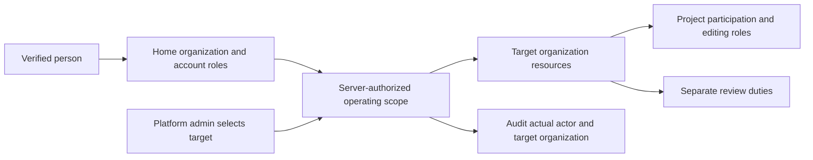
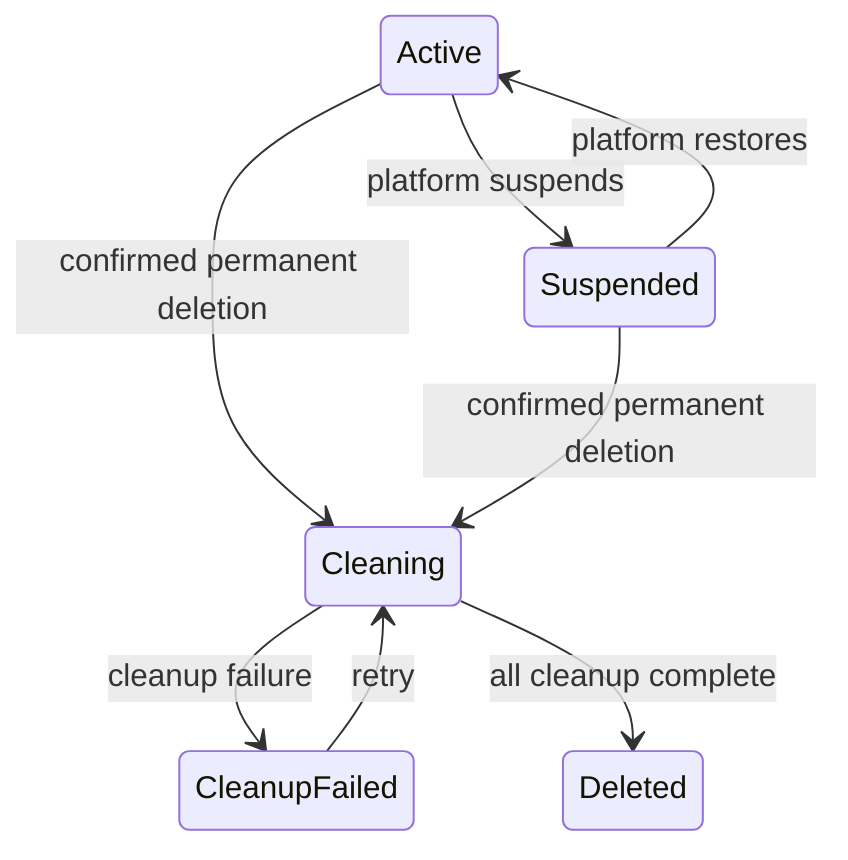

# Organization management: operating scope, collaboration and lifecycle

> Status: **Accepted design, implementation in acceptance** — Q1–Q20 and the complete design (Q21) were confirmed on 2026-10-23. Slices 1–32, including mixed erasure/recovery, are integrated; #1401 adds the complete operational scenario and user documentation. Candidate CI, build and independent review remain delivery gates tracked in the [implementation plan](../exec-plans/active/2026-10-23-organization-management.md).
> Chinese: [组织管理整体设计](../zh-CN/design-docs/2026-10-23-organization-management-design.md)
> Decisions: [ADR-0051](../adr/0051-organization-provisioning-and-member-admission.md)
> Published specification: [GitHub Issue #1368](https://github.com/tzrea1-Q/WiseEff/issues/1368), labelled `ready-for-agent`.
> Original design source baseline: `e795bd1a70c07391f893e4818cd8b07c138abcb3`. The starting-point observations below describe that historical baseline.

## Outcome and scope

Make Organization management a usable operating surface: platform administrators establish and recover Organizations; Organization administrators admit people, organize collaboration and complete departures; users can see their Organization's projects and understand where they may contribute. Administrators can complete normal operations in the product without maintenance SQL or routine platform intervention.

The first delivery includes all confirmed capabilities: platform Organization directory and explicit operating scope, invitations/direct creation, flat Teams, project participation, administrator succession, member departure and transfer, Organization suspension/restoration and permanent erasure. Delivery stages below are ordering, not permission to omit lifecycle or erasure.

Keep one Organization per account. Do not add private projects, department trees, inherited Team permissions, a custom permission designer, email infrastructure, an undeletable system Organization, or a new workflow engine. Existing server authorization, Organization isolation, audit and human approval for Agent/device writes remain correctness requirements.

## Verified starting point

These are source observations, not executed acceptance results.

| Capability | Current evidence | Design implication |
| --- | --- | --- |
| Organization record and navigation | [OrganizationPage](../../src/OrganizationPage.tsx), [scope navigation](../../src/components/admin/OrganizationAdminScopeNav.tsx): name/profile, members, bridges | Extend the existing workspace and add a platform directory. |
| Member operations | [users service](../../server/modules/users/service.ts): create, roles, enable/disable/delete, password reset, explicit OIDC binding, project review duties | Reuse domain writes; add invitations and handover orchestration. |
| Project editing | [shared policy](../../server/modules/parameter-kernel/policy.ts): organization-level business roles can edit across projects | Separate editing participation from review-duty bindings; migrate effective permissions before changing the policy. |
| Personal identity | [OIDC migration](../../server/migrations/0238_oidc_member_identities.sql), [auth repository](../../server/modules/auth/repository.ts): Organization-bound identities and independently stored role bindings | Transfer must reconcile identity and role records, not only change `users.organization_id`. |
| Inbound and outbound integrations | [credential resolver](../../server/modules/auth/integrationCredentialResolver.ts), [webhook delivery](../../server/modules/logs/webhookDelivery.ts): independent machine-principal and worker paths | Suspension and erasure must cover machine calls, queue claims and outbound delivery as well as user APIs. |
| Permanent project cleanup | [database authorization](../../server/migrations/0224_project_permanent_deletion.sql), [object cleanup](../../server/modules/projects/purge.ts): actual home-Organization checks and actor-dependent retries | Adapt authorization and retain a platform-owned cleanup record that survives deleted accounts. |

## Product navigation

Use two levels of administration. The platform directory manages Organizations; entering one opens the same Organization workspace its own administrators use.

| Entry | Content and actions | Reuse |
| --- | --- | --- |
| Platform → Organizations | List/search, create and designate initial admin, enter target, suspend/restore, recover administrators, transfer accounts, preview/track erasure | New directory; existing Organization business pages remain shared. |
| Organization → Overview | Status, member/Team/project counts, outstanding invitations and handovers, actionable links | Extend the current Organization landing page; every count links to its working list. |
| Members | Search/filter, direct creation, invitations and status, roles, enable/disable/delete, password/OIDC management, departure and handover | Existing member list and member details. |
| Teams | Flat groups, create/rename/delete, member selection and bulk actions | Bulk selection resolves into explicit member/project updates; group changes do not implicitly change project rights. |
| Projects | Organization project list, explicit participants/editing roles, separate review and merge duties | Existing project management, `ProjectReviewRolesPanel` and project configuration workbench. |
| Resources | Locate Organization parameter resources, knowledge, logs, device pairings and integration credentials | Link existing consoles; expose the existing Organization credential list beyond its current per-skill filtered view. |
| Settings | Organization identity/name and lifecycle status; platform-only lifecycle actions when authorized | Existing profile editing and platform lifecycle operations. |

The workspace persistently shows the Operating organization and its status. A platform administrator can return to the directory or their Home organization explicitly. Existing member/bridge and business deep links stay usable. Resource indexes do not duplicate editors or introduce a second configuration source.

## Identity and authorization

Retain the authenticated actor's identity and Home organization. Resolve the Operating organization explicitly on the server; ordinary users are limited to their Home organization, while a platform super administrator may select another. A caller-supplied identifier alone never authorizes that scope. Do not simulate scope by impersonating a member or rewriting the actor's membership.

Carry the authorized target into resource lookups, writes, audits, exports, asynchronous jobs and streaming work. Audit the real actor and target. Adapt existing domain/database authorization checks where they currently require actual home-Organization membership. Integration principals retain their own Organization scope and cannot use the human administrator's cross-Organization capability.

Bind frontend requests and cached data to the displayed target. Switching scope clears incompatible selections and drafts from the active view and ignores late responses from the previous target; unsaved work is preserved or explicitly resolved. Two browser tabs must not silently change each other's write target. A resource ID from another Organization must not override the selected scope.

| Actor | Project view | Business editing | Organization operations |
| --- | --- | --- | --- |
| Active ordinary member | Organization-visible projects; sensitive detail still follows its domain permission | Explicit project participation plus editing role and domain permission | Own account functions only |
| Project reviewer/merger | Same project visibility | Review/merge only through separately assigned duties; no new authority inferred from migration | No Organization administration grant |
| Organization administrator | Own Organization | Direct administration under existing domain rules | Members, invitations, Teams, project assignments and handover |
| Platform super administrator | Explicit target Organization | Full target administration under real identity | Organization provisioning, recovery, transfer and lifecycle |

Organization suspension overlays this matrix: existing permitted reads remain, new business writes stop. Platform recovery/handover and cleanup are explicit lifecycle operations. Account password/session maintenance remains distinct from Organization business writes.

Project participation and review duties are separate facts even when they reuse role names. In particular, copying an Organization-wide `hardware-committer` grant into the existing project review-binding table would accidentally create review authority. Migration must materialize editing eligibility without doing that. Reuse existing role vocabulary and domain policy entry points; do not introduce a generic policy engine. Project creation and metadata/lifecycle management continue through the existing administrator surface.

## Joining, collaboration and departure

Invitations capture the target Organization, selected roles, Teams, projects and project roles, expiry and state. Acceptance creates the intended membership and grants together, once, without another approval. The inviter can grant only authority they may manage; an Organization administrator cannot create platform super administrators. Revoke, regeneration and acceptance must not race into duplicate or revived grants. If a selected project or grant is no longer valid, explain the conflict and allow correction/reissue rather than silently changing the invitation. An existing member is managed through member settings; an account in another Organization requires transfer.

Direct creation, administrator password reset and OIDC prebinding remain available. Public evaluation registration is independently configurable and targets exactly one designated Organization. A suspended/erasing or missing evaluation target cannot accept registrations. Existing evaluation members and pending requests are preserved for management; disabling the public entry does not silently delete them.

A Team is only a grouping. Deleting a Team removes its grouping, not its members, projects or individually configured roles. Bulk project assignment shows the selected people and resulting roles explicitly; future Team membership changes do not inherit that grant.

Departure disables access and revokes personal sessions/credentials/pairings immediately, then presents unfinished drafts, review duties, pending work and responsibilities for handover. Unassigned items remain visible to administrators. Use existing domain reassignment operations and validate the successor's current eligibility. A new generic asset-transfer engine is unnecessary. Machine credentials owned by the Organization remain available independently of their departed creator.

Preserve historical actor and Organization attribution separately from the current responsible person and live account relationship. Account deletion/transfer must not null out known historical labels or relabel prior work as a successor's. Existing missing historical attribution is reported as missing; do not invent past names or recoverability. Organization erasure still removes that Organization's business history, as confirmed in Q15; this preservation rule applies to member departure/deletion/transfer.

Transfer preserves the account identity, moves its sole membership, removes source Organization/Team/project grants, configures target grants and revokes old sessions and personal pairings. Source drafts, tasks and historical records remain source-owned and can stay pending handover. Validate all Organization-bound identity records and target identity conflicts in the same operation. Local account usernames retain their existing global uniqueness.

**OIDC (Q20):** retain the existing `organization_id` claim contract. After transfer, old access is revoked and the UI may show “Waiting for identity-system synchronization,” including the required target and verification result. Successful login requires a newly verified identity with the correct Organization claim and matching explicit binding. Local-password accounts do not require this external step. Do not silently remap an old Organization claim or use token roles as target grants.

Normal removal, demotion, disablement and transfer must retain an effective Organization administrator. A platform administrator can urgently disable the last one and recover the Organization afterward. All such paths, including concurrent operations and Organization deletion, must retain one usable platform super administrator. Move platform accounts that must survive before deleting their Home organization; keep the platform role distinct from old Organization grants during transfer.

## Organization lifecycle and cleanup

These are product states, not a prescribed storage enum. A failed cleanup never restores normal Organization use. The deleting platform administrator can inspect progress without entering the unavailable business workspace.

| Path | Suspended | Cleaning / failed cleanup |
| --- | --- | --- |
| Member read / new business mutation | Prior allowed reads / reject new mutations | No business access |
| New machine integration request | Reject | Reject and revoke Organization credentials |
| Queued jobs | Pause claims | Cancel and remove Organization-owned work |
| Already-started analysis/indexing | Finish and persist its admitted result; no new external side effect | Stop or fence final writes; cleanup owns remaining artifacts |
| Webhook delivery and retries | Pause new outbound sends, including callbacks from finishing analysis | Prevent new sends; coordinate already-started sends and remove outbox/payloads |
| Device action | No new dispatch; record already-issued commands truthfully | No new dispatch; never claim physical rollback or successful cancellation without evidence |
| Platform lifecycle work | Recovery and handover allowed | Cleanup progress and retry allowed |

Restoration releases eligible paused work only after rechecking its current authorization and target. It does not revive individually disabled accounts, revoked credentials or stale device commands. Machine calls and outbox workers require their own Organization-state checks; a UI-disabled button or user-authentication check alone cannot enforce this behavior.

Erasure previews counts and impact across members/identities, Teams/invitations, projects and configuration/history/drafts, Organization registrations, knowledge and indexes, logs/analysis, Agent sessions, files/artifacts, jobs/outbox, personal pairings and Organization integrations. Shared Catalog definitions and other Organizations' references remain. Verify the actual dependency inventory when implementing; this list does not claim that a generic cascade already exists.

Commit the cleanup intent before deleting owned data, fence new writes and worker claims, coordinate in-flight producers, then use existing domain cleanup and object-reference rules. Cleanup metadata must survive the target Organization and its users; retries use explicit platform authorization, not a deleted local account. Recheck progress after process restart; retry only unfinished work. Never delete a shared object merely because one Organization references it.

Mark deletion complete only after owned database records and objects are removed and producers cannot recreate them. Compact detailed cleanup metadata into the minimal platform receipt: actor, time, target, counts and outcome, without business payloads. Backups follow deployment retention; restoring an older backup must reapply the applicable deletion state before exposing recovered Organization data. This is an operational recovery requirement, not a claim of selective immediate backup erasure.

## Delivery order and migration

| Stage | Coherent result | Completion focus |
| --- | --- | --- |
| 1. Scope and platform directory | Explicit operating scope end to end, Organization create/list/enter, shared workspace and administrator recovery | Two-Organization API/browser proof; real actor audit; database/domain checks support authorized cross-Organization administration. |
| 2. Members and collaboration | Invitations, Teams, project participation, existing review-duty UI, effective-permission migration | Existing editors keep equivalent editing access; no new review/merge/device rights; new projects require configured participation. |
| 3. Departure, transfer and suspension | Immediate access removal, handover/draft preservation, stable attribution, local/OIDC transfer, read-only Organization lifecycle | Concurrent last-admin protection; all identity, machine, worker and callback paths obey lifecycle rules. |
| 4. Permanent erasure and end-to-end delivery | Impact preview, durable progress, retry and final receipt; complete Organization operations UI | Crash/retry and storage-failure cases, no recreation after deletion, shared resources preserved, complete frontend acceptance. |

Use current domain modules and the existing jobs/storage infrastructure. Add only the durable records needed for invitations, grouping, project participation, lifecycle progress and historical attribution. Keep transaction ownership and domain reassignment/deletion in their owning modules; a coordinating Organization operation calls those capabilities. Do not introduce a new message bus, scheduler, policy framework or duplicate resource repository.

Deploy schema/backfill and consumer changes in a controlled order. Compare effective editing access and existing review assignments before/after; include disabled members without reactivating them. Do not switch the editing policy until its participation backfill is complete. Preserve existing IDs and historical accepted plans; this design deliberately supersedes the old home-only/no-invitations/no-project-membership exclusions in ADR-0037, not unrelated domain evidence contracts.

## Acceptance and final confirmation

Use existing real API behavior tests; PostgreSQL for identity/permission migration, transactions, last-admin races, invitation consumption, handover and cleanup concurrency; isolated real API-mode browser tests at `1440x900` for operator/user flows. Reuse storage and local callback test infrastructure to exercise failed cleanup and stopped delivery. No new test framework. Follow the repository verification matrix, selected checks, build obligations and independent review for authorization/destructive changes during implementation.

Acceptance must demonstrate:

1. Platform admin operates in Organization B while retaining their own identity; ordinary Organization A requests cannot read/write B; browser tabs and stale responses cannot redirect actions.
2. Invitation acceptance activates exactly its still-valid grants once; expired/revoked/regenerated links fail; public registration respects its configured target and switch.
3. An ordinary non-participant reads an Organization project but cannot edit it; adding participation changes only the intended editing rights; old editors and review duties survive migration without extra authority.
4. Departure revokes access before handover; drafts and business history remain manageable; transfer preserves source ownership and handles identity conflicts/OIDC synchronization visibly.
5. Concurrent administrator changes cannot remove the last usable platform admin; the platform can recover an Organization with no effective local admin.
6. Suspension covers user writes, machine requests, queue claims, webhooks and device dispatch; already-admitted work reports truthful outcomes; restoration does not resurrect revoked access.
7. Organization erasure survives process/object-store failure and retry, preserves shared/other-Organization data, prevents late producer writes and reports complete only after actual cleanup.
8. Every new control is reachable and useful in the real API-mode UI, with pending/empty/error/read-only/cleanup states; existing business routes remain usable.

Q1–Q20 and this assembled navigation, architecture, delivery order and acceptance boundary were confirmed in Q21 on 2026-10-23. Implementation now follows the linked plan. Its executed local API/PostgreSQL/browser results remain distinct from candidate CI, independent review, Hosted and target-host evidence. Local acceptance does not establish production deployment or a target backup-restore drill. Recovery operations follow [Organization deletion replay](../runbooks/backup-restore.md#organization-deletion-replay).

The current acceptance uses local password sessions and a controlled loopback OIDC issuer. Verification against a deployed external identity provider, MinIO, Redis restore and target-host recovery has not been executed for this candidate.
