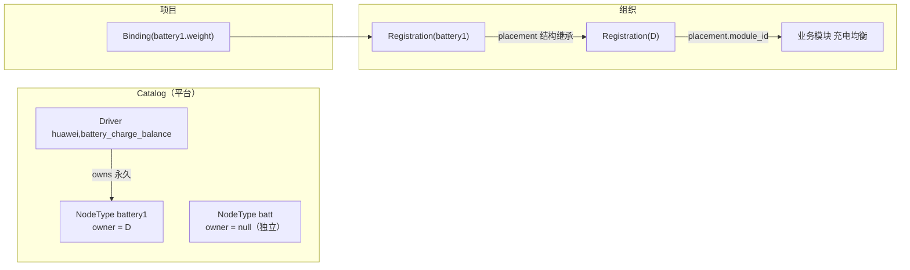

# #1479 落地方案：业务模块直接容纳主体，节点主体归属驱动

Status: 已完成（2026-11-03）。S1–S5 已合并：#1480（S1）、#1481（S3a）、#1482（S2）、#1483（S3b）、#1484（S4）、#1485（S5）。决策记录：[ADR-0053](../../adr/0053-business-modules-hold-subjects-and-drivers-own-child-nodes.md)。存量组织需按 runbook 先运行子节点认领、再运行模块结构迁移（本计划的 PR 均未对任何部署执行）。

Issue：[#1479](https://github.com/tzrea1-Q/WiseEff/issues/1479)。修订对象：[ADR-0042](../../adr/0042-organizations-register-canonical-subjects-once.md) 中“placement 节点类型”与“一模块一主体”部分、#1447 批量登记的“创建同类型模块 / 选择空闲模块”契约。

## 1. 代码核查结论（比 issue 多出的事实）

| # | 事实 | 位置 | 对方案的影响 |
| --- | --- | --- | --- |
| F1 | `subject_placements` 有 `unique (organization_id, module_id)`：一个模块只能被一条 placement 占用；**configuration-schema 放进 business 模块也受此限制** | `0137` L2874 | 必须删除该唯一约束，否则业务模块无法容纳多个主体 |
| F2 | 类型触发器 `assert_subject_placement_kind` 强制 driver→driver-group、node-type→node-type、configuration-schema→business | `0209` L50 | 改写触发器；这是“调整归属”看不到目标的根因 |
| F3 | 登记写入路径会**自动造包装模块**：插入 `attribution_subjects` + `parameter_modules(kind=driver-group/node-type)`，挂在所选 business 下 | `parameter-governance/registration/repositories.ts` L7–95 | 登记、批量登记、review resolution 都走这里，需统一改 |
| F4 | 默认目标/choose-parent 都按 `moduleKindForSubject` 查同类型模块；种子初始化还预留一个“默认驱动分组”空槽 | `productionWire.ts` L632–668、L822；`seedInitialization/placementCapacity.ts` | 改为按业务模块解析；种子不再需要容量槽 |
| F5 | 组织级识别规则 `module_recognition_rules` **以 module_id 为主键**（compatibles / nodeTypeName / nature / cardinality 挂在包装模块上） | `0212` | 包装模块消失后必须迁到以 registration 为键 |
| F6 | `catalog_subjects unique (kind, canonical_key)`、`catalog_subject_aliases unique (selector_kind, normalized_selector)` 全局唯一：`battery1` 只能有一个全局 node-type | `0137` L212、L265 | 跨驱动同名节点无法表达；需要“所属驱动”进入身份 |
| F7 | 平台目录导入把 `childNodes` 当作 `structural-non-param` **直接丢弃** | `catalog-publication/import/vendorAdapter.ts` L541 | 驱动→子节点结构在 Catalog 中从未存在，需在导入/同步时物化 |
| F8 | 观测匹配只用节点自身 compatible，否则按节点名全局回退；`listObservedProperties` 不取父节点 | `catalogProjectValueSync.ts` L299、L373 | 需带祖先上下文匹配 |
| F9 | `dts_logical_node_revisions.parent_logical_node_id` 已存在 | `0048` L182 | 祖先驱动上下文可以直接 SQL 取到，无需改解析器 |
| F10 | Binding 只引用 `registration_id / subject_id / definition_id`，不引用模块；准入要求该 subject 自身有 active registration | `binding/repositories.ts` L114 | 模块改动不碰 Binding；**保留子主体各自的 Registration** 可零改写现有绑定 |
| F11 | 同步循环中匹配失败只 `continue`，不会删除既有 Binding | `catalogProjectValueSync.ts` L512 | 收紧匹配后旧绑定不会被同步删掉（S3 仍需用测试钉住） |
| F12 | 16 个 nodename schema 中只有 5 个（battery0/1、cccv_para0、middle_cpu、scharger_v800）出现在某个驱动的 `childNodes`，且各只出现一次；其余 11 个是独立节点 | `schemas/dts/vendor/wiseeff` | 独立 NodeType 必须继续存在；仓库内 schema 没有跨驱动共享子节点 |
| F13 | `driver-group` 字面量出现在 165 个文件（含迁移、fixture、wayfinder SQL） | `rg` | 需分阶段收敛，不能一次性删除类型 |

## 2. 目标模型（本方案的决定）

| 决定 | 内容 | 理由 |
| --- | --- | --- |
| M1 Module 只做业务分类 | 新写入只允许 `business` / `unclassified`；`driver-group`、`node-type` 进入只读遗留状态，迁移后归档 | issue §4；F2/F3 |
| M2 业务模块可放多个根主体 | 删除 `unique (organization_id, module_id)`；placement 目标限制为 business/unclassified | F1 |
| M3 结构归属是 Catalog 身份 | `catalog_subjects` 新增永久列 `owner_subject_id`（null = 独立 NodeType），唯一性改为 `(kind, owner, canonical_key)`；别名同理。节点换驱动 = 新主体 + ADR-0044 定义替换 | 回答“结构如何版本化”：所有权不可变，生命周期仍由 release membership 表达，无需结构版本表 |
| M4 子主体保留各自 Registration | 子主体 Registration/Placement 继续存在（满足 ADR-0042 exactly-one），但 `placement.module_id` 必须为 null，展示位置由所属驱动的 placement 推导 | F10：现有 battery1 的 9 条绑定无需改写 |
| M5 生命周期跟随根主体 | 登记根主体时在同一事务登记其 active 子主体；停用根主体级联停用子主体（标记 `cascade`）；恢复根主体只恢复被级联停用的子主体；子主体在 UI 中无独立登记/停用入口 | issue §6 建议；避免“驱动停用、子节点仍可新绑定” |
| M6 匹配带驱动作用域 | 顺序：自身 compatible → 驱动；否则最近带 compatible 的祖先驱动 D 的 owned child（按节点名）；否则 owner=null 的独立 NodeType。owned NodeType **不能**脱离 owner 上下文被匹配 | F6/F8/F9；修复跨驱动误识别 |
| M7 单一读模型接缝 | 新增视图 `parameter_catalog.registration_effective_module(registration_id, module_id, via_owner_registration_id)`；模块树、统计、定义库、项目工作台都只读它 | 避免各处各算一套“子节点在哪” |
| M8 名称不是身份 | 包装模块的名称迁为 Registration 的可选 `display_alias`（仅根主体），子主体旧名称写入迁移报告，不展示 | issue §5.5 |

识别规则（F5）改为 `registration_recognition_rules`，主键 `(organization_id, registration_id)`，字段与语义不变。

## 3. 分片交付（每片一个 PR，独立可合并、可回退）

### S0 决策文档（docs only）
- 新增 ADR-0053「业务模块与主体结构分离」：M1–M8，显式取代 ADR-0042 的 placement kind 段落与 #1447 的“同类型模块”契约；中英文伴随文档；`CONTEXT.md`/术语表补 `owner subject`、`structural placement`、`display alias`。
- 在 #1479 回帖记录第 6 节决策的结论（见 §5 待确认项）。

### S1 归属解耦（直接修复原问题，不碰 Catalog）
- 迁移 `03xx_placement_business_modules.sql`（新增，不改旧迁移）：
  - 删除 `subject_placements (organization_id, module_id)` 唯一约束，补普通索引；
  - 改写 `assert_subject_placement_kind`：新写入/更新的 `module_id` 必须是 `business` 或 `unclassified`；**仅当 module_id 未变化时**容忍遗留 typed 模块（存量行在 S4 前保持合法）。
- 服务端：`moduleKindForSubject` 删除；`registration/repositories.ts` 不再插入 `attribution_subjects`/typed 模块，“新建分类”只建 business；`resolveDestinationModuleId`、默认目标、choose-parent 改按业务模块解析；review resolution、批量登记共用同一路径。
- 前端：`CanonicalSubjectPlacementPanel` 删除 `SUBJECT_KIND_MODULE_KIND` 过滤与 “occupant” 概念，候选 = 业务模块树（含 unclassified），不可选项给出原因；“调整归属”对 unset 主体可直接选择或新建业务分类；`RegistrationDialog` 与批量登记去掉“创建同类型模块 / 选择空闲模块”。
- 种子：删除 `placementCapacity` 的 driver-group 预留槽，种子登记直接落到业务模块。
- 验收：`huawei,charge_mode_test`（driver, unset）可直接选“电源管理/充电/充电测试”；同一业务模块下登记多个驱动；PostgreSQL 集成测试覆盖触发器拒绝 typed 新目标、并发登记同模块不再冲突、跨组织模块被拒；1440×900 API 模式下检查模块管理归属对话框。

### S2 读模型与识别规则迁移
- 视图 `registration_effective_module`（M7，S2 阶段 `via_owner` 恒为 null）。
- `subtreeCounts`、`dashboardRead`、定义库模块筛选、项目工作台分组改读视图；模块树在业务模块下渲染主体叶子（主体是叶子节点，不是模块）。
- 新表 `registration_recognition_rules` + 数据迁移（从 typed 模块的规则按其 placement 搬到 registration）；识别规则编辑从“模块编辑”移到“主体详情”；旧表只读保留到 S5。
- 验收：统计在“子树汇总”与“主体自身定义”两处分别显示且不重复计数（单测 + PG 集成）。

### S3 Catalog 结构与作用域匹配
- 迁移：`catalog_subjects.owner_subject_id`（FK 到 driver 主体，不可更新触发器）、唯一性/别名唯一性改为含 owner；`is_canonical_node_type_name` 不变。
- 目录导入：`vendorAdapter` 把 `childNodes` 从“丢弃”改为结构事实（每个子节点名必须有且仅有一个对应 nodename schema，否则 blocker）；Markdown 导入增加可选 `parent` 指令；同步器在新 release 中物化 owner（仅允许对 owner=null 且从未被其他驱动声明的主体做一次性认领，否则须新主体）。
- 存量认领迁移（带预检）：对仓库中 5 个被 `childNodes` 唯一声明的 NodeType，检查所有组织的 observation/binding 的祖先驱动是否都等于声明 owner；全部一致才写 owner，否则写冲突报告、保持独立。
- 匹配：`listObservedProperties` 递归取最近带 compatible 的祖先；`resolveObservedSubject`/`SubjectSelector` 增加 `ownerContext`；matcher revision +1，自动登记 proof 记录新 revision。
- 生命周期（M5）：登记/停用/恢复根主体的级联；子主体 placement 强制 `module_id is null`（触发器）；视图通过 owner registration 推导展示位置。
- 验收：不同驱动下同名 `battery1` 不被识别为同一主体（单测 + PG 集成）；无 owner 上下文的 `battery1` 进入 Review Queue（unknown）而既有 Binding 保持不变（F11 用测试钉住）；驱动级联登记/停用/恢复在并发下幂等。

### S4 存量 typed 模块迁移
- 新增只读预检 CLI（脚本名待定，按组织运行）：输出映射与冲突，不写库。冲突类：
  1. typed 模块的父级不是业务模块；
  2. NodeType 被多个驱动实际使用 / 祖先证据缺失；
  3. 子主体已登记但 owner 驱动在该组织未登记；
  4. typed 模块下挂有业务子模块；
  5. 模块显示名与实际主体不一致（如本例 `charge_mode_test` → `battery1`），仅报告。
- 应用迁移（事务、幂等、按组织分批、写审计事件 + 映射表 `module_structure_migration_map`）：
  - 根主体 placement → typed 模块的最近业务祖先；typed 模块名 ≠ 主体名时写 `display_alias`；
  - 子主体 placement → `module_id = null`（结构继承）；冲突 3 的子主体保持现状并生成 review item；
  - typed 模块设 `archived_at`，不删除（遗留 FK 均为 `on delete set null`，删除会抹掉历史标签）；
  - 不触碰 Binding、ProjectValue、Definition、Registration ID。
- 原案例回归 fixture：复刻 `huawei,charge_mode_test`（3 绑定，unset）与 `battery1`（9 绑定，放在名为 `charge_mode_test` 的 node-type 模块），断言迁移后 12 条 Binding 的 ID、current value、history 行数与哈希不变；`battery1` 显示在其 owner 驱动下；迁移报告列出“battery1 展示位置从 充电测试 移到 owner 驱动所在模块”。
- 重复运行无变化；中途失败回滚无部分写；租户隔离（只迁本组织）。

### S5 收敛与清理
- `ModuleKind` 新代码路径只保留 `business | unclassified`；`driver-group/node-type` 仅留在遗留读与历史迁移/fixture；删除 `module_recognition_rules` 旧表的读路径。
- 导入模板 `moduleName` 字段降级为 `categoryPath` + 可选 `displayAlias`，旧字段给出弃用诊断。
- 中英文用户文档、API 契约、#1447/#1448–#1450 说明更新；`seedRebuildPreservation` 与种子语义对齐（新种子与升级后数据一致的 PG 对比测试）。

## 4. 风险与处理

| 风险 | 处理 |
| --- | --- |
| 收紧匹配后，原来靠全局节点名匹配的观测失配 | S3 认领只对证据一致的主体生效；失配进入 Review Queue，既有 Binding 不删（F11 测试） |
| 迁移改变 battery1 等子主体的展示位置 | 预检报告显式列出“展示位置变化”，由管理员确认后执行 apply |
| ADR-0040 规定同步器是 Catalog 唯一写入方 | owner 认领通过一次带预检的结构迁移写入（同 0147 先例），之后只由同步器写 |
| 165 处 `driver-group` 引用 | 分片：S1 只改写路径；S4 迁数据；S5 才收敛类型 |
| 授权/租户 | 所有新写路径沿用现有 governance 授权与组织作用域；迁移按组织运行；新增 PG 授权负例测试 |

## 5. 已确认的决策（2026-11-02，均采用推荐项）

1. **子主体生命周期**：采用 M5「完全跟随根主体，无独立停用」？（备选：允许子主体独立停用，但不能在根主体停用时独立恢复。）
2. **证据不一致的存量 NodeType**：保持为独立全局 NodeType 并报告（推荐），还是阻断迁移直到人工处理？
3. **typed 模块迁移后**：归档保留（推荐，可追溯）还是在 S5 后硬删除？

UX 层面（候选列表呈现、主体作为叶子展示、不可选原因文案）按现有模式由实现方决定并记录在 PR 中。

## 6. 验证计划

每片：`npm run test:impact -- <changed-files>`；涉及迁移/触发器/登记的片段跑真实 PostgreSQL 集成测试（registration integration / lifecycle / concurrency 及新增迁移测试）；S1、S2、S4 在 API 模式下 1440×900 检查模块管理（归属对话框、模块树、统计）；S3 跑 catalog 发布与 DTS 同步集成测试。PR 描述只报告实际执行的命令与计数。

## Documentation Impact Matrix

| Category | Decision | Files |
| --- | --- | --- |
| Architecture | Update | `docs/adr/0053-business-modules-hold-subjects-and-drivers-own-child-nodes.md` 及中文伴随文档；ADR-0042 由 ADR-0053 修订 |
| Domain terms | Update (S3/S5) | `CONTEXT.md`：owner subject、structural placement、display alias |
| API contract | Update per slice | `docs/generated/openapi.json` |
| Generated artifacts | Review per slice | `docs/generated/db-schema.md` |
| User docs | Update (S5) | 模块管理与导入模板的中英文用户文档 |

## Documentation Update Gate

- 每个分片在同一 PR 内更新其改变的契约、生成物与文档。
- 计划仅在 S1–S5 全部合并并完成 §6 验证后移入 `docs/exec-plans/completed/`。
- 未实际运行的检查不得记为通过。
