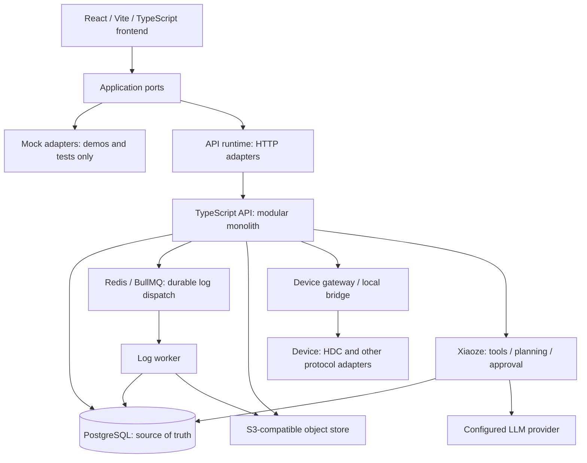

# WiseEff Platform Overview

> Chinese: [Chinese](zh-CN/platform-overview.md)

This overview is for external developers evaluating WiseEff or preparing to contribute. It takes about 15 minutes to read and explains what the platform does and how its parts fit together. Follow the links for contracts, procedures, and verification details.

## What WiseEff Is For

WiseEff brings engineering parameter changes, device debugging, log analysis, and reusable knowledge into one development workflow, with help from Xiaoze. The modules share organization, permission, approval, and audit rules. Engineers can investigate a problem, propose a change, validate the result, review it, and save the evidence. Assistant changes to devices or production data still require authorization and human approval.

## Capability Map

The table uses English names for the Chinese-first UI and includes each page's route. The pages and actions available to you depend on server-side permissions, organization membership, and project scope. See the [User Guide](user-guide/README.md) for steps and the [permission design](security/user-permission-design.md) for access rules.

| Domain | What you can do | Entry points and references |
| --- | --- | --- |
| Parameters | Manage canonical Definitions and Catalog releases, browse and compare project values, and make changes through drafts, submission, review, and merge. | Parameters (`/parameters`), Change review (`/parameter-review`), Parameter administration (`/parameter-admin`); [Catalog model and publication](design-docs/catalog-authoring-and-publication-control-plane.md). |
| Debugging | Read device nodes and write after authorization and safety checks. Prepare DTS reload candidates, inspect deployment runs and verification results, restore baselines, or promote changes to drafts. | Node debugging (`/node-debugging`), Parameter debugging (`/dts-reload`); [device lab runbook](runbooks/hdc-device-lab.md) and [DTS reload module](../server/modules/dts-reload/). |
| Logs | Upload logs, track analysis jobs, use domain-aware agent analysis, inspect evidence, and create knowledge drafts. Provider failure cannot be reported as full agent success. | Intelligent analysis (`/logs`), Dashboard (`/log-dashboard`), Log administration (`/log-admin`); [analysis operations](runbooks/log-analysis-llm.md). |
| Knowledge | Create and publish entries within an organization, keep immutable revisions, extract text from files, and check index health. Search returns published content only. | Knowledge (`/knowledge`), Knowledge administration (`/knowledge-admin`); [knowledge design](design-docs/2026-08-12-knowledge-base-design.md). |
| Xiaoze | In API mode, use contextual read tools, plan tasks, cite sources, and propose actions for human approval. Mock mode has no Agent UI. | An assistant shared across workflows, with no separate business page; [Agent architecture](../ARCHITECTURE.md) and [Agent provider runbook](runbooks/agent-provider.md). |
| Governance | Manage organization members and roles, approve registration and activation, inspect audits, and use platform controls and readiness checks. | Organization management (`/organization`), Audit center (`/audit`), Platform console (`/platform-console`); [organization design](design-docs/2026-08-19-organization-administration-design.md) and [security](SECURITY.md). |

The [operation coverage matrix](developer/user-operation-coverage-matrix.md) lists acceptance cases and evidence requirements for each workflow. Check the actual run results to determine whether the current acceptance run passed.

## Architecture At A Glance

The diagram shows the logical relationships between components; a deployment may enable only some adapters. See [Architecture](../ARCHITECTURE.md) and the [technical compendium](design-docs/full-stack-architecture.md) for the detailed topology. Frontend [runtime composition](../src/app/appRuntime.ts) selects HTTP or mock adapters for [application ports](../src/application/ports/). The [runtime policy](../src/infrastructure/http/runtimeMode.ts) defaults to API and rejects production mock builds.

PostgreSQL is the source of truth for business state, audit, approval, and job lifecycle records. Redis/BullMQ dispatches durable log jobs; a worker first claims the database job, then updates its progress or terminal state. Database polling remains available for local development and compensation. Object storage holds file artifacts. See the [self-hosted runtime](runbooks/self-hosted-runtime.md), [queue implementation](../server/modules/jobs/), and [log worker](../server/modules/logs/worker.ts) for how these components operate.

### Main Backend Module Groups

All module groups below are under [`server/modules/`](../server/modules/) and deploy as part of the same API. They do not require separate microservice deployments.

| Group | Responsibility |
| --- | --- |
| `auth`, `users`, `projects`, `audit` | Manage identity, organization and project scope, roles, and traceable audit records. |
| `parameters`, `parameter-*`, `catalog-*`, `dts` | Manage parameter values and governed changes, canonical identity, and Catalog publication and cutover; preserve DTS syntax. |
| `debugging`, `deviceBridge`, `dts-reload` | Connect device protocols, handle snapshots and readback, and manage the reload run lifecycle. |
| `logs`, `jobs` | Parse and analyze logs, claim and retry database jobs, dispatch queues, and check worker health. |
| `knowledge` | Manage entries and revisions, extract content, build indexes, and retrieve within the permitted scope. |
| `agent` | Provide Xiaoze tools, planning, and approval orchestration; integrate threads and checkpoints. |
| `operations`, `release-verification` | Check health and readiness, and assess release evidence. |
| `notifications`, `product-feedback` | Send workflow notifications and collect and triage internal beta feedback. |

## How Writes Stay Governed

The [architecture write pattern](../ARCHITECTURE.md) is: authenticate → authorize server-side → validate input → transactional domain write → correlated audit → structured response/error. Every step must respect organization and project scope. The server must check authorization even when the frontend shows a button. Parameter drafts, submissions, reviews, and merge each require their own permissions. The [parameter service](../server/modules/parameters/service.ts) implements transactional writes and audit; see [security](SECURITY.md) for the policy.

Agent read tools use the caller's authorization; mutating tools wait for human approval. `beginApproval` records the proposal, and `resolveApproval` rejects or approves it. If the user edits the arguments, the system updates the proposal before checking authorization and executing at approval time. Approval records persist in `agent_tool_calls` and `agent_approvals`, so they do not depend on process memory. Production and self-hosted environments use PostgreSQL checkpoints to resume graph execution; local development can use memory. See [ADR-0024](adr/0024-agent-approval-state-is-db-backed.md), the [orchestrator](../server/modules/agent/orchestrator.ts), and [checkpointer](../server/modules/agent/xiaoze/checkpointer.ts).

Device writes check device state and value ranges, save a baseline snapshot, then execute through the gateway and record an audit. Ordinary node readback records the observed value without comparing it for equality with the requested value. A successful write status reports command execution; inspect the separate DTS reload, rollback, or restoration records for their verification outcomes. A database transaction cannot make physical device I/O atomic. See the [debugging service](../server/modules/debugging/service.ts), [DTS reload service](../server/modules/dts-reload/service.ts), [bridge module](../server/modules/deviceBridge/), and [device lab runbook](runbooks/hdc-device-lab.md).

## Distinctive Features And Their Evidence

| Feature | How it works and its limits | References and implementation |
| --- | --- | --- |
| Persistent human approval for Agent writes | A proposal needs approval and authorization before execution. Database approval records and durable graph checkpoints support controlled resume. | [ADR-0024](adr/0024-agent-approval-state-is-db-backed.md), [Agent implementation](../server/modules/agent/). |
| Snapshot and readback for device writes | Save a baseline and record ordinary node readback without an equality verdict. DTS reload, rollback, and restoration each have verification outcomes; real hardware evidence is still required. | [Debugging service](../server/modules/debugging/service.ts), [DTS reload service](../server/modules/dts-reload/service.ts), [HDC acceptance](runbooks/hdc-device-lab.md). |
| Explicit log-analysis degradation | Exhausted provider retries can return rules fallback. `analysisSource` and `degradedReason` identify its source and reason; it does not count as full agent analysis. | [Degradation implementation](../server/modules/logs/worker.ts), [analysis operations](runbooks/log-analysis-llm.md). |
| Lossless DTS parsing/serialization | The concrete syntax tree preserves source text. An unedited document serializes byte-identically; edits splice only the changed property spans. Device reload behavior still needs separate verification. | [Parser](../server/modules/dts/parser.ts), [serializer](../server/modules/dts/serialize.ts), [round-trip tests](../server/modules/dts/serialize.test.ts). |
| Immutable Catalog releases | Published artifacts and release identities change only through new versions. Publication and adoption have explicit authorization and recovery rules. | [ADR-0040](adr/0040-canonical-parameter-catalog-relational-model.md), [publication design](design-docs/catalog-authoring-and-publication-control-plane.md), [database enforcement](../server/migrations/0140_catalog_publication_control_plane.sql). |
| Self-hosted without a mandatory SaaS platform | The runtime, database, queue, S3-compatible storage, and observability can all be self-hosted. Live Xiaoze still needs a configured LLM provider; operators choose identity, storage, and models, and manage network access. | [Self-hosted guide](../ops/self-hosted/README.md), [Compose services](../ops/self-hosted/compose.yaml), [provider runbook](runbooks/agent-provider.md). |
| Readiness checks require actual evidence | Readiness and pilot acceptance need real API, database, device, and operational evidence. Implementation, local tests, or deterministic checks alone cannot establish target acceptance. | [Verification matrix](developer/verification-matrix.md), [operations module](../server/modules/operations/), [README boundary](../README.md). |
| Bilingual documentation checks | English and Chinese pages are maintained separately and link to each other. Documentation governance checks the required registry pairs and local Markdown links. | [Registry](../scripts/bilingual-docs.ts), [governance checker](../scripts/check-doc-governance.ts). |

## Roadmap Snapshot — October 13, 2026

For detailed progress, see the [development roadmap](exec-plans/active/development-roadmap.md), updated on the same date. The priorities below have no committed completion dates.

- Delivered: M0–M5 foundations and substantial M6 self-hosted implementation, including canonical Catalog publication and integration, knowledge publication and search, agentic log analysis, DTS reload, organization administration, and parts of the frontend workbench and review redesign. #1143 delivers the bilingual User Guide and Platform Overview. These are branch delivery records; merge, production cutover, and pilot acceptance each need separate confirmation.
- In progress: the remaining frontend overhaul under #1126; completing the trusted-provenance chain (TD-068/#615, with TD-123 tracked separately); gathering target-environment and domain evidence for identity, storage, queue, observability, capacity, devices, and analysis quality. Operational priorities remain self-hosted setup, upgrade recovery, and verification.
- Next/follow-ups: complete handwritten-client contract coverage (TD-003) and fill evidence gaps through the respective plans. Expert-annotated log cases, a second pilot domain, and human judge calibration still need external input, with no committed dates.

## Where To Go Next

| Your goal | Start here |
| --- | --- |
| Set up development or evaluate deployment prerequisites | [README](../README.md) |
| Understand end-to-end architecture and consistency | [Technical compendium](design-docs/full-stack-architecture.md) |
| Integrate with the API | [API docs](api/README.md) |
| Understand why boundaries were chosen | [ADRs](adr/README.md) |
| Contribute a bounded, verified change | [CONTRIBUTING](../CONTRIBUTING.md) |
| Perform a product task with your role | [User Guide](user-guide/README.md) |
