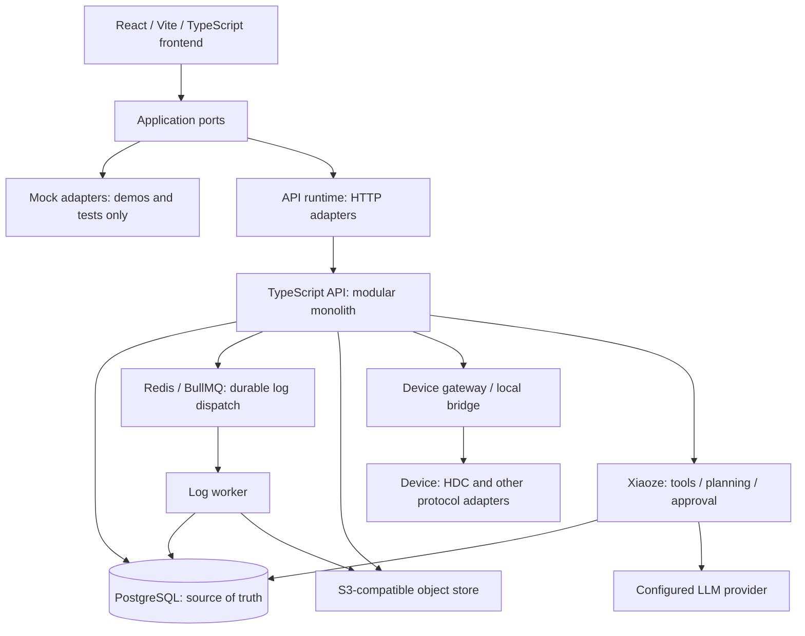

# WiseEff Platform Overview

> Chinese: [Chinese](zh-CN/platform-overview.md)

For external developers evaluating or joining WiseEff. This page is a roughly 15-minute map; the linked topic owners contain contracts, procedures, and verification details.

## What WiseEff Is For

WiseEff connects engineering parameter changes, device debugging, log analysis, reusable knowledge, and Xiaoze-assisted work under shared organization, permission, approval, and audit boundaries. The useful loop is to inspect a problem, propose a change, validate it, review it, and retain the evidence—not to let an assistant silently change a device or production data.

**Readiness:** the repository is suitable for controlled staging and pilot evidence collection. It is **not broadly production-ready** until real target-environment evidence exists for live API, PostgreSQL-backed E2E, HDC device lab, backup/restore, rollback, identity, queue, observability, capacity, and Xiaoze LLM readiness checks. This is the boundary in the [README](../README.md), not a deployment certification. Merged code, local tests, mock demos, and individual host rehearsals do not replace those gates.

## Capability Map

English names below describe the Chinese-first UI; routes identify the actual entry points. Visibility and actions depend on server-side permissions, organization membership, and project scope. The [User Guide](user-guide/README.md) is the task-oriented entry, while the [permission design](security/user-permission-design.md) owns access rules.

| Domain | What it connects | Entry points and deeper owner |
| --- | --- | --- |
| Parameters | Canonical Definitions and Catalog releases, project values, comparison, drafts, submission, review, and merge. | Parameters (`/parameters`), Change review (`/parameter-review`), Parameter administration (`/parameter-admin`); [Catalog model and publication](design-docs/catalog-authoring-and-publication-control-plane.md). |
| Debugging | Device-node inspection and guarded writes; DTS reload candidates, deployment runs, verification, baseline restoration, and draft promotion. | Node debugging (`/node-debugging`), Parameter debugging (`/dts-reload`); [device lab runbook](runbooks/hdc-device-lab.md) and [DTS reload module](../server/modules/dts-reload/). |
| Logs | Upload and analysis jobs, domain-aware agent analysis, result evidence, and knowledge-draft handoff. Provider failure is not presented as full agent success. | Intelligent analysis (`/logs`), Dashboard (`/log-dashboard`), Log administration (`/log-admin`); [analysis operations](runbooks/log-analysis-llm.md). |
| Knowledge | Organization-scoped entries, immutable revisions, publication, file extraction, published-only retrieval, and index health. | Knowledge (`/knowledge`), Knowledge administration (`/knowledge-admin`); [knowledge design](design-docs/2026-08-12-knowledge-base-design.md). |
| Xiaoze | The API-mode assistant combines contextual read tools, planning, citations, and human-approved action proposals. Mock mode has no Agent UI. | Shared assistant, not a separate business page; [Agent architecture](../ARCHITECTURE.md) and [Agent provider runbook](runbooks/agent-provider.md). |
| Governance | Organization membership and roles, registration/activation approvals, audit, platform controls, and readiness checks. | Organization management (`/organization`), Audit center (`/audit`), Platform console (`/platform-console`); [organization design](design-docs/2026-08-19-organization-administration-design.md) and [security](SECURITY.md). |

The [operation coverage matrix](developer/user-operation-coverage-matrix.md) maps workflows to acceptance cases and evidence requirements; its rows are not proof that a fresh acceptance run passed.

## Architecture At A Glance

This is a logical boundary map, not a promise that every deployment enables every adapter. [Architecture](../ARCHITECTURE.md) and the [technical compendium](design-docs/full-stack-architecture.md) own the detailed topology. Frontend [runtime composition](../src/app/appRuntime.ts) selects HTTP or mock adapters behind [application ports](../src/application/ports/); [runtime policy](../src/infrastructure/http/runtimeMode.ts) defaults to API and rejects production mock builds.

PostgreSQL owns business state, audit, approval, and job lifecycle. Redis/BullMQ dispatches durable log jobs; a worker must claim the database job before updating it. Database polling remains available for local development and compensation. Object storage holds file artifacts, not authoritative business state. The [self-hosted runtime](runbooks/self-hosted-runtime.md), [queue implementation](../server/modules/jobs/), and [log worker](../server/modules/logs/worker.ts) describe the operational boundaries.

### Main Backend Module Groups

All paths below are under [`server/modules/`](../server/modules/); these are module groups inside one API, not independently deployed microservices.

| Group | Responsibility |
| --- | --- |
| `auth`, `users`, `projects`, `audit` | Identity, organization/project scope, role governance, and traceable audit. |
| `parameters`, `parameter-*`, `catalog-*`, `dts` | Parameter values and governed changes, canonical identity, Catalog publication/cutover, and DTS syntax preservation. |
| `debugging`, `deviceBridge`, `dts-reload` | Device protocol boundaries, snapshots/readback, and reload run lifecycle. |
| `logs`, `jobs` | Parsing and analysis, database job claims/retries, queue dispatch, and worker health. |
| `knowledge` | Entry/revision governance, extraction, indexing, and scoped retrieval. |
| `agent` | Xiaoze tools, planning, approval orchestration, and thread/checkpoint integration. |
| `operations`, `release-verification` | Health/readiness and release evidence boundaries. |
| `notifications`, `product-feedback` | Workflow notifications and internal beta feedback/triage. |

## How Writes Stay Governed

The [architecture write pattern](../ARCHITECTURE.md) is: **authenticate → authorize server-side → validate input → transactional domain write → correlated audit → structured response/error**. Organization/project boundaries must survive every step; frontend visibility is not authorization. Parameter drafts, submissions, reviews, and merge are separate business steps, not interchangeable write privileges. The [parameter service](../server/modules/parameters/service.ts) implements transactional writes and audit; [security](SECURITY.md) owns the policy.

- **Agent variant:** read tools use the caller's authorization. Mutating tools pause for human approval; `beginApproval` records the proposed call, and `resolveApproval` rejects or approves it. Edited arguments replace the proposal before approval-time authorization and execution. Approval records are persisted in `agent_tool_calls` and `agent_approvals`, not process memory. Production/self-hosted graph resume uses PostgreSQL checkpoints; local development can use memory. See [ADR-0024](adr/0024-agent-approval-state-is-db-backed.md), the [orchestrator](../server/modules/agent/orchestrator.ts), and [checkpointer](../server/modules/agent/xiaoze/checkpointer.ts).
- **Device variant:** device state and value-range checks precede writes, with a baseline snapshot, gateway execution, and audit. Ordinary node writes record readback as an observation without judging equality with the requested value; a successful write status means execution succeeded, not that readback matched. DTS reload and rollback/restoration have separate verification outcomes; inspect those records rather than inferring verification from ordinary write success. A database transaction cannot make physical device I/O atomic. See the [debugging service](../server/modules/debugging/service.ts), [DTS reload service](../server/modules/dts-reload/service.ts), [bridge module](../server/modules/deviceBridge/), and [device lab runbook](runbooks/hdc-device-lab.md).

## Distinctive Features And Their Evidence

| Feature | What it means—and the boundary | Evidence owner or implementation |
| --- | --- | --- |
| Durable human approval for Agent writes | A proposal is not execution; database approval state and durable graph checkpoints support controlled resume. Authorization still applies after approval. | [ADR-0024](adr/0024-agent-approval-state-is-db-backed.md), [Agent implementation](../server/modules/agent/). |
| Snapshot and readback for device writes | Preserve a baseline and record ordinary node readback as an observation, not an equality verdict; DTS reload and rollback/restoration use separate verification outcomes. Real hardware evidence remains necessary. | [Debugging service](../server/modules/debugging/service.ts), [DTS reload service](../server/modules/dts-reload/service.ts), [HDC acceptance](runbooks/hdc-device-lab.md). |
| Honest log-analysis degradation | Exhausted provider retries can return rules fallback with `analysisSource` and `degradedReason`; fallback is not full agent analysis. | [Degradation implementation](../server/modules/logs/worker.ts), [analysis operations](runbooks/log-analysis-llm.md). |
| Lossless DTS parsing/serialization | The concrete syntax tree preserves source text; an unedited document serializes byte-identically, while edits splice changed property spans. This does not certify a device's reload behavior. | [Parser](../server/modules/dts/parser.ts), [serializer](../server/modules/dts/serialize.ts), [round-trip tests](../server/modules/dts/serialize.test.ts). |
| Immutable Catalog releases | Published artifacts and release identities are versioned rather than edited in place; publication/adoption has explicit authorization and recovery boundaries. | [ADR-0040](adr/0040-canonical-parameter-catalog-relational-model.md), [publication design](design-docs/catalog-authoring-and-publication-control-plane.md), [database enforcement](../server/migrations/0140_catalog_publication_control_plane.sql). |
| Self-hosted without a mandatory SaaS platform | The runtime, database, queue, S3-compatible storage, and observability can be self-hosted. Live Xiaoze still needs a configured LLM provider; identity/storage/provider choices and network access remain operator responsibilities. | [Self-hosted guide](../ops/self-hosted/README.md), [Compose services](../ops/self-hosted/compose.yaml), [provider runbook](runbooks/agent-provider.md). |
| Evidence-based readiness | Readiness and pilot gates distinguish implementation from real API, database, device, and operational evidence. Local or deterministic success is not target acceptance. | [Verification matrix](developer/verification-matrix.md), [operations module](../server/modules/operations/), [README boundary](../README.md). |
| Bilingual documentation gates | English and Chinese pages are separate companions; required registry pairs and local Markdown links are checked by documentation governance. | [Registry](../scripts/bilingual-docs.ts), [governance checker](../scripts/check-doc-governance.ts). |

## Roadmap Snapshot — October 13, 2026

The [development roadmap](exec-plans/active/development-roadmap.md), refreshed on the same date, is the owner. This summary is a priority snapshot, not a schedule or a promise of completion dates.

- **Delivered:** M0–M5 foundations and substantial M6 self-hosted implementation; canonical Catalog publication/integration, knowledge publication/search, agentic log analysis, DTS reload, organization administration, and frontend workbench/review slices. This change delivers the bilingual User Guide and Platform Overview under #1143. Delivery on this branch does not imply merge, production cutover, or pilot acceptance.
- **In progress:** the remaining frontend overhaul under #1126; trusted-provenance closure (TD-068/#615, with TD-123 separate); target/domain evidence for identity, storage, queue, observability, capacity, devices, and analysis quality. Self-hosted setup/upgrade recovery and verification remain operational priorities.
- **Next/follow-ups:** complete handwritten-client contract coverage (TD-003), and close evidence gaps through the owning plans. Expert-annotated log cases, a second pilot domain, and human judge calibration remain external inputs. No dates are promised.

## Where To Go Next

| Your goal | Start here |
| --- | --- |
| Set up development or evaluate deployment prerequisites | [README](../README.md) |
| Understand end-to-end architecture and consistency | [Technical compendium](design-docs/full-stack-architecture.md) |
| Integrate with the API | [API docs](api/README.md) |
| Understand why boundaries were chosen | [ADRs](adr/README.md) |
| Contribute a bounded, verified change | [CONTRIBUTING](../CONTRIBUTING.md) |
| Perform a product task with your role | [User Guide](user-guide/README.md) |
