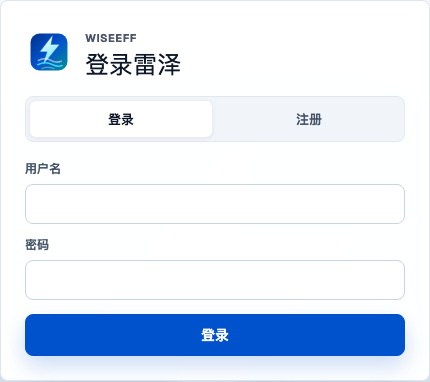
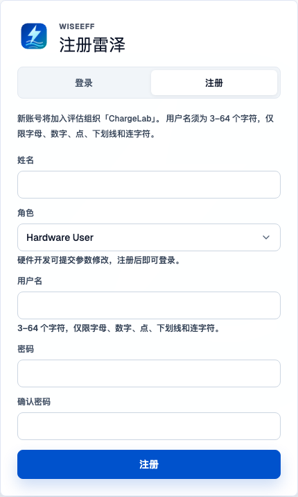

# Account and Access

> Chinese: [Chinese](../zh-CN/user-guide/account-and-access.md)

## Who can do this

Public local registration defaults closed. Platform super administrators can open Experience registration settings in the Organization directory, select one experience Organization and enable its entry. Formal Organizations use invitation links or administrator-created accounts. Closing the entry preserves existing members and pending requests. Guests, hardware users, and software users can sign in immediately after registering; hardware/software committer requests need Admin approval. Once signed in to a local account, you can change your own password. Organization Admins (`admin`) and Platform Admins (`platform-admin`) with `users:manage` can approve requests and reset members' local passwords in the Organization they manage. Neither Admin role is available through self-registration.

## Register a local account

1. Open a protected workflow such as `/parameter-home`, or enter it from the app homepage at `/`. In API mode, visitors who have not signed in see Sign in; select Register and check the displayed experience Organization. If that tab is absent, ask your administrator for an invitation link or account.
2. Enter your name, username, role, password, and password confirmation. Usernames are 3–64 characters using letters, numbers, dots, underscores, or hyphens; passwords must contain at least eight characters. Follow the form's validation messages.
3. Choose guest (`guest`), hardware user (`hardware-user`), software user (`software-user`), hardware committer (`hardware-committer`), or software committer (`software-committer`). The role selector uses English role names; the hints explain immediate access or required approval.
4. Submit. Registering as a guest, hardware user, or software user signs you in; a Committer request shows the pending-approval result.

The screen tells you which Evaluation Organization your account will join. It is ChargeLab when seed data is present; otherwise there must be exactly one available bootstrap Organization. You cannot choose an Organization during registration or change your home Organization in your profile. If there is no suitable Organization, or several exist and the destination is unclear, ask the deployment operator to resolve the setup. Registration does not verify an email address or accept an invitation.

*Local sign-in reached from a protected workflow with a fresh unauthenticated browser context.*

*Registration fields and role selection, available only when self-registration is enabled.*

## Wait for Committer approval

On Register (`/`), requesting either Committer role creates an inactive account and a pending role request. The account records the matching base User role, but remains unable to sign in until an Admin enables it.

Ask your Organization Admin to review the request. They may approve the requested Committer role, reject the promotion while enabling the corresponding ordinary User role, or reject and keep the account disabled. Either enabling outcome lets you return to Sign in (`/`) with the same username and password; only approval grants the Committer role. The decision notification records the actual role and ability to sign in.

## Approve a Committer request

Admins with `users:manage` review applications in the Registration requests queue. Follow [Decide a Committer registration request](organization-and-governance.md#decide-a-committer-registration-request) for the approval procedure and Organization scope. Committer permissions are granted only after approval.

## Get help when there is no Admin

If Sign in (`/`) shows No administrator account yet, contact the deployment operator. The screen explains how to create the first Admin on the server; ordinary users cannot obtain an Admin role through registration. See the [authentication reference](../api/authentication.md) for the operator procedure.

## Edit your profile

Open the top-bar user menu and choose Profile. Local and OIDC users can update their display name and title. Saving these application-owned fields does not change the login identifier, external subject, Organization, or roles.

The dialog checks the deployment's authentication mode before showing password actions. If that check fails, you can still save your profile and retry the capability check. On OIDC deployments, manage your password through your Organization's identity provider; the dialog does not offer local password changes or invent a provider link.

## Change your local password

1. From a signed-in workspace, such as My workbench (`/parameter-home`), open the top-bar user menu and choose Profile. Profile opens as a dialog and has no separate route.
2. In Change password, enter your current password, a different new password of at least eight characters, and confirmation.
3. Submit the change. Your current local session remains signed in; your other sessions are revoked. Use the new password when signing in elsewhere.

## Reset a member's local password

As an Admin with `users:manage`, open People management (`/organization/members`) through Organization management (`/organization`). Choose Reset password on the member's row, enter a new password of at least eight characters and its confirmation, and choose Confirm reset.

Resetting the password revokes all of that member's local sessions. The member must sign in again with the new password. This action requires an existing local password credential; external identity-provider passwords must be reset through the provider's process.

## Sign in on an OIDC-backed deployment

Organization administrators open People management (`/organization/members`) and choose Add user to provision an OIDC member. Enter the exact subject from the configured identity provider; the issuer is read-only. The optional provider email checks legacy migration conflicts. No username or local password is required. To bind an existing member or change a subject, open Member details and save OIDC identity. A conflict preserves your input: check the subject and original migration email, or refresh if another administrator changed the binding. This does not merge accounts or change the internal user ID or roles.

Use the identity-provider sign-in entry supplied by your deployment operator, then open WiseEff at `/`. WiseEff's browser integration obtains and refreshes the provider's access token. The server uses WiseEff's records to check whether the account is active and determine its Organization and effective permissions. WiseEff roles require separate authorization; signing in to the identity provider does not grant them.

OIDC does not automatically create or join members. Existing unbound legacy accounts retain their verified-email migration path using the original migration email. Changing profile email does not grant login access, and an explicitly bound account requires its bound subject.

There is no dedicated OIDC sign-in button or route in the current WiseEff auth screen. If you still see the local Sign in (`/`) form on an OIDC-backed deployment, ask the operator to check the browser identity integration; do not create a local account as a substitute. Follow your provider's process for external-account passwords. See the [authentication reference](../api/authentication.md) for deployment details.
