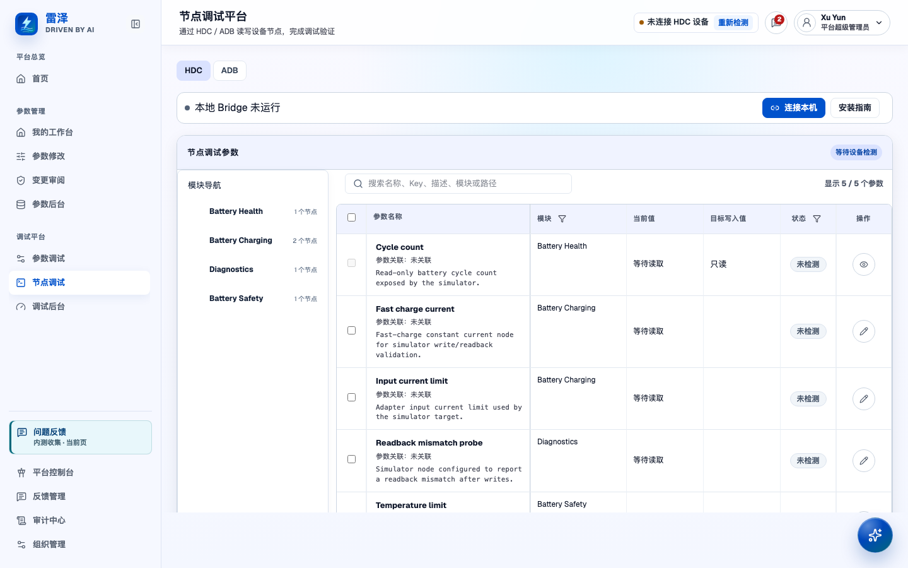
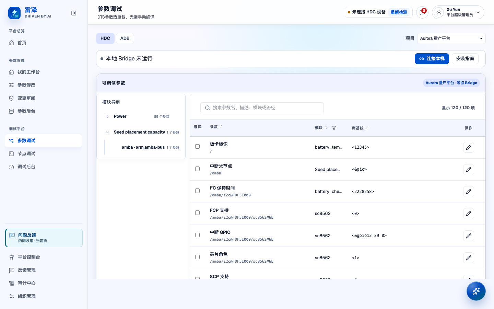

# Debug a device

> Chinese: [Chinese](../zh-CN/user-guide/device-debugging.md)

## Who can do this

Hardware users and software users can open Node debugging (`/node-debugging`) and read nodes with `debugging:view` and `debugging:read`. Writing requires `debugging:write`; rolling back requires `debugging:rollback`. The default hardware/software committer, Organization Admin (`admin`), and Platform Admin (`platform-admin`) roles have these write permissions; ordinary hardware/software users do not. Guests cannot access this workflow.

Parameter debugging (`/dts-reload`) is open only to Committers and higher roles. Starting, deploying, or restoring a DTS reload also requires `debugging:dts-reload` in the selected project's scope, normally held by the same committer/Admin roles. The server supports read-only history queries with `debugging:view`; page access and device writes still require their own authorization. Sensitive parameters can require additional capabilities and explicit confirmation. Even with an eligible role, you must have access to the selected Organization, project, session, and device.

Use the two entries under the Debugging platform navigation group:

- Node debugging (`/node-debugging`) reads and writes individual runtime node paths.
- Parameter debugging (`/dts-reload`) tests a batch of project parameter values through a generated device-tree overlay and kernel reload.

The old Parameter debugging (`/debugging`) workspace is offline; use `/dts-reload`. Admins use Debugging administration (`/debugging-admin`, node catalog at `/debugging-admin/nodes`) to maintain nodes and protocol bindings. Device writes still require write permission.

## Connect your computer and select a device

1. Open Node debugging (`/node-debugging`) or Parameter debugging (`/dts-reload`) and choose **HDC** or **ADB** for your device.
2. Open **Installation guide**, check the platform, architecture and package version, and download the appropriate installer. A Mac browser cannot reliably identify the chip: choose Apple Silicon or Intel after checking About This Mac. When the graphical installer is older than the current portable package, the guide labels the versions separately. Follow the installation guidance; Windows requires running the installer as administrator so the browser can launch Bridge.
3. Choose **Connect this computer** and allow the browser to open the installed Bridge. The guide stays open and provides retry/manual terminal recovery. Temporary pairing codes refresh on expiry; use the regenerate action to request a fresh code if needed, rather than reusing an old code.
4. Connect the target device to the computer running Bridge and complete the device's debugging authorization. Detect devices in the page. If multiple targets are offered, select the intended one before any write or deployment.
5. Check the Bridge connection and HDC/ADB device detection separately. If detection fails, check the cable, device authorization, selected protocol, and the panel's tool status, then detect again.

If installation, pairing, or HDC/ADB tooling remains unavailable, ask your deployment operator to use the [local Device Bridge runbook](../runbooks/local-device-bridge.md). Confirm the target device before writing. Real-device verification requires the hardware and tools on site; simulated results do not establish target-device readiness.

## Find and read a node

In Node debugging (`/node-debugging`), choose a module or subtree and search by name, Key, description, module, or path. Inspect the node's details, the path for the selected protocol, access mode, current value, and status before preparing a target value.

- **RO** nodes are read-only.
- **RW** nodes can be written only when the binding is available and the safety checks pass.
- **WO** nodes do not offer safe writes because a pre-write snapshot cannot be obtained.
- A missing or disabled HDC/ADB binding makes that node unavailable for the selected protocol. Ask an Admin to check its binding in Debugging administration (`/debugging-admin/nodes`); do not guess a replacement path.

The displayed current value reflects a single observation; the device state may have changed since then. Check stale-value warnings and read again when you need to confirm the current state.

*The node list with the Bridge installation guide collapsed; no real device is connected and displayed values are not fresh device reads.*

## Write a node and interpret the result

1. Open a writable node's editor, check the device, node path, units and risk, then enter the target value. Edits stay local until you stage or write them; closing modified content offers continuing or discarding it. For a complex value, expand the format and normalization guidance. Numeric bounds, when configured, are enforced by the server; complex values are checked against their value metadata.
2. Choose the write-and-readback action, or stage values and use the batch-send bar. Only pending writable nodes are sent; selecting rows limits the batch to those selected pending nodes. A batch containing high-risk nodes asks for confirmation before it sends anything.
3. Before a physical write, the server checks authorization and the device lease, reads the previous value, and records a pre-write snapshot. If the pre-write read fails, it does not issue the write. High-risk writes require explicit human confirmation.
4. Inspect write outcome and readback outcome separately. An executed write tells you that the command ran; the device may still return a different value. Node debugging displays the actual return value without judging equality, including when the device uses a different representation.

If a write executed but readback failed or is unknown, the displayed value may be stale. Use **Read again (without writing again)** to read the value again. If the write outcome is unknown, check the connection, Bridge guidance, and node value before considering another write.

To restore a node, use **Rollback snapshot** in Node debugging (`/node-debugging`) and review the confirmation. The system checks rollback authorization, writes back the stored pre-write value, and reads back the result. Availability depends on a valid snapshot and its session/device context. Inspect the actual outcome after confirmation to determine whether rollback succeeded. Node snapshots and DTS reload evidence snapshots serve different purposes.

## Pre-flight and deploy a DTS reload

In Parameter debugging (`/dts-reload`):

1. Select the project and candidates, compare each library baseline with its debug value, and explicitly add edits to the reload batch. Expand the batch summary above the candidates to review or edit selected values. Closing an unsaved editor offers continuing or discarding it. The platform generates the overlay, so you do not need to write it manually. Debug values apply only to this run and do not update the parameter library, drafts, or release baseline.
2. Start pre-flight. The platform compiles the base and overlay, performs a dry-run merge, and checks the resulting properties and values. Review each step and diagnostic. A validated pre-flight means those checks passed; the values have not yet been deployed to the device. Resolve blocked or failed checks before proceeding. Ask the operator or project Admin for help with toolchain or project-source problems.
3. Complete Bridge connection and device detection, then choose deployment and review the target, parameter changes, and generated overlay in the confirmation. Sensitive values and device deployment require separate confirmation. You can prepare pre-flight before connecting a device; deployment requires a connected device.
4. After confirmation, the platform mounts and transfers the compiled artifact, checks its on-device digest, triggers reload, and gathers available kernel-log and debug-node evidence. Use the run's terminal state and snapshot to determine whether driver behavior was verified; the transfer result alone is insufficient.

| Run outcome | What it means |
| --- | --- |
| Validated | Pre-flight passed; device deployment is a separate action. |
| Failed / blocked | Inspect the failed step or refusal. A failure after a device-side write may still leave debug residue. |
| Unverifiable | Deployment commands and integrity checks succeeded, but driver behavior could not be confirmed: no readable bound parameters, or incomplete reads without a contradiction. |
| Behaviourally verified | All selected parameters with readable debug-node bindings matched their debug values under the declared value shapes. Unbound parameters remain evidence gaps. |
| Contradicted | At least one bound parameter read disagreed with its debug value; this is not a verified run. |

DTS reload compares bound node observations with the debug values; ordinary node debugging does not. Kernel-log text is retained as unjudged evidence and cannot establish reload success or failure on its own.

*Reload candidates with the Bridge installation guide collapsed; no real device is connected and no pre-flight or deployment has completed.*

## Restore the baseline after a reload

Parameter debugging (`/dts-reload`) can show debug residue for the selected device. This indicator comes from the platform's records of prior runs rather than a live device-state check. Rebooting, reflashing, or changing the device outside WiseEff can invalidate it.

Choose **Restore baseline (compensating reload)** and inspect the confirmation. The platform starts a new run for the same parameter set, using the library baseline values recorded in the run that left the residue. The new run must still pass pre-flight, sensitive-parameter checks, and separate deployment confirmation. Missing baselines or changed configuration can block restoration.

Restoration deploys another overlay with baseline values. The existing overlay remains applied and cannot be undone or unloaded through this action. The platform clears its residue record when the compensating deployment reaches verified, unverifiable, or contradicted, and retains the record if restoration fails. After the indicator clears, inspect the new run's evidence and remaining warnings to determine whether driver behavior matches the baseline values. A reload snapshot stores evidence; it does not provide a device-tree copy you can use to undo changes. See the [reload snapshot decision](../adr/0021-reload-snapshot-satisfies-device-write-snapshot-non-negotiable.md) for this boundary.

## Find history and share evidence

- In Node debugging (`/node-debugging`), expand **Node operation records** for the current session's detection, read, write/readback, and rollback events. Expand **Full result** for the complete output, errors, node path, return code and timestamp; check these alongside the node detail's write and readback outcomes.
- In Parameter debugging (`/dts-reload`), expand **Run history**. It lists runs by project, including blocked and failed runs, with baseline-restoration runs marked separately. You can also filter to the current device. Open a run to view its pre-flight steps, baseline and debug values, terminal state, and reload snapshot. The snapshot includes recorded baselines, artifact digest/integrity results, available kernel-log evidence, and verification outcomes for each parameter. Download the compiled artifact while it is available; expired artifacts are marked unavailable.
- Keep the run ID and project/device context with your report. A reload run can be reopened through Parameter debugging (`/dts-reload?runId=<run-id>`). Report missing bindings, failed reads, truncation, and unverifiable states rather than presenting them as successful verification.
- Admins can cross-check retained actions in Audit center (`/audit`). The [operation coverage matrix](../developer/user-operation-coverage-matrix.md) distinguishes automated/simulated checks from conditional real HDC/ADB evidence. Use real-device evidence to assess target-hardware acceptance; history records alone are insufficient.
