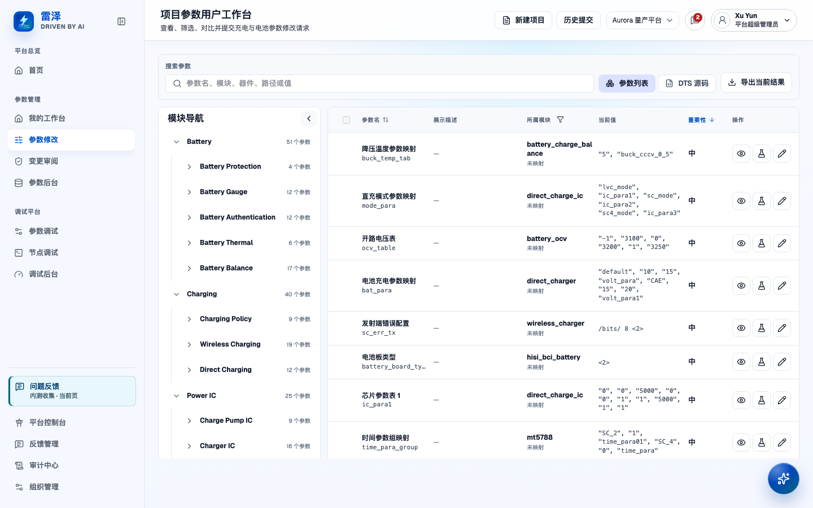
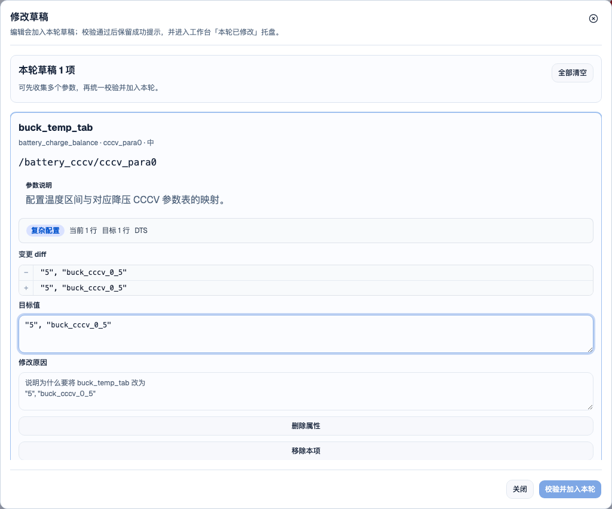
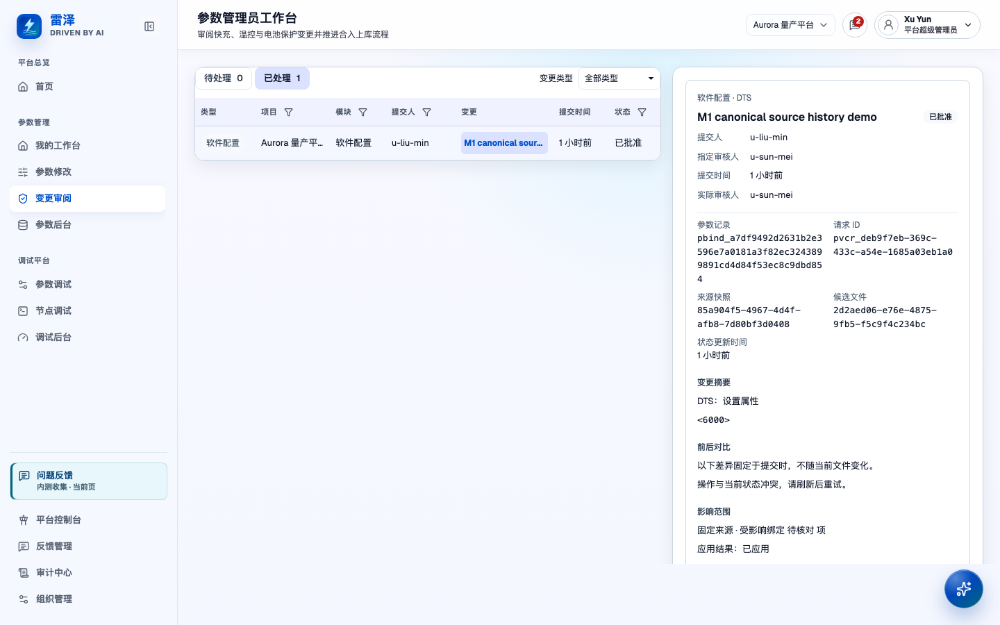
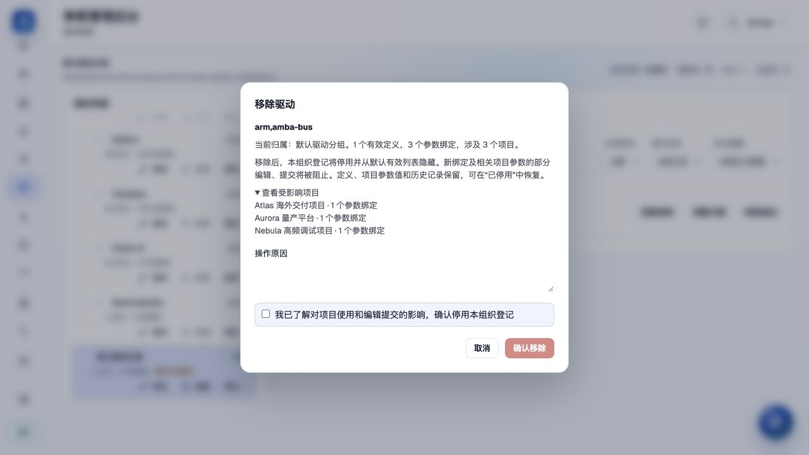
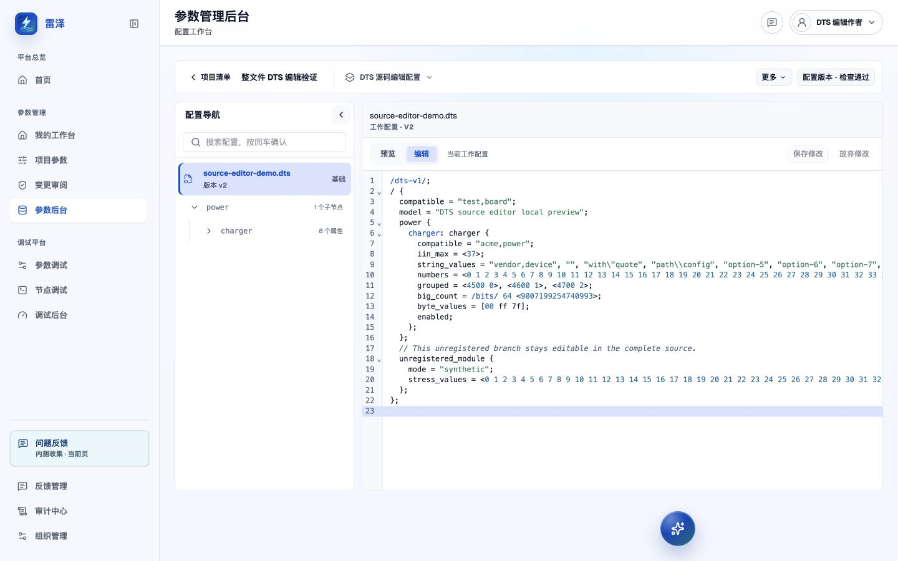

# Manage project parameters

> Chinese: [Chinese](../zh-CN/user-guide/parameter-management.md)

## Who can do this

- Guests (`guest`) can browse parameters and published definitions with `parameter:view`.
- Hardware users, software users, and hardware/software committers can prepare changes with `parameter:edit` and access to the target project. A project must finish initialization before normal changes can be submitted.
- A software committer bound to the project, or an Organization Admin (`admin`), reviews current parameter-value requests. Submitters cannot approve their own requests. Hardware committers handle hardware review in the separate staged workflow described below.
- Organization Admins with `admin:access` can manage initialization, imports, project files, config sets, and baselines in their Organization. Platform Admins (`platform-admin`) can enter a target Organization from the organization directory and manage its projects, parameters and subject registrations. Permission to review or merge a project's changes still depends on the separate role bindings checked by the server; selecting an Organization does not grant self-approval.

When operating in another Organization, check the **Current operating Organization** banner before changing anything. Project lists, initialization, configuration sources, exports, activity and project deletion receipts use that fixed Organization. A separate tab can keep your Home workspace open; entering a target does not change your account membership. Permanent project deletion and object-cleanup retries retain the target after the project has disappeared. Shared Catalog definitions remain platform resources and are not deleted with a project.

The UI is Chinese-first. The English page names below translate its labels; use the routes to find each page. For role requests, see [Account and access](account-and-access.md).

## Find a parameter and compare projects

1. Open "Parameter changes" (`/parameters`) and select the project. "My workbench" (`/parameter-home`) also lets you find work and pending actions by project.
2. Search the parameter table and filter by module or importance. Open a row's details to check its property key, node or configuration instance, current value, definition revision, source location, and history. Parameters with the same name can have different meanings; use these details to tell them apart.
3. Open "Cross-project comparison" from the row details, still within `/parameters`. Select the peer configuration instance and compare values and revision information. If editing is permitted, "Use this project configuration in a draft" prepares a change; it does not apply the peer value immediately.

The former "Comparison analysis" page (`/parameter-comparison`) is unavailable. Use row-level comparison instead.

*The seeded Aurora workbench shows where to find modules, parameters, and row actions.*

## Prepare and keep a draft

In the current API workbench on "Parameter changes" (`/parameters`), open "Edit", enter the target value and a reason, then choose "Validate and add to this round". After validation succeeds, the draft is saved on the server and appears in the "Modified this round" tray. Saving a draft does not change the current value or source file. Resolve any validation diagnostics; the editor text counts as saved only after validation succeeds.

Closing the editor keeps its unvalidated text while the workbench remains mounted. Choose "Continue editing" to reopen it. This text has not been saved on the server and may be lost if you reload the page or leave the workbench. Successfully created server drafts can be loaded again. Removing a saved draft from the tray deletes it, rather than just hiding the row.

In the older, non-API editor, choose "Save draft" to add the edited item to the local round. Closing that editor discards unsaved edits and keeps only the last saved local version. "Stash this round" saves the round's pending drafts for later when using API-backed persistence. These older save and stash controls serve different purposes from validation in the current API editor.

*The editor before validation; opening it does not save a draft or change the device.*

## Submit the intended changes

On "Parameter changes" (`/parameters`), select the saved drafts you intend to submit, check their target values and reasons, and submit from the round tray. For current parameter values, choose a software reviewer or leave the request in the software review pool. Submission fixes the targets and source context for review; you cannot switch to another source without authorization.

A round groups changes prepared together. Current canonical requests retain their own request and batch identities; they are not converted into the older submission-round records. Submit node-enablement drafts and canonical parameter-value drafts separately. If role candidates are missing, working revisions are stale, or validation fails, resolve the reported issues before retrying.

Open "My historical submissions" (`/parameter-submissions`) from the workbench to track your requests. Current requests show pending, approved, rejected, or withdrawn status, the target changes, source evidence, and reviewer notes. A submitter can withdraw a pending request; to continue afterward, prepare and submit a new request.

## Review the right workflow

Open "Change review" (`/parameter-review`), select the project and a pending item, and inspect its type before acting.

*A seeded handled request from the Aurora review queue, opened by an Admin; capturing it does not create or approve a request.*

### Approve current parameter-value requests

Current software-configuration requests use software review. They do not automatically follow the hardware-review → software-review → separate-merge timeline. The project's software committer or Organization Admin checks the fixed values and source differences, affected bindings, reason, and any existing conflict decision. On approval, the system rechecks the source and commits the reviewed change; this panel requires no additional merge link. A batch is approved or rejected as a whole. If the source has changed or the evidence is inconsistent, approval is blocked and the target stays unchanged.

### Advance staged requests

Node-enablement requests still use the staged workflow. Older records may also show these stages. Archived records are read-only and cannot be processed further.

- For hardware review, check hardware conditions, configured values, safety/risk implications, and the submitter's evidence.
- For software review, check implementation/configuration impact, source consistency, and the earlier review.
- For software merge, check completed review requirements and supply a valid HTTP(S) merge link. Merge is a per-request action.

For review and merge eligibility, see the maintained [User Permission Design](../security/user-permission-design.md).

For a staged submission, select assignees for hardware review, software review, and software merge. Each discipline acts only at its permitted stage. High-risk staged changes require hardware and software review evidence before merge. The server checks account status, roles, and project scope; a visible button alone does not establish permission.

## Read the timeline and respond to rejection

Use "My historical submissions" (`/parameter-submissions`) for your requests and "Change review" (`/parameter-review`) for review details. Older rounds show selection, target-value preparation, hardware review, software review, and software merge in their timeline. Check the status and reason to understand progress. Rejected or withdrawn rounds have stopped, even if a stage remains highlighted. Eligible active rounds offer "Withdraw this round"; archived rounds are read-only.

For current requests, progress appears in pending or history entries and reviewer notes, without the older five-step timeline. If rejected, read the reason, check the target and source context on "Parameter changes" (`/parameters`), supply the missing evidence or corrected value, and create a new submission. After withdrawal, you also need a new request to continue; the old request stays closed.

## Understand definitions before governing a project

Create a driver, node type or configuration schema with **Add subject** in **Canonical subjects and placement**. Enter the compatible identity, node name or governed configuration-schema identity respectively; drivers also require explicit nature and instance-cardinality choices. A subject can be published without inventing a parameter. **Add definition** only adds a parameter to a published subject. If its subject is missing, follow the single subject-creation flow and continue adding a definition after publication. Subject publication, organization registration and project node enablement are separate operations.

Open "Parameter definitions" (`/parameters/definitions`) to browse published contracts and revisions. A definition says what a property means; a project binding identifies its actual node or configuration occurrence, and the project value is that occurrence's configured value. Changing a project value does not redefine the shared property contract.

The Platform owns the Catalog, and its published releases are immutable. An Organization registers Catalog subjects and places them in its own taxonomy; the definition schema remains Platform-maintained, rather than becoming a private fork. Open "Parameter definition management" (`/parameter-admin/specs`) in "Parameter admin" (`/parameter-admin`) to take part in governance. Proposals and uploaded DTS files go through a separate publication process described in the [Catalog authoring and publication reference](../design-docs/catalog-authoring-and-publication-control-plane.md).

In definition management, read the value type, unit and limits before editing. Returning from a correction preview to edit requires a new preview. Closing an unsaved editor asks whether to discard changes; publication progress remains visible and refreshable. The history view loads older revisions on request and compares their content with the current revision.

The examples field accepts a complete DTS property statement, a DTS value, or a JSON example array. DTS examples may include `/* ... */` and `// ...` comments, including after the final semicolon. Comments outside strings are ignored when converting the example; quoted content such as `"7|8"`, `"3^1"`, `"0xa"`, or `"http://host"` remains unchanged.

A Platform Admin with Catalog authoring and publication capabilities can leave the affected-project selection empty when correcting an unused identity. Preview and publication check current references across all Organizations. Existing or concurrently added references stop this shortcut and require the actual project migration. A target identity conflict links to its existing Definition. Completion creates a replacement Definition and retains the old key and history; it does not delete or retire the old identity. The separate retirement action appears only with authoritative global zero-reference evidence and rechecks it before opening the existing retirement flow.

Under "Module management" (`/parameter-admin/modules`), use the Modules tab to search the tree and filter subjects by module, subject type, registration or definition count. Tree filters also constrain the subject list. Selection, tree state and subject filters are retained in the URL, including when returning from definition details. Module details are readable without write permission; only authorized Organization Admins maintain classifications and subject placement.

Use "Remove driver" (or the equivalent node-type/configuration-schema action) to stop using a registered subject in this Organization. The confirmation loads current definition, binding and project counts, lists up to 50 affected projects, and requires a reason and explicit acknowledgement. Retirement blocks new bindings and some existing project editing/submission operations while retaining definitions, values and history. The default subject list hides retired registrations; select "Retired" to restore the same registration and placement. If the original module was deleted, restoration leaves attribution unset until it is reassigned. A retired Platform subject cannot be restored by the Organization. Module classifications remain even when empty. Definition management also hides retired registrations by default; enable "Include retired registrations and subjects" to inspect retained records. Conflicting writes retain the reason and require refreshed evidence and confirmation.

An unregistered subject can also be removed from this Organization, whether or not it has parameter definitions. Confirmation marks it retired in this Organization without first registering it or selecting a module. The shared Catalog subject and definitions remain available to other Organizations. Restore it from "Retired", then assign its module attribution because it has no previous module.

For an unregistered subject with no suitable target module, choose a business parent and name the target in the registration form. Confirmation creates the correctly typed target and registers the subject in one transaction. If the organization has no business classification, create one from the form's entry first. Placement changes show full destination paths and impact; a conflict requires refreshed evidence and confirmation again.

Source identification shows recognized records alongside records needing review in its own full-width view. Select a project to constrain server-side results; keyword and source filters cover the records already loaded, with additional pages available on request. Empty states explain how observations are produced. Review links open the exact authorized item, including items outside the first page. A recorded definition proposal is not a published definition; its receipt links to the definition directory to continue authoring.

Open pending reviews from parameter definition management. Search by compatible, property or source, then filter by project or reason. The processing view shows all affected sources and explains the available choices. Registration requires a real candidate and compatible target module; restoration selects a verified retired registration. Unknown sources can record a definition intent or be marked out of scope. Enter a reason, review the impact and explicitly confirm. Refreshing evidence retains input; leaving a changed form asks before discarding. An intent is not a published definition: use the result's next-step link to continue in definition management. Processing history opens the existing audit center.

Review evidence updates automatically on opening the form, returning to the window and choosing Continue. Your input stays in place. If the evidence or available targets change, review them again before confirming; if the read fails, use Retry. No manual refresh is needed, and these checks never submit a resolution.

The Historical registry is a read-only snapshot, distinct from current canonical registration. Search, filter or sort its rows and open details for recorded driver attributes and parsing coverage. This API does not provide a historical timeline. Node-mapping history remains accessible after pending tasks are resolved.

## Manage shared DTSI versions

Open **Shared DTSI** (`/parameter-admin/sources`) in the parameter administration console. Organization parameter administrators can choose **Import resource**, select a UTF-8 `.dtsi` file, file set, directory or ZIP archive, or enter source directly, name the resource, and save a draft. Directories and ZIP archives retain original relative paths and content; ordinary file selection supplies filenames only, so use a directory or ZIP for nested paths. `.h` and `.hpp` members are retained as header dependencies, never parsed as DTS or JSON parameter files. Multi-file resources show a file list for switching complete source files and editing paths. Renaming a member in the current draft retains its identity. Incomplete DTS text can be saved while it is being prepared; saving does not publish a version or change any project.

To publish, enter a **Change description** and choose **Preview publication**. The server freezes the complete source set, member identities, roles, checksums and include graph; review the read-only preview before choosing **Publish version**. Source-only declarations containing `compatible` and `status` need no invented parameter definition. A library needs no project root DTS: preview lists external references that a project must supply and does not claim complete project compilation. The first version is `v1`; published bytes and history are immutable, and publication does not automatically update project configurations. Missing includes, cycles, path escapes, duplicate labels and syntax errors identify original file locations for repair and retry. Native `/include/` is supported; C preprocessing, including `#include`, explicitly blocks publication.

Imports allow 128 files, 2 MiB per file, 16 MiB of total source and an 8 MiB ZIP archive. Paths and include nesting are limited to 16 levels and expanded source to 32 MiB. Archive inflation has a 200× compression-ratio limit with a minimum 1 MiB budget. Unsupported files, nested archives, symbolic links, absolute paths, traversal and normalized-path collisions reject the complete import without silently skipping files. ZIP archives are checked and expanded by the server on draft save; a failure retains the selected archive and input.

Use **Versions** to open exact historical source. **Create new version** copies the current published source into a draft with the same member identity. Discarding that draft retains the published version and history. If another administrator changes the draft after preview, regenerate the preview from current source; a failed request retains input for retry.

Version history shows the publisher, publication time and change description. Select two published versions and choose **Compare selected versions** to inspect their original file differences and ordered semantic declarations, including fixed dependencies. Semantic comparison preserves separate nodes and the order of assignments and deletions; it does not evaluate a project's final configuration. **Usage** lists authorized project configurations, exact pinned versions and direct or transitive references. Follow a configuration link to its effective view or a version link to its read-only source. A newer published version is marked available and **not evaluated**; publishing it leaves every existing project pin unchanged.

Permanent Organization deletion by a platform administrator includes that Organization's shared DTSI drafts, previews and published history in its impact preview and cleanup. Ordinary resource operations retain published history; other Organizations' source and the platform Catalog remain intact.

Reopen a resource from the list to continue editing. If another administrator saved first, your input stays on screen and saving is blocked until you reload and check the current draft. Leaving with unsaved edits asks for confirmation. **Discard draft** removes the never-published resource and its draft after confirmation. Readers cannot create, save or discard drafts.

Native node-path references such as `&{/soc}` and `<&{/soc/clock}>` retain their original source positions. Library publication lists required paths that the library does not declare; project composition must resolve them to actual nodes and refuses missing targets. These paths are locators and do not establish logical-node identity by themselves.

## Initialize or import project parameters

As an Organization Admin, open "Parameter admin" (`/parameter-admin`) and its "Project list" (`/parameter-admin/projects`). Start the project initialization wizard and fill in the project identity and owner. Select source projects, choosing a primary source if you use several, then select candidate parameters and submit the snapshot for review. You can also explicitly choose to start from an empty library. The project then waits for review. An Admin approves or rejects initialization in "Change review" (`/parameter-review`); approval creates the selected bindings, while rejection lets the creator revise the setup. Ordinary parameter changes can be submitted only after initialization succeeds.

Open "Batch parameter import" in the organization-configuration area of "Parameter admin" (`/parameter-admin`), select the target project, and upload or paste JSON, CSV, or DTS content. Check the parse report, row decisions, and batch preview before confirming. The server parses full DTS; the client does not infer its contents. A canonical import stages drafts, so current values and source files change only after submission and approval. Check the confirmation screen and returned status to see whether the import has taken effect. The preview is only for checking the proposed changes. Going back from confirmation preserves the selected preview rows; changing the source or review decisions regenerates the preview. After staging, use the receipt’s "View drafts and continue to review submission" action to continue in the target project.

For project DTS/JSON source files, open "Configuration workbench" under "Parameter admin" (`/parameter-admin/projects/:projectId/configuration`, replacing `:projectId` with the selected project). Check the working source, uploaded candidate, differences, and history. After uploading a file or candidate, explicitly assign files to a config set and follow the offered review or apply action. Uploading alone does not activate the working configuration. JSON changes retain their exact source context and apply to project source files; they do not permit arbitrary edits to the global Catalog.

In API mode, the configuration navigator shows DTS instances that match the organization's active registered modules, plus their actual DTS parent paths. Unrelated branches are hidden. Parent-only entries provide structure without unrelated properties; matched instances retain their properties, including disabled instances and instances without parameter values. Navigation search uses the same scope and still finds file names. The source canvas retains the complete file. A history or conflict link outside the navigation scope can still locate its source and shows a scope notice. If no module matches, the file remains accessible; if the scope cannot be loaded, retry the navigation read rather than treating it as an empty result.

The API project list offers reversible "Archive" and "Restore project" actions. Archived projects are hidden by default and can be found with the archived-status filter. They are also removed from project selectors in Project parameters, Parameter debugging and other workspaces; restoring makes them selectable again. If the active project is archived, the refreshed workspace selects another available project or clears the selection when none remain. Archiving retains history and existing access; it does not freeze configuration writes. Restoring keeps the project’s initialization progress. The configuration workbench and review-role page return to the list’s previous filters, sort and page.

An Organization Admin can open **Deletion impact preview** from a project's actions. Review the owned configuration, source versions, values, reviews and history, retained resources, object references and blockers, then acknowledge and choose **Confirm permanent deletion** once. Data changes require a refreshed preview. Pending work and separately protected offline archives or deployment evidence must be handled through their existing workflows first. Shared Catalog definitions/releases, other projects, independent knowledge, logs and devices remain; project associations are detached. Database and exclusive-object cleanup have separate statuses. Storage failure leaves a retryable receipt in **Project cleanup records**, including after reload; deletion is complete only when both statuses are complete. Retrying the same confirmation does not repeat database deletion or audit. Deleted project IDs cannot be reused by old tasks.

## Keep working configuration and releases distinct

In "Configuration workbench" (`/parameter-admin/projects/:projectId/configuration`):

- **Effective configuration** shows the complete composed device tree, including nodes outside organization business navigation. Select a node to read final values, its own status and ancestor reachability. Identical `compatible` values remain separate instances. Expand **Inheritance and overrides** to trace the ordered sources. Source links open frozen file versions; shared-resource links open fixed published members read-only and retain a project-node return link. Historical configuration links keep their revision after current sources advance. A deletion without a recorded original line still links to its exact file version and explicitly identifies the missing line.
- Select the config set and DTS file, then switch between Preview and Edit above the source. Edit strings, arrays, comments and nodes directly as DTS. Preview is read-only and retains the current input. Search, folding and undo are available; the inspector shows Definition details.
- Choose Save changes or press Cmd/Ctrl+S to validate the complete file, inspect its difference and enter a reason. A current file administrator with parameter edit permission can choose **Directly apply changes** without another reviewer, including comment-only changes. Alternatively, select a software reviewer and choose **Submit review**. Syntax or Definition errors keep the input and show diagnostics. The source must be nonempty and at most 2 MiB. Resolve existing parameter drafts and pending requests before applying a whole-file change.
- Direct application updates the working source, configuration and derived parameters together and refreshes the workbench. History identifies it as the administrator's own application, with no separate reviewer. A lost response can retry the same operation without applying it twice; a stale preview or revoked role refuses the operation and keeps the local text. Release publication and device writes remain separate operations.
- Submitted means pending review. The author can withdraw from Personal submissions; the assigned reviewer can approve or reject from the Review inbox. Approval updates the working file, configuration and affected parameter values together. Return and check the review result to load the authoritative version; later local typing is retained.
- A current administrator with project file-management permission can also open the organization's source requests in the Review inbox. Under **Administrator takeover**, reassign a pending request to a currently eligible reviewer, or enter a reason and cancel it to release the configuration block. Reassignment keeps the frozen difference; cancellation records the actual administrator and reason, without signing a review or deleting history. Closed requests stay unchanged. Refresh after an assignment, permission or status conflict; the author and valid assigned reviewer retain their usual actions.
- Local recovery is separate from server submission. Drafts are scoped to the current account, organization, project, configuration and file. Storage failures or two-tab conflicts offer a draft download; an outdated base blocks submission until compared with the latest source. Discard restores the loaded working source and does not withdraw an existing request. Same-session switching retains editor history; a page reload restores text and position, not undo history.
- A config set groups member files by role and order. Working configuration comes from those members' active versions; ungrouped files are outside that set's Working and Release views. An empty set can accept an existing file after its source has been verified. Files that require reviewed membership changes or have an unknown source stay blocked.
- A release baseline is a snapshot of fixed member versions. A draft baseline still needs to be published. Check the server's release-readiness summary, resolve blocking issues, and acknowledge required warnings before release. Local unsaved edits or unavailable or stale readiness results can block the action.
- To restore a Canonical configuration snapshot, inspect its saved versions, member roles/order, include/overlay composition and parameter impact, then enter a reason. Later-added members are retained and listed. Reattaching a saved member or changing its role/order requires explicit confirmation. One transaction creates the new Working source revision, values and history; the original snapshot and released baseline stay unchanged. Single-file rollback remains available in file history.
- Older snapshots without complete composition information identify the missing fields and link to the configuration editor. If an actual historical source revision exactly matches their saved file versions and has a complete source receipt, select it explicitly and preview again. Otherwise complete the configuration and save a new snapshot. Missing source objects, erased Definitions or stale source/Catalog/parameter state refuse the whole restore.
- A conflict means file content and a UI draft disagree about an intended change. Check both sources and choose the file or draft value in the conflict task. The choice is retained in the request; if the source drifts from that decision, approval is blocked.
- Writeback writes the reviewed change to its exact project source on approval or merge, preserving version and history evidence. It changes project source files without writing to devices or releasing a baseline. If the fixed source has changed, resolve the conflict or refresh and resubmit, then check whether the file was updated.

Older project `/files`, `/config-sets`, `/structure`, and `/conflicts` links redirect to this integrated workbench. See the maintained [configuration workbench reference](../design-docs/2026-08-06-project-configuration-workbench-design.md) for the underlying model, and return to the [User Guide](README.md) for other workflows.
