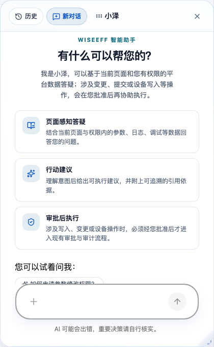
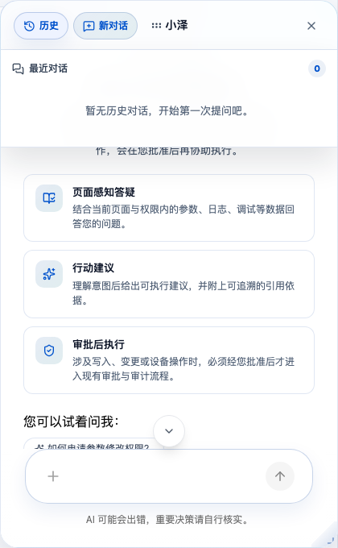

# Ask Xiaoze and approve an action

> Chinese: [Chinese](../zh-CN/user-guide/xiaoze.md)

## Who can do this

- Signed-in users, including guests (`guest`), can ask read-only questions within their permissions. Parameter and knowledge queries require `parameter:view` and `knowledge:view`; node snapshots require `debugging:view`, and recent log conclusions require `logs:view`.
- Hardware users, software users, hardware/software committers, Organization Admins (`admin`), and Platform Admins (`platform-admin`) can approve parameter proposals only with `parameter:edit` and access to the target project. Creating a knowledge draft requires `knowledge:edit`.
- Organization Admins and Platform Admins can open **Audit center** (`/audit`) and **Knowledge administration** (`/knowledge-admin`). These page permissions do not replace the server's checks on each action.

Xiaoze is available in the API-backed app, not the mock experience. It is a popup assistant, not a separate navigation page. The UI is Chinese-first; the English labels below give their meaning, and the routes identify the pages. See [Account and access](account-and-access.md) for role requirements.

## Ask about your current work

1. Open **Parameter changes** (`/parameters`), select your project, and choose **Open Xiaoze**. You can also ask from **Knowledge base** (`/knowledge`); its **Ask the knowledge base (Xiaoze)** entry opens Xiaoze with a fixed preset prompt, not your search question. Replace or extend that prompt with your actual question before sending.
2. State what you want to understand, including the parameter or object you mean. The page supplies its route, page identity, your role, a project identifier where applicable, and a short page-context summary. This is not a full screen read: do not assume Xiaoze sees every table row, selection, or unsaved edit. Name the relevant object in your question.
3. Ask for evidence, not just an answer. Xiaoze can use read-only tools to query project parameter counts and pending requests, search configured parameters and explain their definitions and values, and search or read published knowledge. It can also retrieve stored node snapshots associated with **Node debugging** (`/node-debugging`) and recent conclusions from **Intelligent analysis** (`/logs`).
4. Check the returned sources before relying on the explanation. Read-only queries do not require an approval card; they still undergo server-side permission checks. Project tools require project access, while knowledge retrieval is scoped to your Organization. Node snapshots and recent log conclusions currently return Organization-scoped records, not a guaranteed selected-project-only result.

Xiaoze reads existing log conclusions; it does not run the log-analysis workflow itself. A stored node snapshot is not proof of a fresh device read. The current registered write tools submit parameter changes and create knowledge drafts; they do not write device nodes. Use [Device debugging](device-debugging.md) and [Log analysis](log-analysis.md) for those workflows.

*The Xiaoze welcome panel, scrolled to its beginning after the parameter workbench finishes loading; no LLM request or approval card is generated.*

*History before any question is sent; this is not evidence of an executed or approved action.*

## Review a parameter proposal before approving

On **Parameter changes** (`/parameters`), ask Xiaoze to prepare a change for a specific parameter. A proposal is not an applied change: mutating tools pause for explicit human approval before changing business data. Conversation text alone is not approval.

When **Confirm parameter change** appears:

1. Check the **Project** and **Parameter** identifiers against the object you intended to change.
2. Review **Target value**, the **Change reason** when supplied, and any source links. Do not approve an unexplained or incorrectly targeted proposal.
3. Edit **Target value** if needed. The card submits that edited value with the rest of the proposal; the server validates it in the parameter's source format and rechecks authorization. Project, parameter, and change reason are not editable fields on this card. If those are wrong, reject the proposal and ask for a corrected one.
4. Choose **Approve** to execute the proposal, or **Reject** to prevent that proposed write. You may supply an optional **Rejection reason** to explain what needs correcting.
5. Check the execution result. Approval alone does not prove success: permissions, validation, or execution can still fail. A successful parameter action creates a change request, not an immediate device write or merge. Follow it through **Change review** (`/parameter-review`) if your role permits, or use the [parameter-management guide](parameter-management.md) for the submission and review path.

## Turn a useful answer into a knowledge draft

Ask Xiaoze to prepare a new knowledge draft from the conversation. In **Confirm creation of a knowledge draft**, inspect **Draft title**, **Tags**, any **Source analysis**, and **Content preview**. The preview may be shortened; it is not necessarily the complete draft. Only the title is editable on this card. If the body, tags, or source need changes, reject it and request a revised proposal.

Choose **Approve** only after checking the proposal. Approval creates a new draft, never updates an existing knowledge entry and never publishes it automatically. Inspect the resulting entry in **Knowledge base** (`/knowledge`). Draft and archived entries are excluded from Xiaoze's knowledge retrieval until a human publishes the draft. Authorized administrators can also review the **Agent draft publishing queue** in **Knowledge administration** (`/knowledge-admin`). Publishing remains a separate human decision.

Xiaoze's recent log conclusions include the analysis source and degraded reason, and the primary conclusion's summary flags degradation. If the approved draft cites a degraded source log analysis, the platform automatically adds a provenance notice at the top of the draft body, identifying rule fallback or early convergence and its limitation. It does not add the same notice twice when it is already at the start. Review the notice and source evidence in the created draft before publishing; the notice remains editable, and approval and publishing are still separate human decisions.

## Distinguish AI output from its sources

- Assistant answers are labeled **Xiaoze**, and the chat warns that AI may make mistakes and important decisions need independent verification. An explanation is generated content, not an authoritative engineering decision.
- When citations are available, **Sources** appears below the answer. Sources come from tool results, such as parameter records, node snapshots, log conclusions, or published knowledge. A source with a link opens the referenced object; a source without a link is shown as a label. An answer without sources should not be treated as evidence-backed merely because it sounds confident.
- Knowledge entry details show a revision and a **Source** label distinguishing **Human** from **Agent**. The administrator's Agent draft queue shows the creator, originating session, and associated source analysis when present. Check these alongside the draft content before publishing; an Agent label is provenance, not a quality guarantee.

## Understand who approved and who acted

The approval chain records the human decision and links the action to its session, tool call, and approval. An approved Xiaoze action remains Agent-initiated in audit records; approving it does not relabel it as a direct user action. Authorized administrators can investigate in **Audit center** (`/audit`).

For the maintained approval and provenance contracts, see [the DB-backed Agent approval decision](../adr/0024-agent-approval-state-is-db-backed.md). Return to the [User Guide](README.md) for other workflows.
