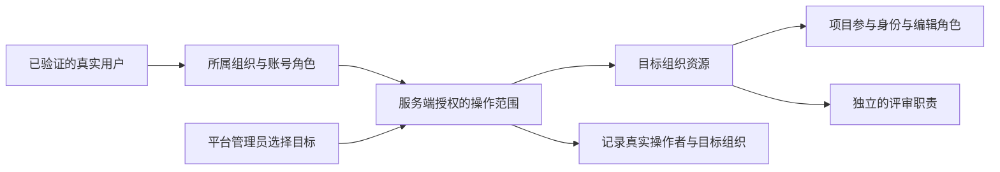
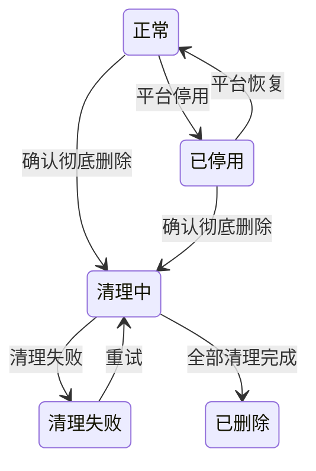

# 组织管理整体设计：操作范围、协作与生命周期

> 状态：**已接受设计，实施进入整体验收**——Q1–Q20 及完整方案（Q21）已于 2026-10-23 确认。33 票已全部集成，包括混合删除与恢复、完整运营场景及使用文档。当前候选 CI 和独立审查仍是交付要求，实际进度见[实施计划](../exec-plans/active/2026-10-23-organization-management.md)。
> English: [Organization management design](../../design-docs/2026-10-23-organization-management-design.md)
> 决策记录：[ADR-0051](adr-0051-organization-provisioning-and-member-admission.md)
> 已发布规格：[GitHub Issue #1368](https://github.com/tzrea1-Q/WiseEff/issues/1368)，标签 `ready-for-agent`。
> 原设计源码基线：`e795bd1a70c07391f893e4818cd8b07c138abcb3`。下文起点核对保留该历史基线的观察。

## 目标与范围

将组织管理完善为可日常使用的运营入口：平台管理员建立和恢复组织；组织管理员接纳成员、组织协作、处理人员离职；用户能看见本组织项目，并理解自己能参与哪些工作。管理员可以通过产品完成正常操作，无须维护 SQL 或为日常事项反复找平台管理员。

首期包含全部已确认能力：平台组织目录和明确的当前操作组织、邀请与直接创建、扁平团队、项目参与身份、管理员交接、成员离职和调动、组织停用恢复及彻底删除。下面的阶段只表示交付顺序，不表示将生命周期或删除功能移出首期。

账号仍只属于一个组织。首期不增加私有项目、部门树、团队权限继承、自定义权限设计器、邮件基础设施、不可删除的系统组织或新工作流引擎。现有服务端授权、组织隔离、审计和 Agent/设备写入的人类审批仍属于逻辑正确性要求。

## 已核实的起点

以下是源码核对结果，不是已执行的验收结论。

| 能力 | 当前证据 | 对设计的影响 |
| --- | --- | --- |
| 组织信息与导航 | [OrganizationPage](../../../src/OrganizationPage.tsx)、[组织导航](../../../src/components/admin/OrganizationAdminScopeNav.tsx)：名称/信息、成员、设备代理 | 扩展现有工作区，新增平台组织目录。 |
| 成员操作 | [users service](../../../server/modules/users/service.ts)：创建、角色、启停/删除、重置密码、显式 OIDC 绑定、项目评审职责 | 复用已有业务写入，补邀请和交接统筹。 |
| 项目编辑 | [共享策略](../../../server/modules/parameter-kernel/policy.ts)：组织级业务角色可跨项目编辑 | 编辑参与关系与评审职责分开；先迁移实际权限，再切换策略。 |
| 账号身份 | [OIDC 迁移](../../../server/migrations/0238_oidc_member_identities.sql)、[认证仓库](../../../server/modules/auth/repository.ts)：身份与组织绑定，角色另存 | 调动同时处理身份和角色，不能只修改 `users.organization_id`。 |
| 入站和出站集成 | [凭据解析](../../../server/modules/auth/integrationCredentialResolver.ts)、[Webhook 投递](../../../server/modules/logs/webhookDelivery.ts)：独立机器身份与后台通路 | 停用/删除覆盖机器调用、任务领取和外发，不能只拦用户 API。 |
| 项目彻底清理 | [数据库授权](../../../server/migrations/0224_project_permanent_deletion.sql)、[对象清理](../../../server/modules/projects/purge.ts)：要求真实所属组织，重试依赖操作者 | 调整授权衔接，并保留不随组织账号删除的平台清理记录。 |

## 产品入口

管理入口分两层：平台组织目录管理组织本身；进入目标组织后，使用该组织管理员也使用的同一套工作区。

| 入口 | 内容与操作 | 复用方式 |
| --- | --- | --- |
| 平台 → 组织 | 列表/搜索、创建并指定初始管理员、进入目标组织、停用恢复、管理员恢复、账号调动、删除预览和进度 | 新增目录；组织业务页面共用。 |
| 组织 → 概览 | 状态、成员/团队/项目数量、未处理邀请和交接、可操作入口 | 扩展现有组织首页；统计数字能进入对应工作列表。 |
| 成员 | 搜索筛选、直接创建、邀请及状态、角色、启停/删除、密码/OIDC 管理、离职交接 | 复用成员列表与详情。 |
| 团队 | 扁平分组、创建/改名/删除、成员选择及批量操作 | 批量选择最终落为明确的成员/项目更新；分组变化不隐含改变项目权限。 |
| 项目 | 本组织项目列表、明确的参与者/编辑角色、独立的审核与合入职责 | 复用现有项目管理、`ProjectReviewRolesPanel` 和项目配置工作台。 |
| 资源 | 定位组织参数资源、知识、日志、设备配对、集成凭据 | 跳转已有控制台；将已有组织级凭据列表提供为总览，技能页保留过滤视图。 |
| 设置 | 组织标识/名称、生命周期状态；有权限的平台管理员显示生命周期操作 | 复用原信息编辑及新增平台生命周期操作。 |

工作区持续显示当前操作组织及状态。平台管理员可以明确返回组织目录或所属组织。现有成员、代理和业务深链接保持可用。资源入口只做盘点和定位，不再复制编辑器或增加第二套配置来源。

## 身份与授权

保留真实操作者的身份与所属组织，由服务端明确解析当前操作组织。普通用户限于所属组织，平台超级管理员可选择其他组织。客户端提交目标 ID 本身不构成授权，也不通过冒充成员或修改账号归属来模拟切换。

授权后的目标范围传入资源查询、写入、审计、导出、异步任务和流式工作，审计记录真实操作者和目标。对于目前要求操作者实际属于目标组织的业务/数据库授权，必须贯通调整。机器集成身份仍限定在自己的组织，不能使用人类平台管理员的跨组织能力。

前端请求和缓存必须绑定页面显示的组织。切换后清理不匹配的当前选择和草稿视图，并忽略旧目标的迟到响应；未保存工作应保留或明确处理。两个浏览器标签页不能暗中改变彼此的写入目标，其他组织的资源 ID 也不能覆盖当前范围。

| 身份 | 查看项目 | 修改业务 | 组织操作 |
| --- | --- | --- | --- |
| 有效普通成员 | 本组织项目可见；敏感详情仍遵循各业务权限 | 明确的项目参与身份、编辑角色及业务权限 | 个人账号功能 |
| 项目审核/合入人员 | 同一项目可见性规则 | 按独立配置的职责审核/合入；迁移不能推导出新权限 | 不因此获得组织管理权 |
| 组织管理员 | 自己的组织 | 按现有业务规则直接管理 | 成员、邀请、团队、项目分配和交接 |
| 平台超级管理员 | 明确选择的目标组织 | 以真实身份完整管理目标组织 | 创建组织、恢复、调动及生命周期 |

组织停用在这层规则上叠加限制：保留原有允许的读取，停止新业务写入。平台恢复、交接和清理属于明确的生命周期操作；账号密码/会话维护与组织业务写入区分。

项目参与和评审职责是不同事实，即使复用角色名称也不能混在一起。例如，将组织级 `hardware-committer` 直接复制进现有项目评审绑定表，会意外增加审核权。迁移必须只落实现有编辑资格。复用角色词汇及业务策略入口，不引入通用权限引擎。项目创建、元信息和生命周期管理继续通过现有管理员入口。

## 加入、协作与离职

邀请记录目标组织、预设组织角色、团队、项目及项目角色、有效期和状态。接受邀请时一次性建立成员及其授权，无需第二轮审批。邀请人只能授予自己有权管理的权限，组织管理员不能创建平台超级管理员。撤销、重发和接受不能因并发产生重复或复活的授权。如果预设项目或授权已失效，应解释冲突并允许修改重发，不能静默改变邀请内容。同组织已有成员通过成员设置管理，其他组织账号必须走调动。

直接创建、管理员重置密码和 OIDC 预绑定保留。公开体验注册单独配置，明确指向一个组织；目标停用、清理中或不存在时不能接纳注册。现有体验成员和待审核申请保留供管理，关闭公开入口不静默删除这些记录。

团队只负责分组。删除团队不删除成员、项目或个人已经配置的角色。批量分配项目时显示选中的人及产生的角色；之后加入或离开团队不继承或撤销这次明确授权。

离职立即停用访问并撤销个人会话、凭据和配对，然后展示未完成草稿、评审职责、待办及责任交接。未分配事项持续对管理员可见。复用已有领域内重新指派操作，检查接任者当时是否具备资格，不新建通用资产转移引擎。组织所有的机器凭据不因创建人离职自动失效。

历史操作者及发生时的组织应独立于当前负责人和账号关联保存。删号/调动不能清空已知历史署名，也不能把过去工作改成接任者的署名。已有缺失历史应明确缺失，不能编造旧姓名或恢复能力。Q15 的组织彻底删除仍清除该组织业务历史；这里的保留规则适用于成员离职、删号和调动。

调动保留账号身份、改变唯一所属组织、清除原组织/团队/项目授权、配置目标授权，并撤销旧会话和个人配对。原组织草稿、待办及历史留在原组织，可以暂存待交接。同一操作中校验所有组织绑定身份及目标身份冲突。本地用户名继续全平台唯一。

**OIDC（Q20）：**保留现有 `organization_id` 声明契约。调动后撤销旧访问，界面可显示“等待身份系统同步”，提供所需目标和检查结果。重新登录须使用已验证的新身份，其组织声明和显式身份绑定都正确。本地密码账号不需要外部同步。不能静默重映射旧组织声明，也不将令牌角色直接当作目标组织授权。

正常移除、降权、停用和调动应保留有效组织管理员。平台管理员可紧急停用最后一位组织管理员，之后恢复负责人。所有这些入口，包括并发操作及组织删除，都必须保留至少一个可用的平台超级管理员。删除所属组织前，先调走需要保留的平台账号；调动时区分平台角色与应清除的旧组织权限。

## 组织生命周期与清理

这是产品状态，不指定数据库枚举写法。清理失败不恢复组织的正常使用。执行删除的平台管理员可以在业务工作区已不可用时查看进度。

| 通路 | 已停用 | 清理中 / 清理失败 |
| --- | --- | --- |
| 成员读取 / 新业务修改 | 保留原允许读取 / 拒绝新修改 | 业务不可访问 |
| 新机器集成请求 | 拒绝 | 拒绝并撤销组织凭据 |
| 排队任务 | 暂停领取 | 取消并清理组织所有的工作 |
| 已启动分析/索引 | 允许完成并保存已获准的结果，不新增外部副作用 | 停止或阻止最终写入，由清理流程处理残留 |
| Webhook 投递和重试 | 暂停新外发，包括收尾分析产生的回调 | 禁止新外发，协调已开始发送并清理 outbox/载荷 |
| 设备操作 | 禁止新派发，记录已下发命令的实际结果 | 禁止新派发，无证据时不宣称物理回滚或成功取消 |
| 平台生命周期操作 | 允许恢复和交接 | 允许进度查询和重试 |

恢复后，排队工作须重新检查当前权限和目标后才可继续。不复活单独停用的账号、已撤销凭据或过期设备命令。机器调用和 outbox worker 都要检查组织状态，不能只靠禁用按钮或用户鉴权实现。

删除预览覆盖成员/身份、团队/邀请、项目及配置/历史/草稿、组织登记、知识及索引、日志/分析、Agent 会话、文件/产物、任务/outbox、个人配对和组织集成。共享 Catalog 定义及其他组织引用保留。实施时核实实际依赖清单；该列表不表示已有通用级联删除。

先持久化清理意图，再清理数据：阻止新写入及任务领取，协调在途生产者，复用各领域清理和对象引用规则。清理记录必须能在目标组织及账号删除后继续存在，重试使用明确的平台授权。进程重启后重新核对进度，仅重试未完成项。不能仅因某组织引用一个对象就删除仍被其他组织使用的对象。

组织自己的数据库记录及对象删除完成、生产者不能重新生成数据后，才标记已删除。详细清理状态最终收敛为最小平台回执：操作者、时间、目标、数量和结果，不含业务载荷。备份按部署保留周期过期；恢复旧备份时，应在开放恢复出的组织数据前重新落实对应删除状态。这是运维恢复要求，不代表可以即时选择性擦除备份。

## 交付顺序与迁移

| 阶段 | 完整交付结果 | 完成重点 |
| --- | --- | --- |
| 1. 操作范围与平台目录 | 明确操作范围端到端贯通，组织创建/列表/进入，共用工作区及管理员恢复 | 两组织 API/浏览器验证；真实操作者审计；数据库/业务授权支持合法跨组织管理。 |
| 2. 成员与协作 | 邀请、团队、项目参与身份、现有评审职责界面、有效权限迁移 | 旧编辑者保留等价编辑权，不新增审核/合入/设备权；新项目明确配置参与者。 |
| 3. 离职、调动与停用 | 立即撤销访问，交接和草稿保留，稳定历史署名，本地/OIDC 调动，组织只读生命周期 | 最后管理员的并发保护；身份、机器、任务、回调均遵守生命周期。 |
| 4. 彻底删除与整体验收 | 影响预览、持久进度、重试和最终回执，组织运营界面完整可用 | 进程/存储故障重试，删除后不再生成数据，共享资源保留，前端全流程验收。 |

采用当前业务模块和已有任务/存储基础设施，只增加邀请、分组、项目参与、生命周期进度及历史署名需要的持久记录。事务责任和重新指派/删除仍归各业务模块，组织操作负责统筹调用，不新增消息总线、调度器、权限框架或重复资源仓库。

按受控顺序交付表结构、回填和调用方改造。比较迁移前后的有效编辑权限及现有评审职责，包含停用成员但不重新激活他们。参与关系回填完成后才切换编辑策略。保留已有 ID 和历史已接受计划；本设计明确修订 ADR-0037 中仅所属组织、无邀请、无项目参与身份的排除项，不改写其他领域验收约束。

## 验收与最终确认

沿用现有真实 API 行为测试；身份/权限迁移、事务、最后管理员并发、邀请消费、交接和清理并发使用 PostgreSQL；操作员与用户流程使用隔离的真实 API 模式浏览器，在 `1440x900` 验收。复用存储及本地回调测试设施，验证清理失败和停止投递，不新增测试框架。实施时遵循仓库验证矩阵、相关测试选择、构建要求，以及授权/破坏性变更的独立审查。

验收必须证明：

1. 平台管理员在乙组织操作时身份不变；普通甲组织请求不能读写乙组织；标签页和迟到响应不能改变操作目标。
2. 邀请只能接受一次且只生效仍合法的预设权限；过期、撤销、被重发替代的链接失效；公开注册遵守目标和开关。
3. 普通非参与者可读本组织项目但不能修改；添加参与关系只改变预期编辑权；迁移保留旧编辑者及评审职责且不扩大授权。
4. 离职在交接前撤销访问，草稿和业务历史仍可管理；调动保留原组织资产，身份冲突及 OIDC 同步过程可见。
5. 并发管理员操作不能移除最后一个可用平台管理员；平台能恢复没有有效组织管理员的组织。
6. 停用覆盖用户写入、机器请求、任务领取、Webhook 和设备派发；在途工作结果真实，恢复不会复活已撤销访问。
7. 组织彻底删除能承受进程/对象存储失败及重试，保留共享和其他组织数据，阻止迟到写入，仅在真正清理完成后宣告完成。
8. 新增控件在真实 API 模式下可达且有用，覆盖等待、空、失败、只读和清理状态，现有业务入口持续可用。

Q1–Q20 以及本文整合的导航、架构、交付顺序和验收边界，已在 2026-10-23 的 Q21 中确认，当前实施按上述计划推进。计划记录的本地 API、PostgreSQL 和浏览器结果，与候选 CI、独立审查、Hosted 及目标主机证据分别报告。本地验收不代表生产部署或目标备份恢复演练已完成。恢复操作遵循[组织删除状态重放](../runbooks/backup-restore.md#组织删除状态重放)。

当前验收使用本地密码会话和受控 loopback OIDC 发行方；本候选尚未执行真实部署外部身份提供方、MinIO、Redis 恢复或目标主机恢复验证。
