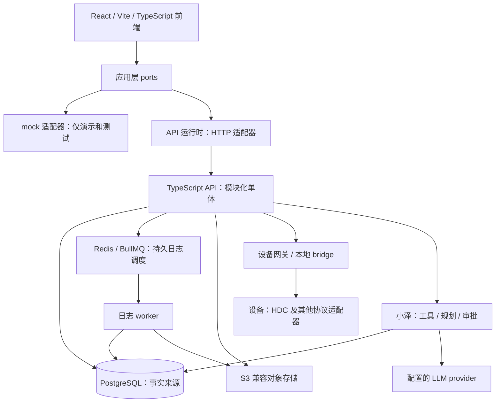

# WiseEff 平台概览

> English: [English](../platform-overview.md)

这份概览面向正在评估 WiseEff 或准备参与开发的外部开发者，阅读约需 15 分钟。你可以在这里了解平台能做什么、各部分如何配合，再通过文中的链接查阅接口契约、操作步骤和验证细节。

## 平台解决什么问题

WiseEff 把工程参数变更、设备调试、日志分析和知识积累放在同一套研发流程中，小泽协助处理这些工作。各模块共用组织、权限、审批和审计规则。工程师发现问题后，可以提出修改、验证结果、审阅变更并保存证据；助手修改设备或生产数据前，仍须获得授权和人工批准。

## 能力地图

下表列出了当前界面的中文导航名称和路由。你能看到哪些页面、执行哪些操作，取决于服务端权限、组织成员身份和项目范围。操作步骤见[用户指南](user-guide/README.md)，访问规则见[权限设计](security/user-permission-design.md)。

| 领域 | 可以做什么 | 入口与专题文档 |
| --- | --- | --- |
| 参数 | 管理规范 Definition 和 Catalog 发布版本，查询、对比项目参数值，通过草稿、提交、审阅和合入完成变更。 | 参数修改（`/parameters`）、变更审阅（`/parameter-review`）、参数后台（`/parameter-admin`）；[Catalog 模型与发布](design-docs/catalog-authoring-and-publication-control-plane.md)。 |
| 调试 | 读取设备节点，在授权和安全检查通过后写入；准备 DTS 重载候选，查看部署记录和验证结果，恢复基线或提升为草稿。 | 节点调试（`/node-debugging`）、参数调试（`/dts-reload`）；[设备实验室手册](runbooks/hdc-device-lab.md)与 [DTS 重载模块](../../server/modules/dts-reload/)。 |
| 日志 | 上传日志并跟踪分析任务，让 Agent 结合领域上下文分析，核对结果证据并生成知识草稿。模型不可用时，不能报告为完整 Agent 分析成功。 | 智能分析（`/logs`）、看板（`/log-dashboard`）、日志后台（`/log-admin`）；[分析运维手册](runbooks/log-analysis-llm.md)。 |
| 知识 | 在组织内创建和发布知识条目，保留不可变修订，从文件中提取正文，并检查索引健康。检索只返回已发布内容。 | 知识库（`/knowledge`）、知识后台（`/knowledge-admin`）；[知识库设计](design-docs/2026-08-12-knowledge-base-design.md)。 |
| 小泽 | 在 API 模式下结合当前上下文调用读取工具、规划任务并引用来源，提出需要人工批准的操作建议。mock 模式不提供 Agent 界面。 | 各工作流共用的助手，没有独立业务页面；[Agent 架构](root/ARCHITECTURE.md)与 [Agent provider 手册](runbooks/agent-provider.md)。 |
| 治理 | 管理组织成员和角色，审批注册与账号激活，查询审计，使用平台控制和就绪检查。 | 组织管理（`/organization`）、审计中心（`/audit`）、平台控制台（`/platform-console`）；[组织管理设计](design-docs/2026-08-19-organization-administration-design.md)与[安全文档](SECURITY.md)。 |

[操作覆盖矩阵](developer/user-operation-coverage-matrix.md)列出了各工作流的验收用例和证据要求。判断本次验收是否通过，还需查看实际运行结果。

## 架构速览

图中展示了各部分的逻辑关系，具体部署可能只启用部分适配器。详细拓扑见[架构地图](root/ARCHITECTURE.md)和[技术文档合集](design-docs/full-stack-architecture.md)。前端通过[运行时装配](../../src/app/appRuntime.ts)，为[应用层 ports](../../src/application/ports/)选择 HTTP 或 mock 适配器。[运行时策略](../../src/infrastructure/http/runtimeMode.ts)默认使用 API，生产构建拒绝 mock。

PostgreSQL 是业务数据的事实来源，保存业务状态、审计、审批及任务生命周期记录。Redis/BullMQ 负责持久日志任务调度；worker 先认领数据库中的任务，再更新进度或终态。本地开发和补偿仍可采用数据库轮询。对象存储用于保存文件产物。相关运行机制见[自托管运行时](runbooks/self-hosted-runtime.md)、[队列实现](../../server/modules/jobs/)和[日志 worker](../../server/modules/logs/worker.ts)。

### 后端主要模块组

以下模块组都位于 [`server/modules/`](../../server/modules/)，随同一个 API 部署，无须分别部署为微服务。

| 模块组 | 职责 |
| --- | --- |
| `auth`、`users`、`projects`、`audit` | 管理身份、组织和项目范围、角色，并记录可追踪的审计。 |
| `parameters`、`parameter-*`、`catalog-*`、`dts` | 按规则管理参数值与变更、规范身份、Catalog 发布与切换，并保留 DTS 原始语法。 |
| `debugging`、`deviceBridge`、`dts-reload` | 对接设备协议，处理快照与回读，管理重载记录的生命周期。 |
| `logs`、`jobs` | 解析和分析日志，认领与重试数据库任务，调度队列并检查 worker 健康。 |
| `knowledge` | 管理条目和修订，提取正文、建立索引，并按访问范围检索。 |
| `agent` | 提供小泽工具、任务规划和审批编排，集成会话与 checkpoint。 |
| `operations`、`release-verification` | 检查健康和就绪状态，核对发布证据。 |
| `notifications`、`product-feedback` | 发送工作流通知，收集和分诊内部 beta 反馈。 |

## 写操作如何受治理

[架构写入模式](root/ARCHITECTURE.md)是：认证 → 服务端授权 → 输入校验 → 事务内领域写入 → 关联审计 → 结构化响应或错误。每一步都必须遵守组织和项目的访问范围，即使前端显示了按钮，服务端也必须检查授权。参数草稿、提交、审阅和合入分别要求对应权限。[参数服务](../../server/modules/parameters/service.ts)实现事务写入和审计，具体策略见[安全文档](SECURITY.md)。

Agent 读取工具沿用调用者的授权，修改工具则必须等待人工批准。`beginApproval` 记录提案，`resolveApproval` 拒绝或批准提案。用户修改参数后，系统先更新提案，再在批准时检查授权并执行。审批状态保存在 `agent_tool_calls` 和 `agent_approvals` 中，因此不依赖进程内存。生产和自托管环境使用 PostgreSQL checkpoint 恢复图执行，本地开发可使用内存。参见 [ADR-0024（英文）](../../docs/adr/0024-agent-approval-state-is-db-backed.md)、[编排器](../../server/modules/agent/orchestrator.ts)及 [checkpointer](../../server/modules/agent/xiaoze/checkpointer.ts)。

设备写入前会检查设备状态和值域，保存基线快照，随后经网关执行并记录审计。普通节点写入后的回读只记录实际观测值，不与请求值做相等判定。「写入成功」表示命令执行成功；要了解 DTS 重载、回滚或恢复的验证结果，应查看各自记录。数据库事务无法保证物理设备 I/O 的原子性。参见[调试服务](../../server/modules/debugging/service.ts)、[DTS 重载服务](../../server/modules/dts-reload/service.ts)、[bridge 模块](../../server/modules/deviceBridge/)和[设备实验室手册](runbooks/hdc-device-lab.md)。

## 平台特点与证据

| 特点 | 含义与边界 | 专题文档或实现证据 |
| --- | --- | --- |
| Agent 人工审批持久化 | 提案须获批准并通过授权检查才能执行。数据库中的审批状态和持久图 checkpoint 支持受控恢复。 | [ADR-0024（英文）](../../docs/adr/0024-agent-approval-state-is-db-backed.md)、[Agent 实现](../../server/modules/agent/)。 |
| 设备写入快照与回读 | 保存基线，记录普通节点的实际回读值，不做相等判定。DTS 重载、回滚和恢复各有验证结果，仍需真实硬件证据。 | [调试服务](../../server/modules/debugging/service.ts)、[DTS 重载服务](../../server/modules/dts-reload/service.ts)、[HDC 验收](runbooks/hdc-device-lab.md)。 |
| 日志分析注明降级 | provider 重试耗尽后可返回规则分析，通过 `analysisSource` 和 `degradedReason` 说明来源与原因。这类结果不能视为完整 Agent 分析。 | [降级实现](../../server/modules/logs/worker.ts)、[分析运维](runbooks/log-analysis-llm.md)。 |
| 无损 DTS 解析与序列化 | 具体语法树保留源文本。未编辑的文档按字节还原；编辑后只拼接被修改属性的文本范围。设备重载行为仍须单独验证。 | [解析器](../../server/modules/dts/parser.ts)、[序列化器](../../server/modules/dts/serialize.ts)、[往返测试](../../server/modules/dts/serialize.test.ts)。 |
| 不可变 Catalog 发布版本 | 发布产物和版本身份只通过新版本更新，不原地修改。发布与采用均有明确的授权和恢复规则。 | [ADR-0040](design-docs/adr-0040-canonical-parameter-catalog-relational-model.md)、[发布设计](design-docs/catalog-authoring-and-publication-control-plane.md)、[数据库约束](../../server/migrations/0140_catalog_publication_control_plane.sql)。 |
| 自托管无需强制依赖 SaaS 平台 | 运行时、数据库、队列、S3 兼容存储和可观测性均可自托管。小泽 live 模式仍需配置 LLM provider；部署者负责身份、存储、模型选择及网络访问。 | [自托管指南](../../ops/self-hosted/README.md)、[Compose 服务](../../ops/self-hosted/compose.yaml)、[provider 手册](runbooks/agent-provider.md)。 |
| 就绪检查要求实际证据 | 就绪与试点验收需要真实 API、数据库、设备和运维证据，不能仅凭代码实现、本地测试或 deterministic 检查通过来判断。 | [验证矩阵](developer/verification-matrix.md)、[运维模块](../../server/modules/operations/)、[README 边界](root/README.md)。 |
| 双语文档检查 | 中英文页面分别维护并互相链接。文档治理检查会核对注册表中必需的双语配对和本地 Markdown 链接。 | [注册表](../../scripts/bilingual-docs.ts)、[治理检查](../../scripts/check-doc-governance.ts)。 |

## 路线图快照：2026 年 10 月 13 日

具体进展以同日更新的[开发路线图](exec-plans/development-roadmap.md)为准。以下列出工作优先级，尚无承诺的完成日期。

- 已交付：M0–M5 基础和大量 M6 自托管实现，包括规范 Catalog 发布与集成、知识发布与检索、Agent 日志分析、DTS 重载、组织管理，以及前端工作台和审阅界面的部分改造。#1143 交付了双语用户指南和平台概览。这里记录的是分支上的交付情况；合并、生产切换和试点验收需分别确认。
- 推进中：#1126 下剩余的前端改造；补全可信来源链路（TD-068/#615，TD-123 单独跟踪）；收集身份、存储、队列、可观测性、容量、设备和分析质量在目标环境及具体领域中的证据。运维工作仍以自托管安装、升级恢复和验证为重点。
- 后续：完成 TD-003 手写客户端契约覆盖，按各自计划补齐证据。专家标注的日志用例、第二个试点领域和人工评判校准仍需外部输入，暂无承诺日期。

## 下一步读什么

| 目标 | 入口 |
| --- | --- |
| 搭建开发环境或评估部署前提 | [README](root/README.md) |
| 理解端到端架构与一致性 | [技术文档合集](design-docs/full-stack-architecture.md) |
| 对接 API | [API 文档](api/README.md) |
| 理解边界背后的决策 | [ADRs 索引（英文）](../../docs/adr/README.md) |
| 提交范围明确、经过验证的变更 | [贡献指南](root/CONTRIBUTING.md) |
| 按自己的角色完成产品操作 | [用户指南](user-guide/README.md) |
