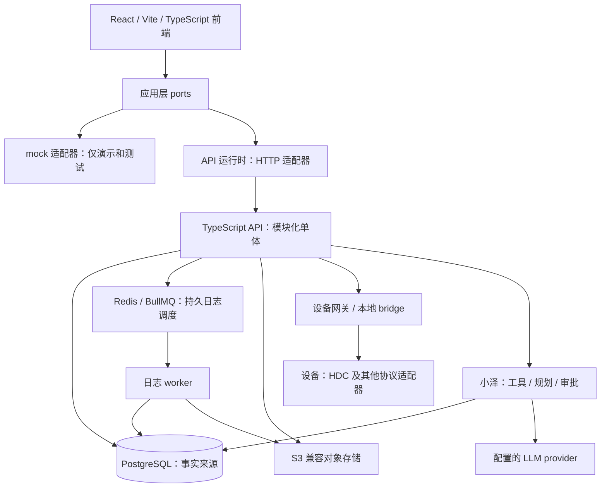

# WiseEff 平台概览

> English: [English](../platform-overview.md)

面向评估或准备参与 WiseEff 的外部开发者，约 15 分钟读完。这里给出平台地图；契约、操作步骤与验证细节仍由链接中的专题文档负责。

## 平台解决什么问题

WiseEff 将工程参数变更、设备调试、日志分析、知识沉淀和小泽辅助工作串在一起，共用组织、权限、审批与审计边界。核心流程是发现问题、提出修改、验证结果、审阅变更并保存证据，而不是让助手悄悄修改设备或生产数据。

**就绪边界：** 当前仓库适合受控 staging 和试点证据收集，**不能泛称为生产就绪**。只有具备真实目标环境的 live API、PostgreSQL E2E、HDC 设备实验室、备份恢复、回滚、身份、队列、可观测性、容量以及小泽 LLM 就绪证据，才能讨论相应验收。这与 [README](root/README.md) 一致，不是部署认证。代码合并、本地测试、模拟演示或单次主机演练都不能替代这些门禁。

## 能力地图

下表使用当前界面的中文导航名称和路由。可见页面和可执行操作取决于服务端权限、组织成员身份及项目范围。[用户指南](user-guide/README.md) 负责操作路径，[权限设计](security/user-permission-design.md) 负责访问规则。

| 领域 | 串联的工作 | 入口与专题文档 |
| --- | --- | --- |
| 参数 | 规范 Definition 与 Catalog 发布版本、项目参数值、对比、草稿、提交、审阅及合入。 | 参数修改（`/parameters`）、变更审阅（`/parameter-review`）、参数后台（`/parameter-admin`）；[Catalog 模型与发布](design-docs/catalog-authoring-and-publication-control-plane.md)。 |
| 调试 | 设备节点读取与受保护写入；DTS 重载候选、部署记录、验证、基线恢复及草稿提升。 | 节点调试（`/node-debugging`）、参数调试（`/dts-reload`）；[设备实验室手册](runbooks/hdc-device-lab.md)与 [DTS 重载模块](../../server/modules/dts-reload/)。 |
| 日志 | 上传与分析任务、结合领域上下文的 Agent 分析、结果证据及知识草稿交接。模型不可用不能伪装成完整 Agent 分析成功。 | 智能分析（`/logs`）、看板（`/log-dashboard`）、日志后台（`/log-admin`）；[分析运维手册](runbooks/log-analysis-llm.md)。 |
| 知识 | 组织内知识条目、不可变修订、发布、文件提取、仅检索已发布内容及索引健康。 | 知识库（`/knowledge`）、知识后台（`/knowledge-admin`）；[知识库设计](design-docs/2026-08-12-knowledge-base-design.md)。 |
| 小泽 | API 模式的助手，结合上下文读取工具、规划、引用和需要人工批准的行动提案。mock 模式不提供 Agent 界面。 | 共享助手，不是独立业务页面；[Agent 架构](root/ARCHITECTURE.md)与 [Agent provider 手册](runbooks/agent-provider.md)。 |
| 治理 | 组织成员与角色、注册及激活审批、审计、平台控制和就绪检查。 | 组织管理（`/organization`）、审计中心（`/audit`）、平台控制台（`/platform-console`）；[组织管理设计](design-docs/2026-08-19-organization-administration-design.md)与[安全文档](SECURITY.md)。 |

[操作覆盖矩阵](developer/user-operation-coverage-matrix.md) 将工作流映射到验收用例与证据要求；矩阵有记录不代表本次验收已经通过。

## 架构速览

这是一张逻辑边界图，不代表每个部署都启用了所有适配器。[架构地图](root/ARCHITECTURE.md)和[技术文档合集](design-docs/full-stack-architecture.md)负责详细拓扑。前端[运行时装配](../../src/app/appRuntime.ts)在[应用层 ports](../../src/application/ports/)后选择 HTTP 或 mock 适配器；[运行时策略](../../src/infrastructure/http/runtimeMode.ts)默认 API，生产构建拒绝 mock。

PostgreSQL 保存业务状态、审计、审批与任务生命周期。Redis/BullMQ 负责持久日志任务调度，worker 必须先认领数据库任务，才能更新进度或终态。本地开发与补偿仍可采用数据库轮询。对象存储保存文件产物，不取代业务事实来源。[自托管运行时](runbooks/self-hosted-runtime.md)、[队列实现](../../server/modules/jobs/)与[日志 worker](../../server/modules/logs/worker.ts)说明这些运维边界。

### 后端主要模块组

以下目录均位于 [`server/modules/`](../../server/modules/)；它们是同一 API 内的模块组，不是各自部署的微服务。

| 模块组 | 职责 |
| --- | --- |
| `auth`、`users`、`projects`、`audit` | 身份、组织与项目范围、角色治理及可追踪审计。 |
| `parameters`、`parameter-*`、`catalog-*`、`dts` | 参数值与受治理变更、规范身份、Catalog 发布及切换、DTS 语法保留。 |
| `debugging`、`deviceBridge`、`dts-reload` | 设备协议边界、快照与回读、重载记录生命周期。 |
| `logs`、`jobs` | 解析与分析、数据库任务认领和重试、队列调度及 worker 健康。 |
| `knowledge` | 条目与修订治理、提取、索引和限定范围的检索。 |
| `agent` | 小泽工具、规划、审批编排及会话与 checkpoint 集成。 |
| `operations`、`release-verification` | 健康、就绪与发布证据边界。 |
| `notifications`、`product-feedback` | 工作流通知及内部 beta 反馈与分诊。 |

## 写操作如何受治理

[架构写入模式](root/ARCHITECTURE.md)是：**认证 → 服务端授权 → 输入校验 → 事务内领域写入 → 关联审计 → 结构化响应或错误**。组织和项目边界必须贯穿全程，前端是否显示按钮不能代替授权。参数草稿、提交、审阅与合入是不同业务步骤，其权限不能互换。[参数服务](../../server/modules/parameters/service.ts)实现事务写入与审计，[安全文档](SECURITY.md)负责策略。

- **Agent 变体：** 读取工具沿用调用者的授权。修改工具必须暂停等待人工批准；`beginApproval` 记录提案，`resolveApproval` 拒绝或批准它。用户编辑后的参数先替换提案，再进行批准时授权与执行。审批状态保存在 `agent_tool_calls` 和 `agent_approvals`，不依赖进程内存。生产及自托管的图恢复使用 PostgreSQL checkpoint，本地开发可使用内存。参见 [ADR-0024（英文）](../../docs/adr/0024-agent-approval-state-is-db-backed.md)、[编排器](../../server/modules/agent/orchestrator.ts)及 [checkpointer](../../server/modules/agent/xiaoze/checkpointer.ts)。
- **设备变体：** 写入前检查设备状态和值域，并保留基线快照；经网关执行后回读验证并记录审计。回读不一致必须如实报告，回滚和恢复本身也受治理。数据库事务不能让物理设备 I/O 变成原子操作。参见[调试服务](../../server/modules/debugging/service.ts)、[bridge 模块](../../server/modules/deviceBridge/)和[设备实验室手册](runbooks/hdc-device-lab.md)。

## 平台特点与证据

| 特点 | 含义与边界 | 专题文档或实现证据 |
| --- | --- | --- |
| Agent 写入的持久人工审批 | 提案不等于执行；数据库审批状态与持久图 checkpoint 支持受控恢复。批准后仍须授权。 | [ADR-0024（英文）](../../docs/adr/0024-agent-approval-state-is-db-backed.md)、[Agent 实现](../../server/modules/agent/)。 |
| 设备写入快照与回读 | 保留基线，验证实际设备结果，而非只相信写入确认；仍需真实硬件证据。 | [调试服务](../../server/modules/debugging/service.ts)、[HDC 验收](runbooks/hdc-device-lab.md)。 |
| 如实降级的日志分析 | provider 重试耗尽后可返回规则分析，明确标注 `analysisSource` 与 `degradedReason`，不冒充完整 Agent 分析。 | [降级实现](../../server/modules/logs/worker.ts)、[分析运维](runbooks/log-analysis-llm.md)。 |
| 无损 DTS 解析与序列化 | 具体语法树保留源文本；未编辑文档按字节还原，编辑时拼接被修改属性的文本范围。这不等于设备重载已验证。 | [解析器](../../server/modules/dts/parser.ts)、[序列化器](../../server/modules/dts/serialize.ts)、[往返测试](../../server/modules/dts/serialize.test.ts)。 |
| 不可变 Catalog 发布版本 | 发布产物与版本身份通过新版本演进，不原地修改；发布与采用有明确授权和恢复边界。 | [ADR-0040](design-docs/adr-0040-canonical-parameter-catalog-relational-model.md)、[发布设计](design-docs/catalog-authoring-and-publication-control-plane.md)、[数据库约束](../../server/migrations/0140_catalog_publication_control_plane.sql)。 |
| 无强制 SaaS 平台依赖的自托管 | 运行时、数据库、队列、S3 兼容存储与可观测性可自托管。小泽 live 模式仍需配置 LLM provider；身份、存储、模型选择及网络访问由部署者负责。 | [自托管指南](../../ops/self-hosted/README.md)、[Compose 服务](../../ops/self-hosted/compose.yaml)、[provider 手册](runbooks/agent-provider.md)。 |
| 基于证据的就绪门禁 | 区分代码实现与真实 API、数据库、设备及运维证据；本地或 deterministic 通过不等于目标验收。 | [验证矩阵](developer/verification-matrix.md)、[运维模块](../../server/modules/operations/)、[README 边界](root/README.md)。 |
| 双语文档门禁 | 中英文页面独立并互链；必需的注册表配对与本地 Markdown 链接由文档治理检查。 | [注册表](../../scripts/bilingual-docs.ts)、[治理检查](../../scripts/check-doc-governance.ts)。 |

## 路线图快照：2026 年 10 月 13 日

同日刷新的[开发路线图](exec-plans/development-roadmap.md)是权威来源。这里只概括优先级，不是交付时间表，也不承诺完成日期。

- **已交付：** M0–M5 基础和大量 M6 自托管实现；规范 Catalog 发布与集成、知识发布与检索、Agent 日志分析、DTS 重载、组织管理，以及前端工作台和审阅界面的部分改造。代码交付不同于生产切换或试点验收。
- **推进中：** #1126 下剩余前端改造；可信来源闭环（TD-068/#615，TD-123 单独跟踪）；身份、存储、队列、可观测性、容量、设备与分析质量的目标环境和领域证据。自托管安装、升级恢复及验证仍是运维重点。
- **后续：** 完成 #1143 下双语用户与开发者入口，以及 TD-003 手写客户端契约覆盖；按各自计划补齐证据。专家标注日志用例、第二个试点领域和人工评判校准仍依赖外部输入，不承诺日期。

## 下一步读什么

| 目标 | 入口 |
| --- | --- |
| 搭建开发环境或评估部署前提 | [README](root/README.md) |
| 理解端到端架构与一致性 | [技术文档合集](design-docs/full-stack-architecture.md) |
| 对接 API | [API 文档](api/README.md) |
| 理解边界背后的决策 | [ADRs 索引（英文）](../../docs/adr/README.md) |
| 提交有界且经过验证的变更 | [贡献指南](root/CONTRIBUTING.md) |
| 按自己的角色完成产品操作 | [用户指南](user-guide/README.md) |
