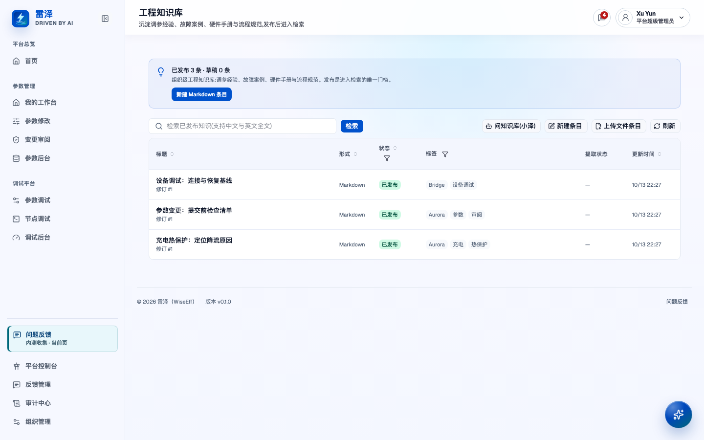
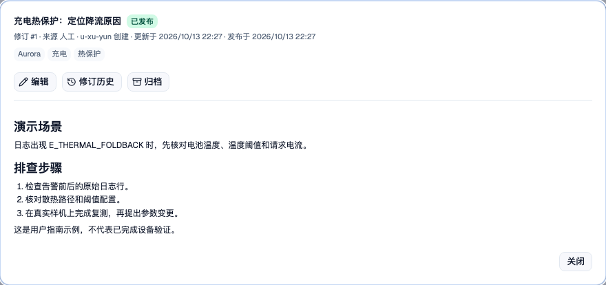
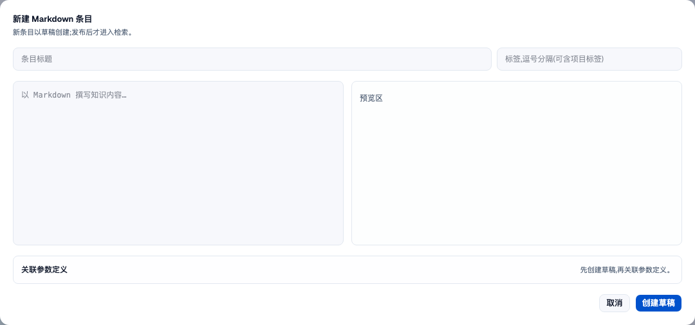

# 查找与维护工程知识

> English: [English](../../user-guide/knowledge.md)

## 谁可以操作

- 当前组织中已启用的成员，具备 `knowledge:view` 即可在知识库（`/knowledge`）浏览和检索。默认角色中的访客、硬件开发、软件开发、硬件MDE、软件MDE、管理员（`admin`）和平台超级管理员（`platform-admin`）都有这项权限。
- 硬件开发、软件开发以及硬件MDE、软件MDE具有 `knowledge:edit`，可以创建条目，并编辑、发布、归档或恢复自己创建的条目。维护他人的条目需要额外权限。
- 管理员和平台超级管理员还具有 `knowledge:manage`，可以维护他人的条目，并在知识后台（`/knowledge-admin`）检查索引健康、处理 Agent 草稿和已归档条目。操作范围限于当前组织。

草稿只有创建者和知识管理员可以查看。具备查看权限的成员可以阅读已发布和已归档条目；知识库和小泽只检索已发布条目。账号与角色设置见[账号与访问](account-and-access.md)。

## 查找已发布的答案

1. 打开知识库（`/knowledge`）。未进行检索时，可以按状态、标签筛选有权阅读的条目。用标签标注项目或主题；知识库没有文件夹层级。
2. 在「检索知识库」中输入问题或关键词，点击「检索」。全文检索支持中文和英文，结果仅包含已发布条目，草稿和已归档资料不会出现。
   新上传或替换的 PDF 会在摘录旁显示命中片段的物理页码，例如「第 3 页」或「第 3–5 页」。页码从 1 开始，可能与文档印刷页码不同。其他格式和旧 PDF 索引保留原有摘录，不显示页码。
3. 打开结果，阅读正文、标签、来源与当前修订。文件条目还应检查正文提取状态；需要时下载原文件核对。
4. 查看页面显示的检索模式，确认语义检索是否可用。实际模式可能是「语义 + 全文混合检索」或「仅全文检索(FTS-only)」。点击「清除检索」可回到条目列表及其筛选条件。

在连接真实 API 的部署中，点击知识库（`/knowledge`）的「问知识库(小泽)」会打开小泽对话面板。请在面板中提出问题，检索框里的文字不会自动发送。小泽可以通过工具查找已发布知识，并提供原条目的引用链接。使用答案前，打开来源核对适用条件。mock 模式不提供这个入口；小泽创建的草稿也需发布后才能被检索。

*包含三条已发布演示知识的知识库，涵盖充电热保护、参数提交检查与设备连接基线。*

*演示条目的正文、标签、人工来源与当前修订；内容不代表真实硬件验证。*

## 创建条目或上传文件

在知识库（`/knowledge`）中，根据资料选择内容形式：

- 选择「新建 Markdown 条目」，填写标题、逗号分隔的标签和正文，可用项目标签标明适用背景。检查预览后，点击「创建草稿」。
- 选择「上传文件条目」，填写标题与标签，选择文件，点击「上传并创建草稿」。每份上传资料创建独立条目。

Markdown（`.md`）和纯文本（`.txt`）上传后成为可编辑的 Markdown 草稿，须为 UTF-8 编码，正文不超过 200,000 字符，单个文件不超过 20 MB。之后可在平台中编辑并保存为新修订。分析技能工作区的「上传 Markdown / 文本」使用相同转换，并把新草稿链接到技能；需要保存技能草稿才能保留链接。以前已存为文件条目的 Markdown 上传保持原有形式。

PDF 和 Word `.docx` 保留为文件条目，原件只能替换，不能在 Markdown 编辑器里修改。没有可提取正文的文件会在列表标为「不可检索」，详情中显示提取原因；应替换为包含文本的版本，单纯发布不能让其正文可检索。文件选择器也接受旧版 `.doc`，但提取器不支持这种二进制格式，应转换为 `.docx` 后替换。

列表的来源列与来源筛选区分「手动编写」「上传」「沉淀」「小泽草稿」「技能包导入」。来源说明资料从哪里来，不授予访问权限，也不会让草稿进入检索。

新条目都从草稿开始。发布前核对正文、适用条件和来源证据，发布后资料才能进入检索或供小泽检索。

如果小泽创建的草稿引用了降级的来源日志分析，平台会在正文顶部自动加入来源提示，与沉淀草稿中的提示相同。提示会标明「降级分析 · 规则回退」或「降级分析 · 提前收敛」，说明原因，并提醒使用结论前复核证据。正文开头已有完全相同的提示时，不会重复添加。未降级的分析、未记录分析来源的旧分析，以及没有来源日志的草稿保持原样。提示属于可编辑的草稿正文，不会阻止发布，也不保证内容质量。

*已有演示知识旁的新建条目对话框；截图未额外创建草稿。*

## 批量导入文档

在 `/knowledge` 点击「批量导入」，选择多份 PDF、DOCX、TXT、MD 文件或一个 `.zip`，可填写逗号分隔的批次标签。每批最多 200 个文档、解压后总计 100 MB，每个文档最多 20 MB，ZIP 文件夹最多嵌套 20 层。文件夹名与批次标签一起成为条目标签，不会创建文件夹层级。每条最多 20 个标签，每个标签最多 60 字符；文件夹名被截断或超额标签未添加时，报告会逐条提示。

点击「开始导入」后可查看逐文档进度。每份支持的文档创建独立草稿；与有权阅读的条目字节完全相同的文件会报告为重复并跳过，不覆盖已有内容，内容改变则创建新草稿。导入报告列出已创建、重复跳过、格式不支持、提取失败和导入失败的文档，提供可用的条目链接及标签提示。提取失败的文件草稿仍保留，可替换文件。核对报告并审阅草稿后再发布。关闭对话框或离开页面不会取消已提交的文档；汇总失败时可「重试汇总」，保留逐文档结果，无须重新上传。

## 批量管理条目

在列表选择条目后，可「添加标签」「移除标签」「发布」或「归档」，每批最多 200 条。标签操作保留其他标签与正文；发布适用于草稿，归档适用于已发布条目，退出检索但保留历史。每条分别检查权限：创建者需要编辑权限，知识管理员可维护他人的条目。结果表逐条显示成功或拒绝原因，一条失败不撤销其他条目的成功操作。

## 从参数定义关联知识

在参数定义详情点击「关联已有知识」，选择自己有权维护的未归档条目：创建者需要编辑权限，知识管理员可维护他人的条目。关联记录明确的定义引用，不会自动发布知识；定义相关检索只返回已发布的引用条目。技能中的已归档链接仍显示为「已归档，不参与检索」，已删除条目显示为「已删除」，均可取消链接。

## 发布并修订条目

1. 在知识库（`/knowledge`）打开自己创建的草稿，或作为知识管理员打开有权维护的草稿，点击「发布」。发布后，条目才能进入检索，索引更新也会加入队列；索引可能需要一段时间才能完成。
2. 修改 Markdown 条目时，点击「编辑」，完成修改后选择「保存为新修订」。文件条目则点击「替换文件」，选择新文件，再点击「替换并生成新修订」。旧文件会保留在修订历史中。
3. 每次保存内容都会追加一条不可变修订。已发布条目保存后仍为已发布，没有「待审批修改」状态。保存前核对内容：这次保存会直接更新已发布正文，并触发索引更新。
4. 打开「修订历史」查看旧版本。对于未归档的条目，有编辑权限的创建者或知识管理员可以点击「恢复此版本」，再确认「恢复为新修订」。恢复会追加修订，原有历史和条目的发布状态保持不变。

若提示当前修订已被他人更新，说明本次保存遇到冲突，尚未成功。先保留自己的改动，再刷新条目、核对差异，并基于最新修订重试。

## 归档过时资料或恢复发布

在知识库（`/knowledge`）打开有权维护的已发布条目，点击「归档」。归档后，条目会退出检索，正文和历史仍保留。以后可用「已归档」状态筛选找到它，点击「恢复为已发布」可重新发布。修改归档条目的正文前，需要先恢复发布。

知识管理员也可在知识后台（`/knowledge-admin`）的已归档列表中恢复条目。「彻底删除」需要在确认时勾选声明，会永久删除条目及全部修订，无法恢复。如果只是停用过时资料，选择归档即可。

具备 `knowledge:manage` 的管理员还可以在知识库（`/knowledge`）的人工草稿详情，或列表行的「更多」菜单中直接「彻底删除」，无需先发布或归档。核对确认范围并勾选不可恢复的确认后，才会执行删除。删除会清理条目、全部修订、文件元数据、参数关联引用及检索索引记录，保留审计。按现有删除契约，存储中的原始文件仍然保留；其他知识条目、共享参数定义和来源日志不被删除。取消不修改草稿；请求失败时保留确认框及错误，可重试。若其他管理员已经删除该条目，会提示内容不存在或已被移除，可关闭弹窗后刷新列表。

知识管理员还可以在知识后台（`/knowledge-admin`）的 Agent 草稿队列中，核对创建者及可用的会话或来源链接，审阅后发布，或拒绝并归档。「草稿直接拒绝归档」只适用于 Agent 草稿；普通草稿须先发布，才能使用常规归档操作。

## 查看索引健康并发起重建

知识管理员打开知识后台（`/knowledge-admin`），进入「检索索引健康」区：

1. 检查检索模式提示。「仅全文检索(FTS-only)」表示语义检索降级或不可用，不表示全文检索已停用。页面还报告 pgvector 是否可用、嵌入端点是否已配置；部署问题请交给运维处理。
2. 查看各条目的发布状态、已索引修订号、索引状态、分块数量及失败原因。索引状态包括「排队中」「索引中」「已索引」「失败」。将已索引修订号与条目当前修订核对，确认最新内容是否已经处理。
3. 对有问题的条目，先阅读失败原因并处理根因，例如替换正文提取失败的文件，再点击「重试」。格式不支持或服务不可用时，需要先解决这些问题，反复重试没有帮助。
4. 需要重新处理已发布条目的索引时，点击「全量重建索引」。提示中的数量是已重新加入后台队列的已发布条目数，只说明任务已入队；是否完成还需查看结果。点击「刷新」查看处理结果与剩余失败。

索引失败可能出在正文提取或嵌入生成上。判断全文检索是否可用时，应结合失败原因和实际检索模式，不能只看失败标记。

## 查找维护中的参考资料

- [账号与访问](account-and-access.md)：注册与角色管理。
- [知识检索架构决策](../../adr/0025-knowledge-retrieval-lives-in-postgres.md)：供开发者和运维查阅的检索架构说明。
- [用户操作覆盖矩阵](../developer/user-operation-coverage-matrix.md)：仓库中的知识操作与验收测试索引，不代表当前部署已经通过验收。
