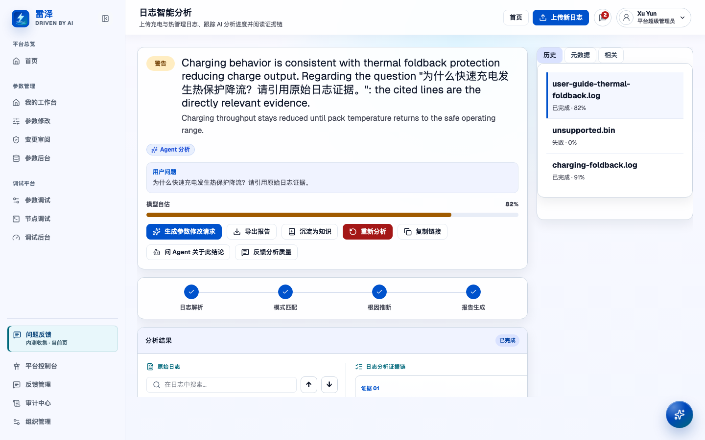
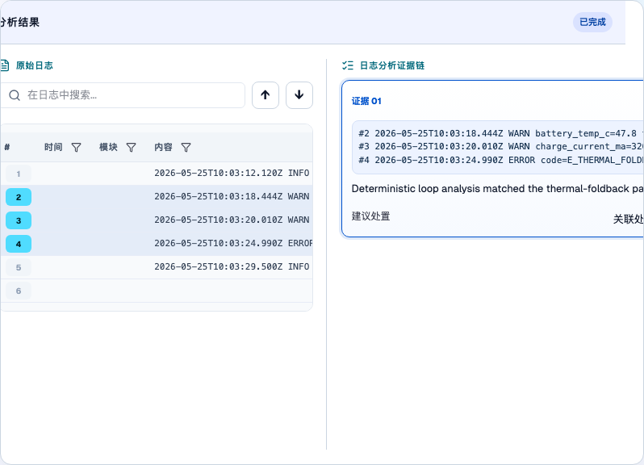

# 分析日志

> English: [English](../../user-guide/log-analysis.md)

## 谁可以使用

「日志分析」分组下的「智能分析」（`/logs`）供硬件开发、软件开发、硬件MDE、软件MDE、管理员（`admin`）和平台超级管理员（`platform-admin`）使用，访客不能进入。查看记录需要 `logs:view`。上传日志需要有效账号及 `logs:upload` 权限，提交分析质量反馈需要有效账号及 `logs:feedback` 权限。标准非访客角色包含这些权限，但只能访问所在组织范围内的记录。

将报告沉淀为知识草稿还需要 `knowledge:edit`。管理员具备 `logs:admin-domains` 时，可以在「日志后台」（`/log-admin?tab=skills`）维护分析技能。本指南介绍真实 API 模式下的流程。模拟模式只模拟上传，无法确认分析或反馈是否已保存到服务端。

在 API 模式下，具备 `logs:admin-domains` 的本组织当前有效管理员可在 `/log-admin?tab=records` 的活跃或已归档记录行选择「删除影响预览」。预览统计所选记录的原始文件、文件及行索引、解码产物、分析运行、阶段、报告、证据、轨迹、反馈、站内通知、投递和任务。核对范围、勾选永久删除确认后，点击「彻底删除」。服务端重新检查预览和当前管理员身份；预览变化时重新获取，上传或投递正在进行时稍后重试。排队及在途分析无法重建已删除的数据，旧日志列表、详情和原文入口随之移除。

共享物理对象、分析技能及修订、源码快照、独立测试用例、独立知识正文、已保存引用和历史继续可用。保留知识显示「来源已删除」，不再链接旧日志；独立内容不会被改写，也不调整保留期限。既有日志审计保留事件身份、操作人和时间，内容载荷替换为已删除标记。数据库删除和不含原文的审计同时提交，存储清理单独显示结果。存储不可用时可「重试存储清理」，刷新后台后也能从待清理回执继续；删除响应丢失时以持久化回执确认结果。

## 从模板到结果回调

1. 在日志后台点击「新建技能」，填写名称，选择通用文本、Linux 内核 dmesg、Android logcat、JSON Lines 模板，或复制已有技能。可附加不超过 2 MiB 的文本样例，然后进入工作区。
2. 在「样例与解析」选中一行样例，用抽取器构建器为片段命名。在「解码」新增寄存器或帧，并绑定抽取字段。在「信号」选择解码字段，填写条件、信号名称和级别。这些步骤均可使用表单，代码视图是可选项。
3. 检查样例预览，在「测试」添加解析测试和分析用例，并执行「试运行」。检查结论、信号证据和轨迹。保存草稿，在发布对话框核对测试结果和变更后发布。测试结果供发布决策参考，不阻止发布。
4. 若要迁移技能，在「版本」导出技能包，在目标组织导入。检查导入的知识草稿，另行上传所需样例和源码快照。
5. 打开已发布技能的「集成」。按需配置模型与预算，保存并发布这些版本设置，再配置结果回调并发送测试投递。签发凭据，安全保存只显示一次的密钥。将技能标识、上传地址和请求示例复制到上传系统。
6. 推送日志包，用同一凭据读取记录和报告，验证结果回调签名后再处理投递。[集成指南](../api/log-analysis-integration.md)提供准确的请求、验签方式、限制与重试行为。

工作区分为「概览」「诊断流程」「样例与解析」「解码」「信号」「知识」「源码」「测试」「集成」「版本」。样例面板在各表单分区间保留；「诊断流程」「源码」「版本」隐藏样例面板，为任务区留出更多空间。草稿栏区分已保存但未发布的更改和已发布版本。源码快照、分析用例各有独立生命周期，运行前需确认其状态。

在技能列表的行菜单中选择「改名」，或对已归档技能选择「恢复」。两项操作均保留原技能身份、版本、历史分析和链接。同名冲突会指出实际占用技能并提供查看链接，可换一个名称或检查该技能；请求失败时保留输入以便重试。恢复沿用现有发布规则，不会重新启用已吊销的集成凭据。

## 编写诊断流程

在 API 模式下，具备 `logs:admin-domains` 的管理员可以在 `/log-admin?tab=skills` 打开技能，选择「诊断流程」。没有流程时，Markdown 编辑器预填五个标题：适用场景、先检查什么、根因判定、常见误判、建议动作。切换「编辑」和「预览」检查文本，计数器显示 20,000 字符上限。

保存草稿，在发布对话框查看流程文本的前后对比，再发布以创建新版本。「放弃草稿」删除已保存的草稿和未保存的更改，恢复当前已发布版本。草稿修改不会改变排队中的分析或显式钉住旧版本的重新分析；新上传使用当前已发布版本。流程只指导只读 Agent，不能授权写操作或替代日志证据。规则回退分析忽略流程。

## 创建抽取器与配置基础格式

打开技能的「样例与解析」分区。在右侧常驻样例面板或分区中选择一行，点击「从此行创建抽取规则」。点击片段或按住 Shift 点击选择范围，为每个字段命名并选择类型。键值对会作为自然片段；数值、十六进制寄存器和引号字符串可以泛化。默认开启「泛化未选中的数字（时间戳、计数）」；关闭后保留这些数字的字面量。构建器优先使用基础格式中的时间戳模式识别行首时间戳，否则识别方括号中的 dmesg 数字时间戳；此元数据前缀变为可选，消息内容仍保持首尾锚定。添加抽取器前，检查生成的模式、命中数、覆盖率和命中行；末尾空行不计入覆盖率。「高级」是紧凑的展开按钮，展开后可直接编辑 RE2 模式并查看校验错误。手动编辑后会显示状态，说明模式不再随片段自动生成；点击「按片段重新生成」可恢复自动生成。编辑已有抽取器使用同一构建器。样例面板用不同颜色、规则 id 和文字图例标识各规则的命中行。

「基础格式」表单编辑现有 `formatProfile`：时间戳模式、错误／警告／信息级别模式，以及缩进接续或起始模式两种多行规则。实时样例预览显示检测到的时间戳、每行级别和条目分组的原始行号。时间戳优先取第一个捕获组；级别依次检查 error、warn、info，首次命中生效。模式使用 RE2。代码视图编辑同一个 JSON 对象，往返不会转换现有画像。无效代码或模式必须修正后才能保存或发布。表单不会迁移画像或改变解析语义。基础格式实时预览限前 500 行、1 MiB，单行最多 6144 字符。

## 配置适用文件和角色

在技能工作区打开「样例与解析」，使用样例流程旁的「适用文件」区块。把适用范围放在这里，方便编辑时直接用同一份样例日志包核对路径。每行填写路径通配，可选填「主日志」「内核」「充电」「配置」等短角色；建议值不限制自定义标签。可上移、下移调整顺序，也可删除。第一个匹配行决定角色，即使该行的角色为空，也不会继续取后续行的角色。没有配置行时，技能适用于所有文件。

通配区分大小写，匹配完整的包内相对路径。`*` 不跨目录，`**` 可跨目录，`?` 匹配一个非斜杠字符，`[0-9]` 等字符类匹配一个字符。例如 `charger/**` 匹配 `charger/charger.log`，不匹配 `kernel/dmesg.log` 或 `Charger/charger.log`。最多配置 100 条通配，每条最多 256 字符，角色最多 40 字符；校验会指出对应行和字段。

上传样例日志包或单个文本样例后，编辑时可直接看到每个样例文件的「匹配／未匹配」状态及角色。单文件样例显示一条记录。预览与实际分析使用同一匹配器及相同规则顺序。保存并发布后，配置用于新分析。只有匹配文件会应用所钉技能的信号规则、抽取器和解码；抽取器自身的文件过滤仍需同时满足。其他可分析文件继续产生通用信号，Agent 也仍可读取。

## 编写信号规则

字段选择器按抽取器和解码器分组。可选择寄存器位域、帧物理量（有声明时显示单位），或 `.meaning` 枚举含义。例如 BQ25890 的 `addr=0x0C val=0x20` 经 charger 映射解码后，可用 `charger.val.fields.CHRG_FAULT.meaning` 等于 `thermal_shutdown` 触发信号。含义的相等/集合比较提供可选枚举值；数值阈值使用缩放后的解码值。路径从 `extractorId.captureName` 开始，经 `.fields.NAME` 遍历，可用 `.value` 或 `.meaning` 结尾。重复帧/TLV 元素用 `.fields.*` 表示任一元素，如 `pd.pdo.fields.pdos.fields.*.fields.voltage.value`；不支持数字索引。缺失或出错字段不命中。这些信号在报告证据中引用日志行，并参与规则回退。

打开技能的「信号」分区，以「当条件满足时，产生指定名称和级别的信号」句式添加规则。条件支持有界 RE2 消息正则、将抽取字段 `extractorId.fieldName` 与标量、数值范围或集合比较，以及同一文件内的时间窗计数。一条规则的多个条件为“或”关系。可以调整规则顺序或删除规则。非法字段显示校验路径，并阻止保存或发布。

在右侧常驻面板上传样例。规则有效时，停止编辑片刻后会自动预览。收起的规则卡片显示句式摘要和命中次数；展开后可编辑条件，点击命中行号标签会高亮样例中的对应行。兼容条件显示可读说明，可在代码视图编辑。达到上限时会说明结果不完整。预览在服务端使用未保存规则。保存并发布后，规则用于新上传；草稿修改不会影响运行钉住的版本。种子「充电」技能包含现有充电规则，未选技能的上传保留原有充电预筛，同时也产生平台通用信号。

## 接入外部上传系统

在技能工作区打开「集成 → 集成凭据」。有 `logs:admin-domains` 的管理员可签发命名凭据，默认勾选「绑定到当前技能」。列表显示名称、绑定技能、状态、创建时间与最近使用时间。未绑定凭据可向本组织的其他技能上传。复制技能标识与上传示例，将凭据占位符替换为密钥管理工具中的值。

签发、轮换后的密钥仅显示一次。复制并安全保存，勾选确认后才能关闭。轮换立即使旧密钥失效，请同步更新上传系统。撤销需确认，且不能恢复。归档技能会撤销绑定的凭据。凭据仅能上传和读取自身记录、报告与文件，不能访问管理接口或其他上传者的记录。有 `logs:view` 的用户照常查看这些记录；「元数据」显示上传所用凭据。

在「集成 → 结果回调」输入接收地址和签名密钥，启用投递并保存。密钥只写不读，留空保留已配置值。发送测试投递，在「最近投递」检查尝试次数、HTTP 状态或错误以及重试状态。回调配置和凭据生命周期独立生效，无需随技能的模型与预算设置一起发布。试运行和分析用例不发送结果回调，请用正常上传检查完整接入流程。

## 在技能中解码寄存器

在 `/log-admin?tab=skills` 打开技能，选择「解码」。新增寄存器，填写 id 并选择位宽（8、16、32 或 64 位）。字段表可编辑包含两端的高低位、名称、枚举标签、比例、偏移、单位、有符号和说明。位段必须位于位宽内，不能重叠或重名。位条从高位到低位排列，除颜色外还用字段名称和位范围标识每个区段。

点击「粘贴寄存器表」导入数据手册中的行，上限为 64 KiB、512 行。粘贴位、名称、说明三列，可用制表符、逗号、多个空格或竖线分隔。位支持 `7`、`7:5`、`[7:5]` 和 `7-5`。先检查可导入与无法识别的行数及解析预览：表头会跳过，无法解析的行逐行显示错误图标和原因。点击「替换当前字段并导入」会用有效行替换当前寄存器的全部字段，保存前再次检查位范围。

对于按地址或消息 id 输出的寄存器日志，新增寄存器映射，选择判定字段，逐项填写匹配值与寄存器 id，也可填写默认项。将抽取器的整数或十六进制值字段连接到寄存器或映射。YAML 代码视图与表单编辑同一份解析规范，完整配置见 [BQ25890 示例](../design-docs/log-parsing-v1.md#寄存器与寄存器映射)。没有默认项的未知匹配值会记录事件错误，不停止分析。

编辑时右侧样例面板常驻。选择命中的样例行，服务端会预览未保存的规范，位条显示各字段的解码值和枚举含义。使用 BQ25890 REG0C 时，`addr=0x0C val=0x20` 得到 `CHRG_FAULT` 为 2（`thermal_shutdown`），`WATCHDOG_FAULT` 和 `NTC_FAULT` 均为 0。有符号字段先按补码解释，再计算比例和偏移；单位与物理值一起显示。预览与数据手册一致后保存并发布。完成的报告在引用行下展示原始寄存器值、嵌套解码字段、含义和单位。

## 在技能中解码协议帧

在同一「解码」区的帧列表中新增帧，填写 id，选择默认字节序（省略时为大端）。按顺序添加字段行，类型包括无符号/有符号整数、字节、嵌套寄存器或帧、switch、repeat、TLV 和校验和。整数字段使用 1、2、4 或 8 字节，可配置比例、偏移、单位和枚举含义。偏移自动更新；变长内容之后显示相对偏移，例如 `+2 after payload`。

变长布局的字节长度、switch 判定字段或 repeat 计数可填写先前解码字段的路径；`hdr.num_objects` 等嵌套路径可使用先前解码的头寄存器。repeat 也支持常量计数及固定倍数。switch 按值选择帧或寄存器，可配置默认项；十进制和十六进制分支键按整数值比较。TLV 根据配置的 tag、length 宽度读取记录，已知 tag 应用对应定义，未知值保留原始字节。校验字段可选 `sum8`、`xor8`、`crc8`、`crc16-ccitt`、`crc16-modbus`、`crc32`，并设置覆盖范围及存储字节序。范围相对所在帧，不得包含存储校验和的字节，也不得与其他校验字段的覆盖范围重叠。

将抽取器的十六进制或字节捕获连接到帧，再选择右侧常驻样例面板中的命中行。编辑器默认选择该行解码的顶层帧，并显示完整载荷。服务端预览未保存草稿，各字段行旁显示解码值。十六进制视图按列宽每行显示 16、8 或 4 字节，并同步偏移栏：选择字段会描边标出对应字节，选择字节会选中对应字段；repeat 的每一项也可单独选择，标出该项的字节范围。描边与字重提供颜色之外的标识，不改变单元宽度。普通整数同时显示十进制与十六进制，带单位或枚举含义的值保持原样。寄存器位条会查找帧中的嵌套实例并显示字段路径；同一寄存器出现多次时，可选择要查看的位置。已知帧错误显示中文警告，悬停可查看原始详情。校验和状态在行内显示，失配保留为解码错误，分析继续。报告及 Agent 解码事件工具使用同一棵嵌套字段树。

单帧最多 4096 字节，帧与寄存器合计最多嵌套 8 层，每个 repeat 最多 256 项，单事件解码元素合计最多 1024，每个 TLV 字段最多 256 项。帧输出还共享事件/运行大小、字段数和时间上限。保存前修复带路径的校验错误；运行时超限及校验和失配记为事件错误。YAML 代码视图往返保留相同定义。[帧规范与 USB-PD 示例](../design-docs/log-parsing-v1.md#字节布局帧)演示两个 PDO 解码为 5000/9000 mV、3000 mA。

## 为技能链接知识

在 `/log-admin?tab=skills` 打开技能，选择「知识」。列表显示已链接条目的标题、发布状态、当前修订与更新时间。「取消链接」只从技能草稿移除该条目，不删除知识条目。

不可读条目显示「无权查看的条目」及其 id，不显示标题、标签、状态、修订或更新时间。日志管理权限不会授予知识读取权限。报告来源也会隐藏不可读条目的修订 id，保留已记录的条目 id。

- 点击「链接已有条目」，搜索并选择本组织已发布的条目，将其加入草稿。不能链接其他组织的条目。
- 点击「上传 Markdown」，或将多份 `.md` 文件拖入上传区，创建知识库草稿并链接到技能草稿。创建沿用知识库正常流程与审计。在知识库中检查并发布各条目后，分析才能检索它们；上传不会自动发布。
- 提交前检查各文件的大小和校验提示，移除不需要的文件。文件须为 `.md`，每份最多 20 MiB、正文最多 200,000 字符。部分失败时，对话框保留失败原因和成功结果；重试只会创建失败的文件。
- 上传除技能管理权限外，还需要 `knowledge:edit`。缺少权限时，禁用操作旁会说明原因。链接已有已发布条目不会授予知识编辑权限。

保存并发布技能草稿后，新分析才会使用该链接集合。运行按其钉住的技能版本选择条目，因此后续技能编辑不会改变该集合。未发布和已归档知识不参与检索。报告来源信息记录分析期间实际返回的条目与修订 id，不会把所有已链接条目都算作已使用。后续知识编辑不会改写该运行已记录的来源。

## 用解析测试检查解码规则

测试文件名（含默认的 `sample.log`）遵循技能适用文件规则及抽取器自身的通配，未匹配时仅使用通用解析和信号，结果详情显示「未匹配适用文件 · 仅通用分析」，帮助判断技能字段缺失的原因。

技能工作区的「测试」分区包含「解析测试」和「分析用例」两个标签页，默认打开「解析测试」。切换标签页会保留各页的编辑内容和已显示结果。以 `?section=tests&tab=parse` 或 `?section=tests&tab=cases` 结尾的链接可直接打开对应标签页。

在「解析测试」标签页，从右侧常驻样例面板选中一行，再点击「新增测试」。新测试预填该行及当前解码字段；没有选中行时可自行填写输入。填写名称，核对输入行和可选文件名，然后在字段路径表中编辑或删除期望。值接受 JSON 或普通字符串。例如，上述 BQ25890 样例的 `val.fields.CHRG_FAULT.meaning` 应为 `thermal_shutdown`。批量编辑期望时可切换到 JSON 代码视图，修改后点击「应用期望代码」。

期望字段按子集匹配，允许额外的解码字段。标量期望比较转换字段的 `value`，因此 `val: 32` 检查原始 `0x20` 的数值；需要检查原始表示时填写 `val.raw`。嵌套寄存器字段填写完整路径。期望信号接受规则 id 或名称，不区分顺序和重复命中；开启精确信号匹配后，多出的信号也会使测试失败。

每次保存草稿都会运行测试。「解析测试」标签页工具栏的「运行测试」也可按需检查当前编辑。标签上紧凑显示通过数/总数、「未运行」或「运行中」；列表显示各项状态，失败详情保留在标签页内。选择失败项后内联显示「字段路径 · 期望 · 实际」，并列出缺失和多出的信号。编辑规范后显示状态清空，直到下次运行。解析测试复用 Worker 的解析引擎与信号规则，不调用模型。

测试保存在草稿中，随版本发布。每技能最多 50 项，每项最多 200 行；全部测试合计最多 5000 行、1,048,576 个输入字符、执行一秒。无效或超限输入需先修正；执行达到上限或出错时显示测试失败。信号规则、字段、传输与输出上限详见[解析测试参考](../design-docs/log-parsing-v1.md#解析测试)。最近一次结果只保留在打开的工作区，刷新后状态清空；再次保存或运行即可重新计算。

发布前服务端重新运行解析测试。发布对话框在变更对比之前，用同一个「发布前测试」区块展示两类测试摘要。解析测试摘要显示通过数/总数，失败项链接打开「解析测试」标签页；分析用例的运行入口打开「分析用例」标签页。变更摘要按名称列出新增、修改和删除的测试；修改项标明样例行、期望字段等受影响部分。区块统一提示：测试失败或尚未运行均不会禁用「发布」。核对结果后由作者决定是否发布。

## 在样例上试运行草稿

在技能工作区（`/log-admin/skills/:skillId`）上传技能的样例日志，再点击「试运行」。此操作需要 `logs:admin-domains` 权限及 API 模式。它先将待保存修改存为草稿，再使用已配置的分析器，在已存样例上运行该草稿；配置真实模型时会调用真实模型，无需先发布。后续编辑或替换样例不会改变已启动的运行。

右侧抽屉展示进度、最终结论与证据，以及按顺序排列的分析步骤。步骤上方汇总步骤数、工具调用次数和已报告的输入/输出 token 数，并标记提前收敛或降级。使用结果前，先核对这些警告。每步展示工具、有界参数摘要、结果大小、返回行引用、结果状态及可用的 token 数。试运行没有日志记录，轨迹的 `file:line` 引用仅展示文本；证据标签仍可在日志查看器抽屉检查本次捕获的样例。轨迹不展示或保存提示词、诊断流程正文、知识正文或模型服务载荷。

每组织同时只能执行一次试运行，跨 API 实例默认总共最多两次。管理员可将 `LOG_DRY_RUN_MAX_CONCURRENT` 配置为 1–4，无效值回退为 2。并发已满时提示「试运行繁忙，请稍后重试」，不启动分析。运行受分析预算与超时约束。启动恢复和状态读取会检测所属进程已消失或截止时间已过，将运行标为失败，提示「服务重启，试运行已中断」，抽屉提供「重试」。试运行不会出现在 `/logs`、计数或搜索中，也不会发送结果 Webhook。每技能保留最近 10 次运行，更早的已完成或失败运行及其轨迹会被清理。

## 用分析用例评估草稿

在技能工作区的「测试」分区选择「分析用例」标签页。只有完整运行的结果与已保存草稿及用例保持一致时，标签才紧凑显示通过数/总数，否则显示「未运行」。用例归属技能身份，跨版本保留，包含原始上传日志包、文件清单和期望。新增日志包，填写期望根因、关键证据和建议动作；正确结果应为拒答或降级时，设置相应期望。添加证据行时选择文件，再选择行号或 RE2 模式。新选择的压缩包需要填写包内文件的相对路径，压缩包名称不能作为证据文件。必填字段有标记，校验消息显示在对应字段旁。保存前可编辑期望。

对已保存草稿运行单个或全部用例。保存草稿期间，工作区会锁定编辑与导航，直到保存完成。服务端使用已配置的分析模型和现有质量评分；配置 judge 时使用 judge，否则使用确定性期望检查。同一输入还会运行上一已发布版本。评分统一显示为百分比，运行降级会在得分旁明确标出。展开用例，可并排比较两个版本的证据召回率与精确率、命中与遗漏行、根因与建议动作得分、类别匹配、期望与实际拒答，以及幻觉行；分析轨迹入口也在详情中。失败或中断不算通过。用例与运行均有上限，与试运行共享准入限制，不产生日志列表记录、统计、搜索结果或结果 Webhook。

发布对话框的「发布前测试」区块仅在结果与已保存草稿和用例保持一致时，展示分析用例的通过数量和版本比较；否则显示「未运行」，并提供前往「分析用例」标签页运行的入口。

对于已完成且绑定技能的报告，拥有 `logs:admin-domains` 的管理员可以点击「存为测试用例」。编辑对话框列出将保留的原始上传文件及大小，并将报告结论预填为期望根因，引用的文件与行号预填为关键证据，建议预填为期望动作。模型服务故障与 token 预算耗尽不会被复制为期望拒答或期望降级；只有真实模型针对内容的拒答才会预填为期望拒答。来源报告降级时，对话框会提示人工核对期望。确认或修改后保存；用例保留原始上传字节，不使用报告中截断的预览。

通过「导入」「导出」以 [`eval-cases/logs` 格式](../../../eval-cases/logs/README.zh-CN.md)的 ZIP 迁移用例。「导入用例」按钮打开文件选择器，导入结果或错误显示在本区的状态区域。导入会在保存前校验标注、日志文件、路径与大小限制。请保留导出的目录结构；校验错误会指出需要修复的具体文件和字段。

## 在组织间迁移技能

在 API 模式下，打开 `/log-admin?tab=skills`，点击工具栏的「导入技能包」。选择 `.zip` 包，为第一个版本选择「草稿」（默认）或「已发布」，然后导入。可选的「技能名称」覆盖包内名称，留空则使用包内名称。对话框逐行显示校验结果，保留精确包内路径与字段，例如 `signals.yaml › rules[2].anyOf[0].field`，并附中文说明。修复列出的文件后重试。失败时不会创建技能、知识条目或用例。技能名称重复时，对话框会聚焦名称字段，并建议「<名称>（导入）」；修改名称即可重试，无需编辑 ZIP。成功后点击「打开技能工作区」。

在工作区的「版本」分区点击「导出技能包」。默认导出已发布版本，也可选择已保存的草稿；导出草稿前先保存当前编辑。ZIP 包含诊断流程、解析与信号规则、解析测试、链接知识的 Markdown 和分析用例。在 WiseEff 之外编辑包文件前，请先阅读[技能包格式参考](../design-docs/log-parsing-v1.md#技能包)。

导入和导出均需要 `logs:admin-domains`，且由真人账号发起。含知识的包还需满足现有知识访问／编辑权限。导入的知识条目始终是链接到新技能的草稿，即使技能选择以「已发布」导入；在知识库审核并发布条目后，分析才能检索它们。目标组织会重新分配技能与知识 id，Markdown 元数据中的来源 id 仅供追溯。源码快照与工作区样例不在包内，请在目标工作区单独上传。同一用例保留日志原始字节与规则，但模型回答仍可能随模型配置、可用的已发布知识或源码快照而变化。

## 上传日志并选择技能

1. 打开「智能分析」（`/logs`），点击「上传新日志」。
2. 选择或拖入 `.log`、`.txt`、`.csv` 或 `.json` 文本日志。真实 API 模式可以将多份文本文件合并为一条分析记录，也可以上传一个 `.gz`、`.zip`、`.tar`、`.tar.gz` 或 `.tgz` 压缩包，由服务端解包。
3. 可以填写「分析问题」，例如询问哪些事件导致温升。如果需要关联参数，先选择项目，再选择一个当前项目参数。完成这两步后，参数才会关联到日志。
4. 检查技能选择。系统根据文件名和有界的文件开头内容，对本组织已发布技能评分，期间显示轻量加载提示。存在明确匹配时会预选技能，并显示「推荐：充电电源 · 匹配 kernel.log」等说明；点击「查看理由」可以查看匹配文件与模式。可以改选其他技能，也可以选择「不使用技能（通用分析）」，手动选择始终优先。检查已选文件，移除不需要的文件，再点击「确认上传」。文件名检查通过后，内容仍需由服务端解析，可能出现解析失败。
5. 在「历史」中跟踪新记录，也可切换到其他记录查看状态和报告。

所选文件共用当前技能和分析问题。浏览器预览最多检查 200 个文件、每文件前 64 行，忽略超过 2 KiB 的行。在浏览器能力允许时，会本地检查支持的压缩包，否则只使用能获取的文件名。推荐出错或超时不会改变已有选择，也不会阻挡上传。没有手动选择时，服务端会重新对已存储日志包评分；并列最高分或得分不足时走通用分析。明确选择「不使用技能」会保持通用分析。报告元数据记录推荐、手动指定或通用选择，并在有匹配时记录理由。

推荐技能在选择列表中只出现一次。推荐摘要显示理由总数；「查看理由」最多展示五条中文说明，每条以前置文件名标识来源，超出时显示「另有 N 条」。报告元数据使用相同的紧凑列表。推荐到来前已手动选定的技能会保留。

上传受服务端配置的日志包限制约束，参见[环境变量](../developer/environment-variables.md)。不支持的文件也有「仍然上传」入口，但这项操作不会让系统支持该格式。

## 跟踪分析阶段

页面显示「处理中」「已完成」或「失败」，并用四个阶段的时间线标示处理进度。这四个阶段共同生成一份报告：

| 阶段 | 含义 |
| --- | --- |
| 日志解析 | 读取日志包文件并解析日志行；所钉技能版本有格式配置时，使用该配置。 |
| 模式匹配 | 管线在根因分析前标示查找已知运行模式的进度节点。 |
| 根因推断 | 根据日志证据分析可能原因；多步日志分析 Agent 在此阶段运行。 |
| 报告生成 | 整理结论、影响、证据和建议处置。 |

等状态变为「已完成」后，再阅读完整报告。如果「失败」，先看失败阶段和原因，必要时修正输入，再点击「重新上传」。此按钮会打开上传对话框，不会自动重试原文件。

## 分清分析来源和降级原因

阅读结论时，同时检查来源标记和降级说明：

- 「Agent 分析」表示结论来自日志分析 Agent。置信度标为「模型自估」，这个数值不是经过校准的正确率。
- 「降级分析 · 规则回退」表示结论由规则引擎生成，未完成完整的 AI 分析。可能是 AI 分析服务不可用，也可能是在预算内未得到有效、且有证据支持的结论。此时的置信度标为「规则评分」。
- 「降级分析 · 提前收敛」表示分析步数或 token 预算耗尽，Agent 依据已读证据提前形成低置信度结论。这种结果仍由 Agent 生成，与规则回退不同。

旧记录可能没有来源标记，仅凭置信度百分比无法判断来源。「已完成」表示处理结束，结论仍需核查，降级报告尤其如此。日志分析由专门的 Agent 执行；会话助手小泽可以讨论已完成的结论，但不执行日志分析。

*通过上传演示日志生成的新报告，包含证据与分析来源标记；使用离线确定性 Agent，不调用实时 LLM。*

## 从结论回到原始日志

1. 在「智能分析」（`/logs`）阅读结论和影响，再对照并列的「原始日志」与证据链。每张证据卡片都列出所属阶段、引用行号和片段、推断、可能命中的规则，以及建议处置。
2. 点击 `file:line` 标签，可在日志查看器抽屉中打开对应文件，包括原始日志预览以外的文件。抽屉会滚动到引用行并高亮，显示上下文和行号，提供「加载上方日志」「加载下方日志」及逐行复制操作。悬停卡片时，原始日志面板中已有的引用行仍会高亮。结合前后事件、时间和模块核对，不要只看摘录。
3. 点击有证据关联的原始行号，可跳回第一张对应证据卡片；没有关联证据的行不提供此跳转。
4. 使用日志搜索及上一个、下一个匹配按钮检查预览中的其他出现位置。如果列筛选隐藏了引用行，先清除该筛选，再定位证据。原始日志面板继续提供有界预览：每文件最多保留前 400 行，整次运行共用 128 KiB 文本预算。超出预览的引用可在抽屉中查看，每次显示的窗口最多 400 行。

抽屉中的超长行最多显示 64 KiB，末尾带有 `… [单行日志超过 64 KB，已截断]` 标记；复制此类行时，会复制所显示的行首内容和截断标记。

分析完成后，点击「导出报告」可下载 Markdown 摘要，点击「复制链接」可复制当前记录的链接。接收链接的人仍需具备该记录的组织访问权限。

*新生成报告中选中的证据卡片展示引用行和推断，供人工核查；分析使用离线确定性 Agent。*

## 检查文件角色

打开报告「文件」标签页，查看包内路径、大小、行数、角色和跳过原因。不在所钉技能适用范围内的文件标记为「仅通用分析」。这不代表文件被跳过：支持的文本仍有通用分析，也能在日志查看器中打开。若第一个匹配行未填角色，匹配文件也可以没有角色。旧记录可能没有保存适用范围分配结果。

## 检查信号和重复日志

在 `/logs` 的记录报告中，点击既有报告旁的「信号」标签页。信号按种类分组，显示严重度、通用或技能来源、次数及 `file:line` 标签。通用信号包含崩溃特征、时间戳间隔、重启、错误突发和每文件首个错误，不选择技能也会生成。技能信号使用该次运行钉住的版本。

行模板表将变化的数字、十六进制、标识符和路径归一化，再汇总出现次数和首末位置。在 API 模式下，每个信号及模板锚点都会打开同一个文件抽屉并高亮引用行，即使原始日志预览显示的是其他文件。可继续加载上方或下方的上下文，并逐行复制。截断提示表示保存的摘要达到上限，其他出现位置仍需查阅原始日志。信号是待核查的线索，不是根因结论。旧报告可能没有保存信号。降级报告保留来源警告，同时使用通用信号与所钉技能的规则。

「信号」页也会说明提取超时、长行仅扫描行首内容或提取失败。超时会保留已完成的信号；提取失败时信号摘要为空。仍可结合报告和原始日志核对，不完整摘要不能说明日志中没有异常。

## 查看分析轨迹

具备 `logs:admin-domains` 的技能管理员可以在 `/logs` 报告中，打开「报告」「文件」「信号」旁的「分析轨迹」。只有 `logs:view` 的账号不会看到此标签页，也不能读取轨迹 API。轨迹属于记录的当前运行；旧记录可能没有保存步骤。

步骤上方汇总步骤数、工具调用次数和已报告的输入/输出 token 数，并标记降级或提前收敛。按顺序查看模型轮次、工具调用、提前收敛、规则回退或其他降级步骤，核对工具参数摘要、结果字节数、结果状态与简短原因，以及模型服务提供时的 token 数。文件参数显示与输入匹配的包内相对路径，最多 120 字符；查询和匹配模式文本仍脱敏。「错误」或「已截断」描述该步骤，不直接说明整次分析失败。点击返回的日志 `file:line` 标签，可在既有日志查看器抽屉定位该行并检查上下文。源码引用显示为带快照身份的源码标签，不打开日志查看器。轨迹只含有界摘要和行引用，不含原始提示词或工具结果正文；它辅助检查诊断流程，不能替代最终证据。

## 反馈报告质量

在「智能分析」（`/logs`）为选中的报告点击「反馈分析质量」。选择「高：判断可信」「中：需要复核」或「低：可能误判」，并可在「可能存在的问题」中说明证据不足、根因误判或缺少关键片段。点击「提交反馈」后等待成功提示；提交失败时对话框会显示错误，可重试。

当前 API 将「高」记录为有帮助，将「中」「低」记录为无帮助，并保存可选说明。反馈用于记录质量评价，不会直接修改报告的置信度、结论，也不表示分析器已经重新训练。管理员可到「日志后台」（`/log-admin`）查看汇总的质量反馈。

## 将核查后的分析沉淀为知识

1. 在「智能分析」（`/logs`）打开已完成的报告，点击「沉淀为知识」。此操作仅向具备知识编辑权限的账号提供。
2. 系统创建草稿，并跳转到「知识库」（`/knowledge`）打开该条目的详情。预填正文包括结论、影响、严重度与置信度，以及已有的证据引用和建议处置，并保留回到来源分析记录的链接。
3. 点击「编辑」，核对正文、标题和标签后保存。若源分析已降级，平台会在草稿开头自动加入来源警告，标明「降级分析 · 规则回退」或「降级分析 · 提前收敛」及对应原因，提醒使用结论前复核证据。置信度分别标为「规则评分」或「模型自估」；旧记录保留「置信度」。编辑时，对照源报告核查警告，并保留尚未验证的推断中的不确定性。
4. 人工审阅后再点击「发布」。草稿需要手动发布，发布后才参与知识检索。治理自己的条目需要 `knowledge:edit`；治理他人条目需要知识管理权限。

术语定义见[领域词汇表](../../../CONTEXT.md)；系统集成契约见[日志分析集成](../api/log-analysis-integration.md)，后者不是交互操作指南。
