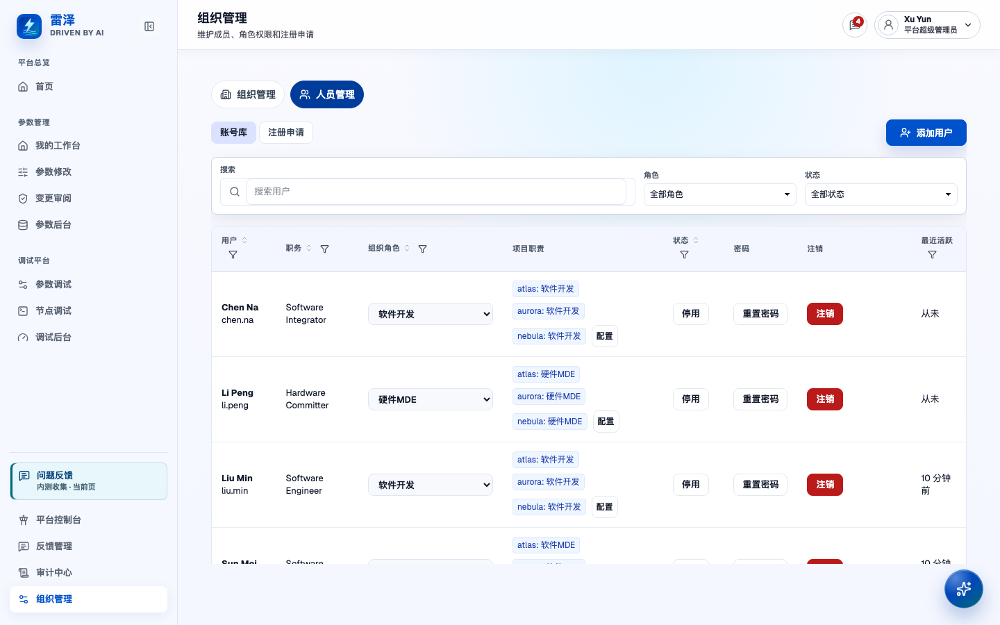
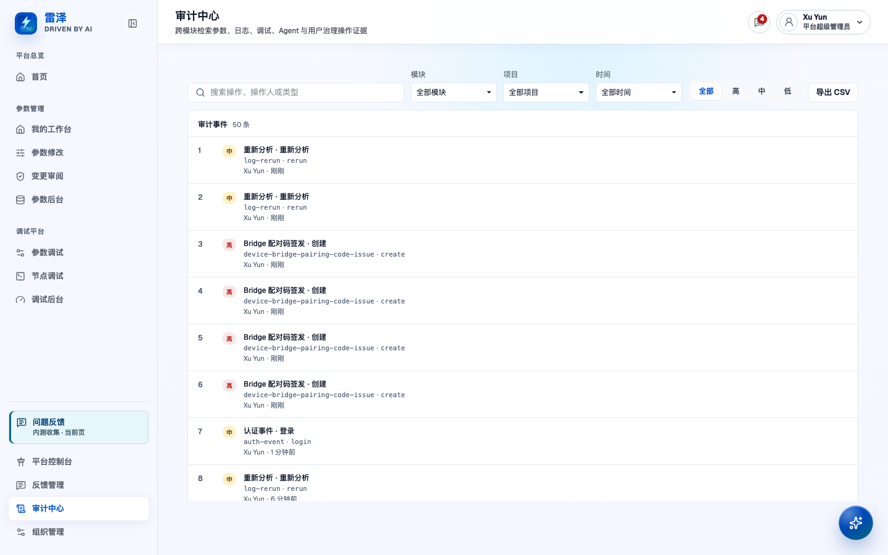

# 组织管理与业务治理

> English: [English](../../user-guide/organization-and-governance.md)

## 谁可以操作

管理员（`admin`）和平台超级管理员（`platform-admin`）可以在权限范围内管理所属组织、使用业务后台。修改成员信息或组织名称需要 `users:manage`；使用审计中心和反馈管理需要 `admin:access`。各业务后台也会检查相应权限和资源范围。已启用并登录的用户，包括访客，都可以提交产品反馈并查看自己的反馈。

其他角色包括访客、硬件开发、软件开发、硬件MDE 和软件MDE。注册和密码操作请参阅[账号与访问](account-and-access.md)。申请访问权限也应按该指南操作，管理后台不是申请入口。

组织对应一家公司或一个部署客户，硬件部、软件部等部门不单独构成组织。「组织管理」只管理你所属的组织，不提供创建、列举或切换组织的功能。加入组织后，仍需单独获得项目访问权限。平台超级管理员也不能任意访问其他组织的业务数据，但可以在注册申请队列中处理跨组织的待审批申请。

## 维护组织档案与成员

1. 打开「组织管理」（`/organization`），核对组织编号与显示名称。需要改名时，编辑「显示名称」并选择「保存名称」。改名不会改变组织身份或你的所属关系。
2. 进入「人员管理」（`/organization/members`）的「账号库」。搜索或筛选成员，先确认角色与启用、停用状态，再执行修改。旧的 `/user-permissions` 书签也会进入人员管理区域。
3. 创建本地账号时，选择「添加用户」，填写姓名、用户名、职位、初始密码与确认密码，并选择合适的角色。按照表单提示完成校验，确认创建成功后再交付账号。
4. 在成员资料中勾选需要的组织角色，可组合多个角色，也可清空普通成员的全部组织角色，再保存并核对确认信息。项目审核职责独立保留。若其他管理员已修改角色，确认框会显示当前集合；选择「重新加载当前角色」，核对后重新选择并保存。关闭成员资料或切换到项目职责前，会提示处理未保存的角色修改。
5. 调整启用状态时，使用成员行内菜单，核对确认信息后提交。停用后账号不能登录；重新启用后，账号按现有角色恢复访问，不会获得额外权限。

管理员不能授予或撤销平台超级管理员角色，也不能通过受保护的行内控件管理平台超级管理员账号。这类操作只能由平台超级管理员执行。你不能停用或注销当前登录账号，也不能移除自己最后的管理员能力。

只需要停止访问时，优先停用账号。注销用户不可撤销，会清除账号的角色、凭据、会话和临时数据。保留的业务与审计历史仍在，相关位置会注明原操作属于已删除用户。操作前务必阅读确认说明。重置密码请参阅[重置成员的本地密码](account-and-access.md#重置成员的本地密码)。

*组织管理员视角的种子成员管理；未修改角色或账号。*

## 查看项目参与名单

进入「项目参与」（`/organization/projects`）并选择项目。名单仅供查看，显示明确的参与人员、项目编辑角色及账号当前状态，也保留已停用成员。平台超级管理员可以查看页面所示目标组织的名单，各标签页分别保留自己的操作组织。

首轮兼容展开保留现有编辑授权。组织和平台管理员可以直接管理项目，审核、合入职责仍单独配置。查看名单不会启用账号，也不会增加审核、合入或设备权限。

## 审批 MDE 注册申请

在「人员管理」（`/organization/members`）中切换到「注册申请」。核对申请人的组织、账号标识、当前角色以及申请的硬件MDE 或软件MDE 角色，再选择以下三种结果之一。

- 通过后，系统授予申请的 MDE 角色并启用账号。申请人可以使用原有凭据登录。
- 「按普通成员启用」会拒绝角色提升，确认对应的硬件开发或软件开发角色，并启用账号。申请人可使用原有凭据登录，不会获得所申请的 MDE 角色。
- 「拒绝并保持停用」会关闭申请，不会启用账号或授予申请角色。
- 管理员处理本组织的申请。平台超级管理员的队列可能包含其他组织的申请，决定前应核对页面显示的组织。

申请关闭、账号变更、审计与通知在同一事务中完成。如果管理员之后已调整该账号的启停或组织角色，批准和启用操作会拒绝覆盖新设置。可以关闭过时申请、保留账号现状，再直接管理成员。资料与项目职责调整不会使申请过时。操作失败时，确认弹窗保留，可重试。

处理历史与通知记录决定时的角色和能否登录，之后的账号调整不会改写这些结果。旧的拒绝记录没有保存账号结果时，页面明确标为未知，不根据账号今天的状态推断。该队列处理自助注册申请；已有成员的角色在「账号库」中调整。

## 查清谁在何时改了什么、为什么改

打开「审计中心」（`/audit`），查询本组织的参数、日志、调试、Agent 和用户管理事件。可查询的记录仅限本组织。

1. 按操作、操作人或事件类型搜索，再结合模块、项目、时间范围和严重度缩小范围。项目筛选在有项目列表时显示。
2. 选中事件，核对操作人、发生时间、操作及对象。如果事件记录了变更前后值或原因，也一并检查；部分事件没有这些信息。
3. 需要对象编号或 Trace ID 时，展开技术详情。事件带有 Trace 时，可以查看关联事件，或按该 Trace 筛选，核对同一次操作的相关记录。
4. 用「加载更多」继续查看匹配项。在 API 模式下，「导出 CSV」导出匹配记录，最多 2,000 条；较大的调查应进一步缩小筛选范围。CSV 包含事件标识与摘要字段，并不包含详情弹窗中的所有信息或原因。

没有查到记录时，先检查筛选条件、加载错误及可用历史范围，再判断操作是否发生。保留策略请参阅[审计保留](../security/audit-retention.md)。

*审计检索及筛选入口；未为填充审计历史而执行业务操作。*

## 选对后台，维护业务模块

组织管理和参数资产治理使用不同入口。维护资产时，先进入对应的业务后台，再通过「审计中心」（`/audit`）核对各后台已记录的变更。

| 要做的事 | 导航名称与路由 | 由这里负责的内容 |
| --- | --- | --- |
| 维护参数资产 | 「参数后台」（`/parameter-admin`）；「参数定义管理」（`/parameter-admin/specs`）；「模块管理」（`/parameter-admin/modules`）；「项目运营」（`/parameter-admin/projects`） | 治理定义、整理参数模块树、管理项目。导入与项目工作流参阅[参数管理](parameter-management.md)。 |
| 维护调试资产 | 「调试后台」（`/debugging-admin`）；其中的「节点调试」（`/debugging-admin/nodes`） | 默认区域维护重载配置；节点区域维护逻辑节点、协议绑定及调试模块树。参阅[设备调试](device-debugging.md)。 |
| 治理日志分析 | 「日志后台」（`/log-admin`） | 检查分析记录和质量，维护业务域。业务域治理需要 `logs:admin-domains`。参阅[日志分析](log-analysis.md)。 |
| 治理知识内容 | 「知识后台」（`/knowledge-admin`） | 审阅 Agent 草稿，管理归档条目，检查索引健康。管理操作需要知识管理能力。参阅[知识库](knowledge.md)。 |

维护参数模块时，打开「模块管理」（`/parameter-admin/modules`），展开树并确认父模块，再新增根模块或子模块。使用可用的编辑、重命名与移动控件调整层级。已注册的规范目录主体应通过归属控件检查；调整分类不会创建新定义。普通模块只有在没有子模块、参数引用或规范目录归属时才能删除。遇到「解散驱动组」时，应单独阅读警告，不能按删除空分类来处理。

维护调试模块时，进入「调试后台」的「节点调试」（`/debugging-admin/nodes`），打开「模块管理」，新增根模块或子模块、重命名，或移动到允许的父模块。只有没有子模块、也没有节点引用的模块才能删除。参数与调试各自维护模块树，修改一棵树不会同步整理另一棵树。

## 附上截图，提交产品反馈

「问题反馈」会在当前路由打开弹窗。导航中有「问题反馈」入口，带页脚的页面也提供这个入口。请先进入发生问题的页面，让反馈记录准确的页面标题与路径；后续可在「我的反馈」（`/feedback`）查看对话。

1. 选择「体验问题」「数据问题」「导出/提交异常」或「功能建议」，填写操作步骤、预期结果及实际表现。问题描述不能为空。
2. 如有需要，把剪贴板中的截图粘贴到表单，检查预览并移除无关图片。每次首次提交或后续回复分别接受最多五张 PNG、JPEG 或 WebP，单张不超过 5 MiB，当次总计不超过 15 MiB。历史截图不占新回复额度，表单显示当前消息的数量和大小。粘贴前先去掉密钥及无关个人信息。
3. 选择「提交反馈」并等待成功提示。「保存草稿」只保留尚未完成的报告，之后仍需提交。有未提交修改时关闭弹窗，系统会询问是否放弃这些修改。
4. 在同一弹窗打开「我的反馈」，继续编辑草稿，或查看已提交记录、附件、状态及公开处理进展。管理员的内部备注不会出现在提交人的视图中。

新截图跟随实际添加它的提交或回复显示。历史截图若无法核实归属，会单独保留，不推测所属消息。上传失败不会发布半条回复；如果存储清理也失败，「我的反馈」会显示待清理上传对象，并提供「重试上传清理」，保留已提交的截图。部署存储容量或单对象大小限制会与当前消息额度分别说明。

在已提交截图旁选择「删除」，可移除自己拥有的截图；反馈管理员还可移除本组织截图。确认弹窗会指明目标。原消息保留删除标记，其他消息和截图保持不变，旧下载链接不再授权访问；共享文件仍保留给其他引用使用。物理清理尚未完成时，标记会明确说明并提供「重试文件清理」，刷新后状态仍保留。历史截图的未知归属保持不变，由可证明的原反馈提交者或管理员移除。这些附件操作也适用于已关闭的反馈。

管理员在「反馈管理」（`/feedback-admin`）中按状态、类型筛选或搜索，检查描述与截图并记录进展。可以开始处理，填写解决结论与公开说明后标记已解决，或确认关闭。已解决的反馈可以填写原因重新打开；已关闭的反馈只读。更新时注意区分公开进展与内部备注。产品反馈和日志分析结果的质量评价使用各自的工作流。
